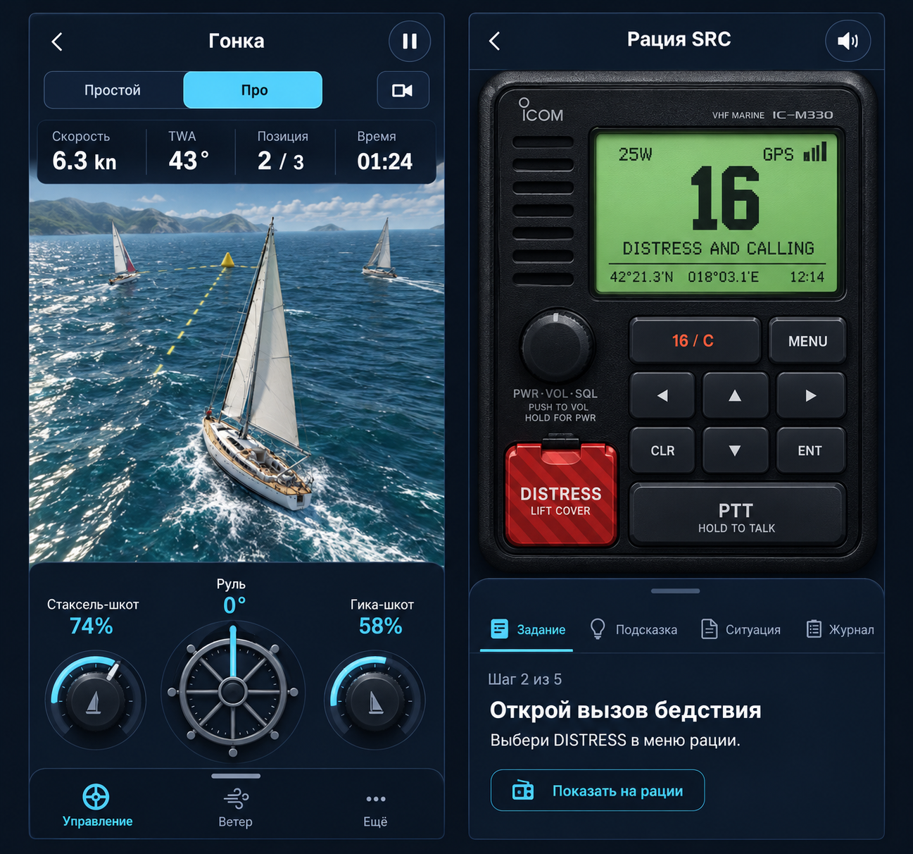
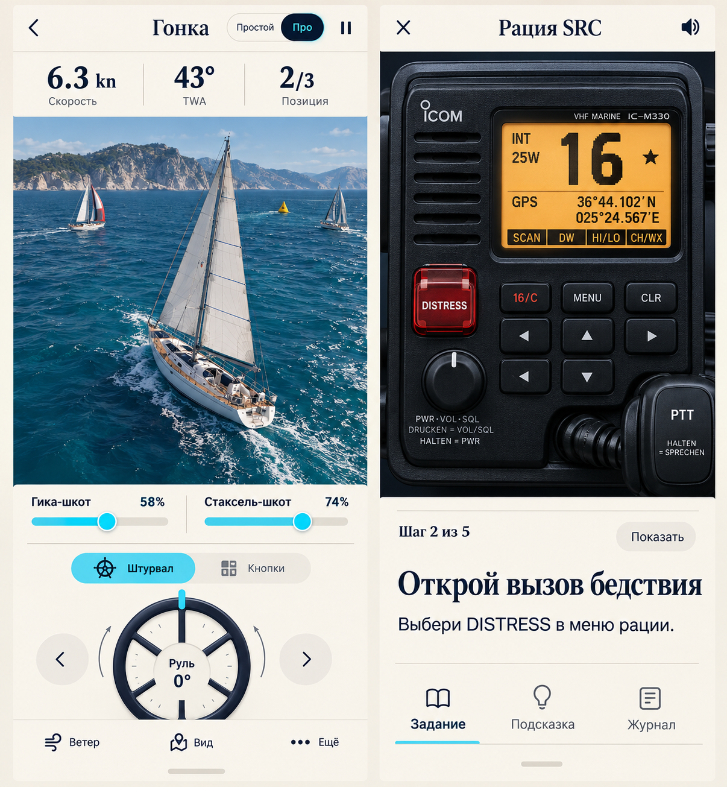
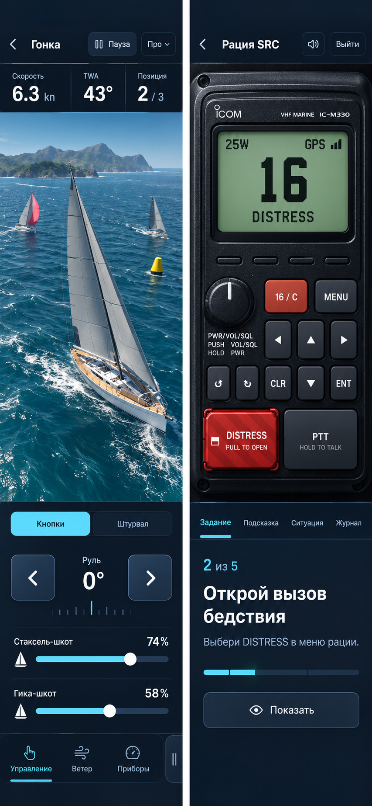

# Regatta: визуальное направление и шрифты

24 октября 2026, Europe/Warsaw. Дополнение к [единому аудиту](audit.md).
Статус: исследование и рендеры, без изменений интерфейса приложения.

## Выбор владельца

Владелец выбрал **первый показанный рендер** как предпочтительное направление
для дальнейшего обсуждения. Порядок ниже совпадает с порядком показа в чате.
Это визуальный ориентир, а не разрешение сразу переписывать приложение.

## Что брать из выбранного направления

- Темная океанская оболочка инструментов, спокойные поверхности, циан для
  действий и выбранных органов управления, хорошо различимые цифры.
- Лодка и рация занимают собственный защищенный прямоугольник. Их форма и
  органы управления видны полностью, интерфейс не накрывает предмет.
- В портрете показания и основные органы управления находятся над или под
  сценой, в горизонтали часть управления переходит в отдельную боковую колонку.
- Дополнительные функции открываются в нижней или боковой области с
  перерасчетом места для сцены. Само слово drawer не разрешает перекрывать лодку.
- В лодочных тренажерах и гонке три штурвала остаются понятной альтернативой
  кнопкам/ползункам: руль в
  центре, стаксель-шкот и гика-шкот по сторонам. Способ ввода выбирается отдельно
  от сложности гонки. Простой = автотрим, Pro = ручной трим, обе версии в 3D.
- В радио короткое текущее задание и переключение Задание / Подсказка /
  Ситуация / Журнал видны отдельно от устройства. Длинные объяснения свернуты.
- Цветовая семантика остается общей для web/native; зеленый/янтарный LCD и
  красный DISTRESS принадлежат реальному устройству, их не надо перекрашивать.

Полностью темную тему для всех текстовых учебных страниц этот выбор отдельно
не утверждает. Их следует показать в том же типографическом и компонентном
языке, сохраняя читаемость длинного текста и согласованность светлых/темных
поверхностей. Принятые native paper-экраны не становятся ошибкой из-за выбора
темного рабочего экрана.

## Шрифтовое предложение

Основной кандидат для выбранного направления -
[Source Sans 3](https://fonts.adobe.com/fonts/source-sans-3), Paul D. Hunt,
Adobe Originals. Предлагаю одну гарнитуру для интерфейса, пояснений и приборов:
400 для текста, 600 для кнопок и навигации, 700 для основных значений. Все эти
веса реально присутствуют в каталоге. Меньшее число гарнитур облегчает единое
поведение на семи языках и коротких экранах.

Альтернативный кандидат -
[IBM Plex Sans](https://fonts.adobe.com/fonts/ibm-plex-sans), Mike Abbink,
Paul van der Laan, Pieter van Rosmalen, IBM. Его можно отдельно сравнить на
точных одинаковых подписях приборов и длинных объяснениях, если нужен другой
характер интерфейса. Для первого направления основной рекомендацией остается
Source Sans 3.

[Source Serif 4](https://fonts.adobe.com/fonts/source-serif-4),
Frank Grießhammer, Adobe Originals, исследован как вариант заголовков учебных
материалов во втором направлении. В рабочие панели гонки и радио его
добавлять не предлагаю.

Adobe Fonts `font_details` подтвердил у выбранных Regular начертаний всех трех
семейств RU, EN, PL, ES, FR, DE, IT. `font_styles` подтвердил реальные
начертания. Машиночитаемые данные: [fonts-verified.json](fonts-verified.json).
Это проверка покрытия языков, не измерение читаемости готового UI.
Карточки образцов Adobe не отобразились из-за несогласованной схемы сервиса;
рендеры выше не являются точным набором настоящими файлами этих шрифтов.
Перед заменой текущих Geist/system нужны настоящие font-файлы в локальной
сборке, проверка нужных глифов и сравнение на устройстве. Внешний Typekit-kit
не создавался, шрифты в аккаунте не активировались.

### Предлагаемая шкала

| Роль | Размер / интерлиньяж | Вес | Проверка |
| --- | --- | --- | --- |
| Основное объяснение | 16 / 24 px | 400 | Длинные RU/DE/PL тексты читаются без уменьшения |
| Кнопки и вкладки | 14-16 / 20-24 px | 600 | Зона касания от 44 px, подпись не обрезается |
| Подпись прибора | 14 / 20 px | 400-600 | Отличается от значения без низкого контраста |
| Скорость, курс, место | 28-32 / 32-36 px | 700 | Разрядность не двигает соседей, табличные цифры |
| Заголовок рабочего экрана | 20-24 / 26-30 px | 600-700 | Умещается вместе с выходом и паузой |
| Заголовок учебного материала | 28-32 / 34-38 px | 600-700 | Не отнимает первый экран у учебной схемы |

Это цель следующего дизайн-среза. Текущие размеры экрана рации и подписи
реального устройства проверяются отдельно, без механического увеличения
каждого аппаратного ярлыка до 16 px.

## Ограничения рендеров

Рендеры показывают цвет, ритм, иерархию и разделение пространства. Генератор
изменил некоторые детали аппаратуры, надписи и расположение клавиш, особенно
во втором варианте. В нем также появились немецкие аппаратные подписи.
Их нельзя копировать в учебный тренажер. Источником поведения и маркировки
рации остаются действующая модель и проверенные руководства ICOM.

На рендерах вода детальнее текущей сцены. Это не подтверждение производительности
такой картинки на iPhone. В следующем срезе нужно использовать существующий
проверенный 3D-движок, контролировать сложность воды и отдельно мерить FPS.
Рендер первого варианта также не заменяет проверку 320x568 и landscape:
красивое изображение не доказывает, что весь рабочий экран поместится.

## Остальные исследованные направления

Вариант 2 оставлен для сравнения теплой учебной оболочки и темных приборов.
Вариант 3 показывает другой акцент на кнопочном управлении. Эти изображения
сохраняются как история рассмотренных вариантов, актуальный ориентир - первый.

## Критерии реального дизайн-среза

1. Один законченный экран гонки и один рабочий экран радио в выбранном языке
   на 320x568, 375x667, 390x844, 844x390 и desktop.
2. Основной предмет виден вместе с текущим заданием и управлением; открытые
   настройки, помощь, меню, журнал и большие сообщения это не ломают.
3. В гонке легко различить Простой / Pro и Кнопки / Штурвал. В радио отдельно
   понятны обучение/экзамен и режим изучения кнопок. Настройки не меняются
   молча при переходе между поверхностями.
4. Настройки и панели сохраняют клавиатурный фокус при работающей симуляции.
5. Все семь языков используют настоящие строки приложения, без текстов из
   AI-рендера, случайного PL/EN fallback или скрытых длинных подписей.
6. Цвета проходят проверку контраста в обеих темах; аппаратная семантика
   рации и тактическая семантика схем не смешиваются с цветом CTA.
7. Поведение, производительность и отсутствие перекрытий проверяются в
   рабочем приложении. Одобрение рендера не закрывает эти проверки.
