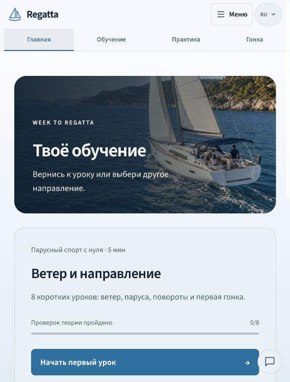
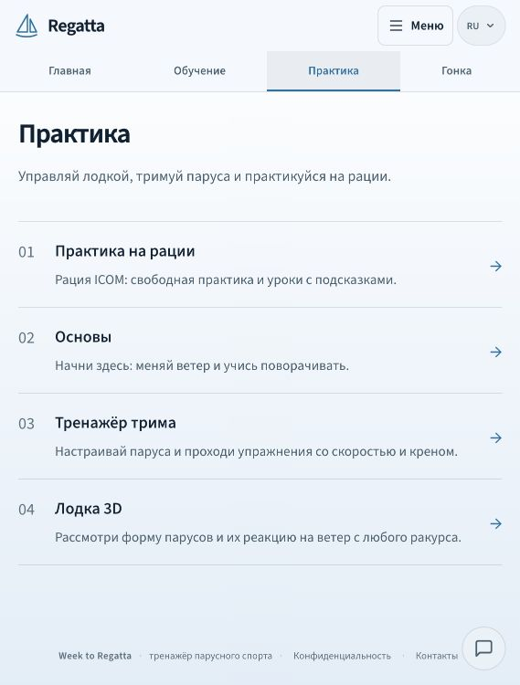
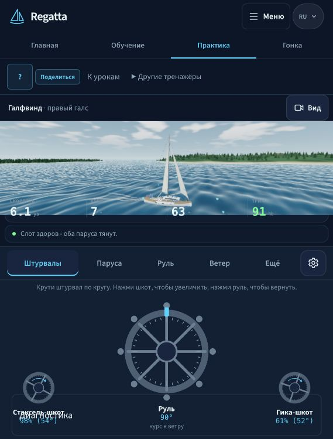
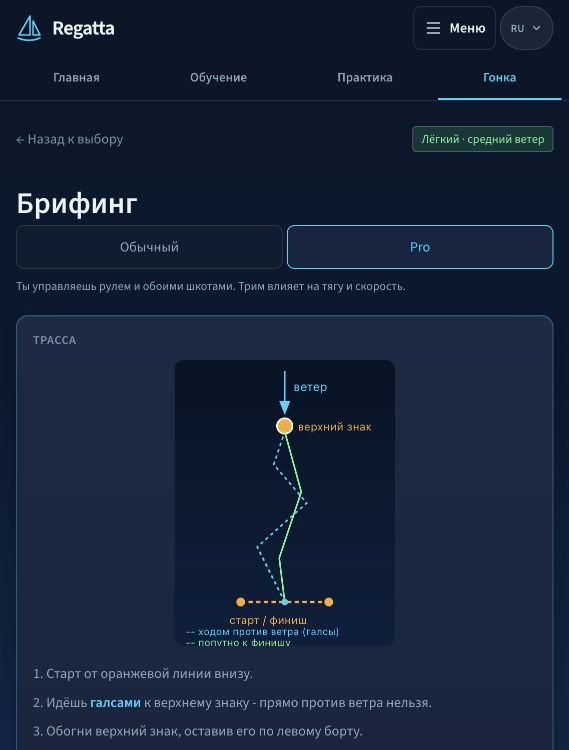
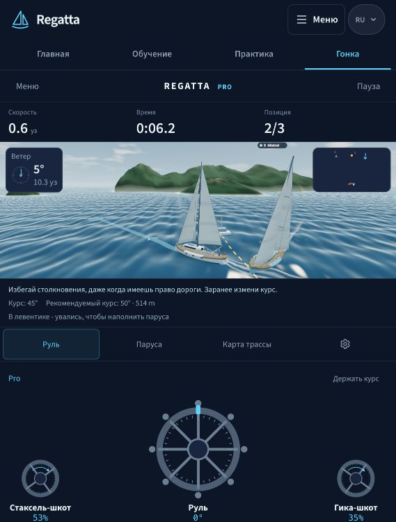
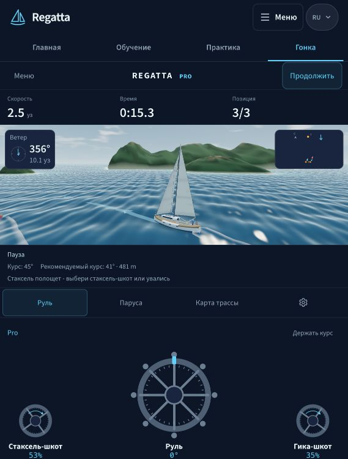
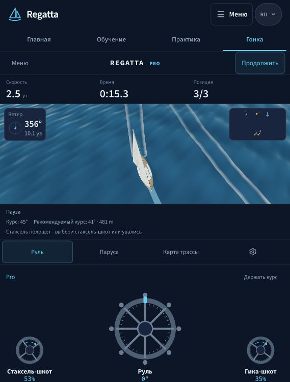
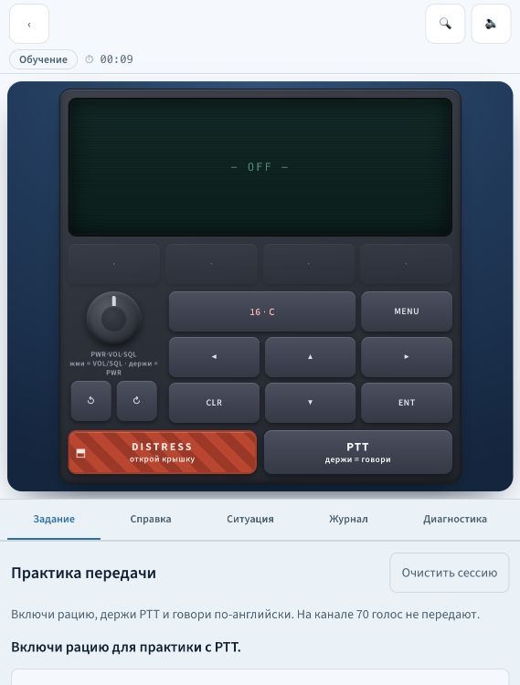

# Regatta: итоговая сверка идей, обратной связи и незавершенных работ

27 октября 2026, Europe/Warsaw. Срез после TestFlight 1.7.0 (69).
Это итоговый отчет о текущем состоянии и повторный аудит, а не заявление о завершении продукта.

## 1. Главный вывод

**Прогресс реальный, но весь согласованный объем не завершен.** Доставлены новая одиночная 3D-точка входа, общий визуальный мир, ручные шкоты Pro, поворот камеры, карта и ветер, значительная часть управления и радио, первые исправленные учебные пути, надежнее сохранение и replay. При этом новая метрическая гонка пока не подключена к игре; все иллюстрации, единая тема, полный учебный цикл, ghost, полная диагностика и приемка телефона/сайта остаются открытыми.

Моя прежняя оценка F12 «светлое чтение и темные инструменты образуют понятную систему» была слишком благоприятной. Она описывала намерение дизайна, а не доказывала удобство перехода. Владелец теперь прямо сообщает о разрыве: светлая оболочка, другое оформление лодки, полностью темный тренажер. **Это незакрытый дефект согласованности.** Старое «готово» в строке V02 не считается принятием нового требования.

Главная проблема процесса: завершенные отдельные компоненты и успешная доставка иногда заслоняли незаконченный путь пользователя. Число тестов и номер TestFlight нельзя использовать как процент готовности продукта.

## 2. На чем основан отчет

- Сопоставлены [первый аудит 24 октября](../2026-10-24/audit.md), [выбранный первый рендер и шрифты](../2026-10-24/design-proposal.md), [повторная сверка замечаний](../2026-10-25/plan-recheck.md), [независимый аудит 26 октября, F01-F15](../2026-10-26/independent-product-audit.md), [единая программаP00-P12](../2026-10-26/completion-program.md), [65 требований 68](../2026-10-26/acceptance68.md) и [дельта 69](acceptance69.md).
- Проверен текущий исходник `1c63b79504f51de904944951085b8666bda6ef2e`. Runtime совпадает с доставленным `2ea498bc0fdd975e73d7aa1c393705d550ee7915`; различия после freeze касаются документации и beta metadata.
- В этом проходе заново открыт локальный production web на 127.0.0.1:3331. Выбрана светлая тема, пройдены Home -> Practice -> Trainer, Race -> Pro -> briefing -> running3D -> Pause -> Orbit, затем прямой вход в Radio. Приняты восемь неизмененных JPEG, каждый сохранен и просмотрен. Вьюпорт 569x750, русский язык. Это **web-проверка исходников 69**, не новая установленная приемка iPhone или повтор всех 65 пунктов.
- Независимые чтения текущих remote refs: main/SITE `5df0ee5`, исторический app `ff0b165`, site-sync `448894f`. Последний main [run40250393806](https://github.com/Warlockus-prod/regatta/actions/runs/40250393806): build/images/deploy success, конечный production Playwright failure. Это опубликованный сайт с незакрытым gate, а не отказ публикации. Новые изменения APP66-69 этой проверкой сайту не приписываются.
- Доставка 69 подтверждена [точным Apple proof](checks/native69-delivery.json).1793 web/602 native и 82 first-attempt browser относятся к проверкам релиза, а не к новому полному прогону этого аудита.
- Реальный iPhone, речь/микрофон/PTT/Reset, полные Simple/Pro-финиши, все уроки/языки/Back, самолетный режим, VoiceOver/Dynamic Type, нагрев и длительный FPS в этом проходе заново не проверялись. Радио на телефоне по решению владельца проверяет он сам.

Уверенность:100% в явно прочитанных константах/ветвях кода и наблюдавшихся действиях в указанном браузере; около 90% в предлагаемом порядке улучшений,80% в художественной оценке. Это субъективная сила основания, не статистический интервал и не процент готовности. Для работы реального микрофона и FPS телефона оценку не выдаю: доказательства пока нет.

## 3. Все основные пожелания владельца

«Доставлено» здесь означает наличие в APP69 или в названном более раннем checkpoint. Оно не заменяет полную приемку каждого устройства.

| Пожелание | Что уже есть | Что не завершено |
| --- | --- | --- |
| Убрать плоскую native одиночную игру | Native Solo открывает общий локальный 3D host; старый race-3d перенаправляет туда | Упрощенные схемы/Основы сохранены для обучения; это не вторая одиночная гонка |
| Настоящее 3D и вращение мира | Общая камера с orbit/zoom; новый поворот заново подтвержден в браузере, кадры 6-7 ниже | Полный повтор жестов на точном 69iPhone не сделан |
| Одна лодка, море, паруса для практики и игры | Общие Yacht, окружение, camera rig и модель сил | Различаются runtime движения и смысл руля по умолчанию; единая управляемая лодка еще не завершена |
| Обычный режим и Pro различаются | Обычный использует автотрим, Pro передает ручные шкоты грота/стакселя; управление парусностью/рифами есть | Единые понятные названия, одна подготовка и полный учебный Pro-путь |
| Штурвал вместо разных случайных кнопок | Общая панель колес, сохранение slider preference, настройки чувствительности | В Basics/Trainer руль по умолчанию означает курс, в Boat/Race перо. Скрытый разный смысл надо устранить или явно объяснить |
| Исправить длинную дугу поворота | Более отзывчивый поворот игрока включен; подготовлен новый metric fleet API | Живая гонка все еще legacy:8units/kn/s при 0.6m/unit, примерно 9.33x физического линейного масштаба. Новая физика не активирована |
| Короткие/средние/длинные трассы | Реестр 120/300/600m и source-контракты подготовлены | Нет поставленного playable-выбора этих физических трасс; маршруты вокруг островов/в Гёджеке еще не готовы |
| Полоса, куда идти, когда поворачивать | Лента маршрута и рекомендации курса, независимые переключатели помощи | Полная проверка траектории человека, поворота и подсказок на новой физике; Coach no-go расхождение остается открытым |
| Судья, галсы, столкновения, старт, знак | Есть ограниченный учебный набор событий и отключаемых штрафов | Нет полного судейства: room у знаков, поворот, препятствия, изменение курса; следующий metric judge не подключен. Собственные секунды штрафа не равны полному регламенту |
| Маленькая карта и ветер постоянно в углах | Поставлены; полная карта по нажатию, wind compass/air arrows/both/off и сохранение выбора | Весь набор коротких/landscape/large-text экранов не принят заново |
| Настройки как шестеренка | Реальный общий gear, виден на новых снимках | Полная проверка контраста/размеров всех значков |
| Дополнительные панели не закрывают лодку/рацию | Основные dock/drawer резервируют место; corner instruments оставляют центр | Полная матрица перекрытий не закрыта. В текущем trainer место сцены слишком мало |
| Современное единое оформление | Выбран Ocean Cockpit; общий Source Sans3 локально, базовые токены/иконки/панели | Переходы темы, плотность, цветовая семантика, единый Back и оставшиеся локальные UI-цвета |
| Красивые вода, берег и паруса как на рендере | Общая вода/лодка/свет реально используются | Рендер не является достигнутой графикой. Берег условный, бюджет/нагрев реального телефона неизвестны |
| Схема / рисунок вместо непонятных старых схем | В 67 поставлен один pilot с двумя состояниями грота, наполнен/полощет, и переключением Scheme/Picture | Это не полная серия обучающих инфографик с ветром/давлением/снастями. Все 8Foundation/13sail lessons не переработаны |
| Урок -> действие -> объяснение -> повтор | Исправлено падение первого пути; первый урок общий, реальная 3Dпрактика и возврат поставлены | Полный цикл для каждого навыка с независимой повторной задачей и записью практического результата |
| Рация всегда доступна | Прямой free вход, закрепленный прибор, guide/ситуации/курс; видны стрелки DIAL | Приемка всего курса и удобства на маленьком телефоне |
| DIAL пальцем, видимый штрих, web-стрелки | Поставлены rotary input, движущийся индекс, альтернативные кнопки; отмена удержаний исправлялась отдельно | Жесты на телефоне владелец проверяет 69; этот проход не повторял DIAL/PTT |
| Свободная речь и видно распознавание | В 69 provisional text,8 передач на сессию, typed fallback, выбранная English locale, native lifecycle logs | Реальная модель/разрешения/микрофон/PTT/Reset и педагогическая польза по журналу владельца |
| Радио на своем языке | Источники интерфейса/курса SRC на 7 языках, оригинал PL отдельно; English on-air фразы сохранены | Полная естественная языковая и визуальная приемка всех разделов не закончена; сначала PL/RU/EN |
| Sternik оставить польским | Сохранен отдельный польский локальный курс, тесты/экзамен/typed oral | Полная приемка каждого экзаменационного пути отдельно |
| Все основные режимы без интернета | Локальные sailing/SRC/Sternik пакеты, модели/шрифты/материалы; live wind убран из native trainer в 66 | Полный clean-install network-blackhole тест до результата на физическом телефоне не закрыт |
| Убрать погоду/рейсы из главного пути | Home строится вокруг обучения; live weather не блокирует native trainer | В web Menu остается «Места и погода», Daily/миссии существуют. Полное удаление этих разделов не сделано; решить роль, не скрывать эту разницу |
| Надежные результаты/возвраты | В 68 durable PB ACK, независимая History, retry/receipts, отдельный replay route и исправленная петля | Весь каталог Back, остальные progress writers, отрицательные disk-сценарии на устройстве |
| Логи на все значимые действия | Ограниченный локальный журнал, часть кнопок/навигации/сохранения, native ASR; support export с версией/сборкой | Assessment outcome, progress-save/retry, ряд облачных/внешних handoff и recovery путей не интегрированы. Схема событий не означает запись события |
| Играть онлайн с людьми | Живая комната, приглашение, ready/countdown; каждый управляет своей лодкой | Это не совместное управление экипажем одной яхты |
| Играть с исторической версией друга | Сохраненные replay можно просматривать | Ghost-заезд против записи еще не реализован |
| Swift и полный native продукт | Сохранен поэтапный план SwiftUI-оболочки с общим локальным 3D | Переписывание на Swift не начато. Swift сам по себе не решает offline, масштаб и содержание |
| APP и SITE отдельно, общий core | Один репозиторий, общие модули, раздельные поставки | Сайт не синхронизирован до 69; конечный production gate красный |
| Убрать мусор и путаницу веток |50 неактивных contained heads архивированы,52recovery refs сохранены |18 активных/неполностью слитых историй еще требуют разбора; protected dirty root и уникальные изменения сохранены |
| Settings Ads для будущего SDK | Локальный preview, четыре камеры, orbit/zoom, направление/линзы/тестовые поверхности | SDK, рекламные запросы и реальные placement signals выключены по решению владельца |
| Изучить eSail в фоне | Есть предварительные наблюдения/снимки | Полное исследование заданий/управления не выполнено: автоматический ввод был ненадежен. Оно не заменяет основную работу |
| Максимальный проверенный релиз |69 доставлен exact Self, Apple VALID/IN_BETA_TESTING, rollback68 сохранен | Публичный App Store, весь продукт и сайт не финализированы |

## 4. Возврат к независимому аудиту F01-F15

| Находка | Состояние после 69 | Следующее условие закрытия |
| --- | --- | --- |
| F01: первый путь падает | Конкретный Skia crash исправлен 66; первый путь заменен общей 3Dпрактикой 67 | Остальные уроки и физический телефон |
| F02: разный масштаб движения | Открыто, новая метрическая реализация только в коде | Реальная human Simple/Pro гонка, боты, guidance, recorder/consumers, включение после gates |
| F03: разный смысл штурвала | Частично | Одна семантика/явная настройка и сравнимые сценарии |
| F04: первый урок расходится | Первый общий урок поставлен 67; весь курс/SITE открыты | Все 8/13 уроков, соответствующая практика и публикация сайта |
| F05: неполная учебная петля | Частично | Практический результат, объяснение ошибки, независимый повтор |
| F06: лишние настройки/Back | Петля History/Replay исправлена 68, повтор выбора режима остается | Одна краткая подготовка, весь каталог входа/выхода |
| F07: радио как обучение | Прибор/guide/ситуации есть; free speech добавлен 69 | Один полный урок/ситуация/разбор и проверка владельца |
| F08: помощь учит решению | Подсказки есть, завершенность не доказана | Почему -> действие -> результат; согласование с physical motion/judge |
| F09: проверены части вместо пути | Доставка точнее документирована, но полный путь не закрыт | Exact binary journeys, negative outcomes, cold/offline |
| F10: логи на все | Частично;69 добавил native ASR и versioned export | D02-D09 интегрировать в реальные обработчики |
| F11: durable/offline | PB/History/replay заметно улучшены 68, пакеты локальны | Все writers и настоящий offline телефон |
| F12: стиль/иерархия | **Переоткрыто новой жалобой на тему**; шрифт готов | Сквозная яркость/панели/Back, большая полезная сцена, phone proof |
| F13: языки/доступность | Источники и локальный шрифт есть, приемка частична | PL/RU/EN пути, затем остальные 4; large text/VoiceOver/keyboard |
| F14: ветки/документы | Частичная безопасная уборка |18 историй, короткий текущий статус, APP/SITE reconciliation |
| F15: бюджет/телефон/SITE | Gates69 прошли; бюджет 6814872 из 6815744bytes, запас 872bytes | Измеримый запас, startup/frame time/нагрев, конечный зеленый production gate |

Полный исходный список 65IDs сохранен в приложенииA. Это не 65 новых тестов.

## 5. Тема, оформление и шрифты: что именно неправильно

**T01, приоритетP1: нет единого договора темы между оболочкой и практикой.**

Причина подтверждена кодом:

1. Native `userInterfaceStyle=light`; `colors=lightColors`. Настройки Light/Dark/Auto для всего native-приложения сейчас нет.
2. DarkSurface и отдельные darkColors задают темные инструментальные экраны.
3. SimWebView до загрузки записывает `regatta_theme=dark`, после загрузки навязывает темный body. Offline sailing HTML тоже собирается с dark.
4. Web theme resolver и inline bootstrap принудительно затемняют game/simulator и любой embed=1 даже после выбора Light.
5. Светлая native палитра теплая, светлая web холоднее. Общая гарнитура не устраняет это расхождение.

Код: [native tokens](../../../mobile/src/design-system/tokens.ts), [surface](../../../mobile/src/design-system/surface.tsx), [SimWebView](../../../mobile/src/simulator/SimWebView.tsx), [offline builder](../../../mobile/scripts/build-sailing-offline.mjs), [web theme](../../../src/lib/theme.ts), [layout](../../../src/app/layout.tsx), [web CSS](../../../src/app/globals.css). Комментарий web bootstrap о «dark-only native app» уже не описывает светлую оболочку целиком.

**T02, приоритетP1/P2: служебный интерфейс отнимает слишком много сцены.** На новом снимке trainer canvas569 x 160, при общей высоте 750 это 21.3%. Над ним навигация и второй ряд действий, под ним показания, статус, вкладки, инструкция и большие колеса. В гонке сцена заметно выше. Колеса полезны, но размер и дублирование уровней надо согласовать с задачей. Это измерение данного web-вьюпорта, не всех iPhone.

**T03, приоритетP2: часть общности существует только на уровне исходных компонентов.** Общие Yacht/camera/controls не означают одинаковую плотность, семантику руля, тему и текст ошибки. У Icon есть риск неправильного default tint в dark subtree; конкретный нечитаемый значок этим проходом не доказан. Большинство аппаратных мелких подписей радио имеют другой смысл, чем основные UI-ярлыки: их нельзя массово увеличивать или перекрашивать без проверки прибора.

Рекомендую следующий визуальный контракт, пока как предложение для этапаP10:

- Дневное обучение: единая светлая спокойная оболочка, одинаковые header/dock/Back по пути в практику. Темный цвет корпуса рации и реального LCD сохраняется.
- Ночной/cockpit-вариант: единая темная оболочка по явному выбору. Он продолжает выбранное направление Ocean Cockpit.
- Три независимых слоя: оформление приложения, оформление приборных панелей, освещение 3Dмира. Дневное море не требует черного всего интерфейса; темный радио-LCD не является темой приложения.
- Один источник presentation preference с передачей native -> локальный HTML до первого кадра. Снимать forced-dark только после проверки затронутых поверхностей.
- Сохранить Source Sans3,400/600/700. Доработать иерархию: текст 16/24, основные control labels14-16, приборные цифры с постоянной шириной. Новый декоративный шрифт не нужен.
- Одна крупная управляемая сцена, краткая текущая задача и главные controls. Второстепенное внизу/сбоку с резервированием места, без лишних навигационных рядов.
- Сначала связать пять реальных экранов, затем улучшать материалы воды/берега в измеренном бюджете. Новая красивая картинка не заменяет этот этап.

Это уточнение реализации выбранного первого направления. Политика оформления в коде этим отчетом не менялась; этот вариант еще не выдан за согласованную новую тему или готовый редизайн.

## 6. Движок, стратегия и обучение

Сохраняем один core и одну визуальную яхту. Сейчас shared force model используется в обоих runtime, но trainer применяет метрическое движение и собственный heading law, а живая гонка продолжает legacy stepBoat. Регистр нового мира и 113 контрактов не подключают его автоматически. Код: [GameClient](../../../src/app/game/GameClient.tsx), [legacy physics](../../../src/lib/race-physics.ts), [3D scale](../../../src/features/race-3d/pose.ts), [trainer session](../../../src/features/sailing-lab/runtime/session.ts), [physical fleet](../../../src/lib/race-physical-fleet.ts), [emission flag](../../../src/lib/race-context.ts).

Следующая физическая приемка должна сравнивать одинаковые ветер, лодку, настройки парусов, воздействие на руль, угловую скорость, потерю хода и фактически пройденные метры. Увеличивать скорость поворота отдельно от пространственного масштаба недостаточно. Старые рекорды сохраняются в прежних классах, новые с ними не смешиваются.

Учебная стратегия остается верной: понять -> увидеть на лодке -> выполнить -> получить причинное объяснение -> повторить в другом условии. Сейчас есть сильные части, но нет полного покрытия навыков. Scheme/Picture помогает именно сравнению принципа и жизни, если одна и та же форма/состояние объясняются стрелками и подписями. AI-изображение не определяет силу, проводку снастей или правильность ответа.

Live multiplayer требует одновременного присутствия людей. После входа в комнату остальные подтверждают готовность, ведущий запускает countdown, у каждого своя лодка. Ghost должен быть отдельным асинхронным режимом: запись загружается заранее, воспроизводится по тем же versioned условиям, не сталкивается с живым игроком. Replay сейчас только показывает запись, он не реализует такую гонку.

SwiftUI имеет смысл как будущая оболочка, если дает измеренную пользу навигации/доступности. Общие локальные контент и 3Dсохраняются. До миграции требуется безопасный перенос накопленного прогресса; перенос всего движка в другой стек сейчас добавил бы еще одну реализацию для согласования. Рабочий Swift-прототип пока не создан.

## 7. Что делать дальше по этапам

ID исходной программы сохранены. Ниже порядок предлагаемых ближайших checkpoints после этого повторного аудита. Ads/eSail остаются фоновыми.

| Шаг | Существующий этап | Конкретный результат | Условие завершения |
| --- | --- | --- | --- |
| 1 | P10, F12/F06 | Небольшой сквозной срез темы и иерархии: Home -> урок ->3D practice -> Race -> Radio -> Back | Согласованный контракт темы, scene allocation, одинаковые action/Back; свежие кадры native/web, короткий/landscape/large text; физика не меняется |
| 2 | P04, F02/F03 | Подключаемая единая метрическая лодка, одинаковый смысл controls | Human Simple/Pro, фактический путь/коллизии/ворота/finish, guidance и recorder; все consumer/native/server gates, без смешивания рекордов |
| 3 | P05/P06 | Playable короткая/средняя/длинная трассы, затем островные маршруты | Каждый маршрут проходим человеком, режимы/помощь независимо выбираются, ясное время/цель; одна подготовка |
| 4 | P06 | Завершенный ограниченный учебный судья и объяснения | Явные фазы старта/финиша/поворота/места, нет выдуманной вины; выключение помощи не меняет физику; границы правил видны |
| 5 | P02/P07/P08 | Один полный sail skill и один полный radio путь, затем расширение | Задание -> действие -> результат -> durable progress -> разбор -> повтор; реальный журнал владельца, mic проверен или честный fallback |
| 6 | P08/P10 | Остальные outcome logs, Back, PL/RU/EN, доступность | Реальные handlers/ACK, нет тихих тупиков, тесты отрицательных исходов; крупный текст/VoiceOver/альтернатива drag |
| 7 | P09/P11 | Ghost после стабильных условий; завершение сверки веток и APP/SITE | Versioned запись/сравнение; уникальные патчи сохранены; сайт обновлен своим отдельным зеленым gate |
| 8 | P12, затемS01 | Полная приемка физического телефона и релиза; позднее SwiftUI spike | Cold/offline/upgrade/data/background/FPS/thermal, метаданные и exact delivery; полная программа не закрывается одним upload |

Каждый шаг: исходное состояние -> код -> source checks -> реальный полный путь -> отдельный rollback commit -> exact release, если он нужен. Визуальный шаг и физический шаг выполняются отдельно. Текущий 69 не пересобирается и не перетегируется задним числом.

## 8. Свежий визуальный маршрут

Это восемь принятых web-снимков текущего прохода. Исходные JPEG сохранены без кадрирования. Предыдущие 22native/webснимка независимого аудита остаются историей, не новым доказательством 69.

### Шаг 1. Светлая Home: вход работает, первый экран перегружен высотой hero

Одна ясная кнопка старта и общий шрифт полезны. Фото занимает большую часть первого экрана; это источник разницы между ожиданием графики и рабочей сценой. Тема явно выбрана Light в Menu.

### Шаг 2. Practice: понятные прямые входы, состояние хорошее в этом размере

Радио доступно первым пунктом. Каталог светлый. Возможное смешение «Основы / Тренажер трима / Лодка 3D» для новичка требует пояснения задач, а не появления еще одного движка.

### Шаг 3. Trainer: работает 3D, тема и место сцены требуют исправления

После Light страница целиком Dark. Canvas 569 x 160 при 750pxвысоты. Показания и панели занимают большую часть окна. Наличие маленьких аппаратных/приборных меток не является измеренной проверкой контраста или VoiceOver.

### Шаг 4. Pro briefing: режим сохраняется, повторный выбор остается

Pro уже был выбран до этого экрана; здесь он снова предлагается. Стартовая схема понятна, но несколько последовательных уровней подготовки увеличивают путь до действия. Полнота всех Back этим не проверена.

### Шаг 5. Running Pro: карта, ветер, gear и ручные шкоты присутствуют

Сцена реально загружена, время идет, видны обе лодки. Наблюдение не является полным финишем или проверкой качества судьи. Короткие мелкие строки advice остаются проблемой иерархии.

### Шаг 6. Pause: текущее состояние удержано

Время 15.3 секунды. Это исходный кадр сравнения камеры.

### Шаг 7. Orbit: полноценное вращение подтверждено в этом web-проходе

После одного drag вид сверху, время по-прежнему 15.3 секунды. Это другая камера той же сцены, не плоский фон. Удобство finger-gesture на текущем iPhone отдельно.

### Шаг 8. Radio free: прямой вход, прибор и задача вместе

Радио целиком видно, web-стрелки есть, free transmission panel открыт. Прибор OFF: речь/PTT/DIAL в этом проходе не проверялись, как согласовано с владельцем. Светлая оболочка радио с темным аппаратным корпусом показывает, что цвет реального устройства можно отделить от темы всего интерфейса.

## 9. Что этот отчет меняет

Он возвращает F12/V02 в явный незавершенный статус по новой жалобе, связывает старые обещания с текущей поставкой и сохраняет весь список требований. Исторические acceptance68/69, Apple proof и tags остаются неизменными. Новых функций, переводов UI, физики, рекламных вызовов, публикации сайта или бинарника этот проход не создавал.

[Машиночитаемый manifest](checks/completion-reconciliation.json) содержит source refs, границы нового прохода и SHA256 снимков. Дальнейшая работа возвращается к одной [программе](../2026-10-26/completion-program.md), а не к разрозненным обещаниям в истории чата.

## ПриложениеA. Все 65 исходных требований без потери ID

Два средних столбца дословно отражают старые labels68, унаследованные 69, а не новую приемку. Сумма: source 51 готово/12 частично/2 будущее; приемка 8 подтверждено/49 частично/8 непроверено. Это характеристики строк прежнего документа, не 51 готовая функция и не процент готовности. Детальные доказательства каждой строки остаются в неизмененной [матрице 68](../2026-10-26/acceptance68.md). Ни одна унаследованная строка не повышается этим отчетом автоматически.

| ID | Исходное требование | Source label68 | Acceptance label68 | Уточнение этого отчета |
| --- | --- | --- | --- | --- |
| N01 | Пять разделов, последний Меню | готово | частично | Новая полная приемка не выполнялась; см. основной раздел |
| N02 | Найти и запустить SRC из приложения | готово | подтверждено | Свежий web free вход; текущий native mic отдельно |
| N03 | Инструмент и курс имеют явные отдельные входы | готово | подтверждено | Новая полная приемка не выполнялась; см. основной раздел |
| N04 | Честное продолжение последнего курса | готово | частично | Новая полная приемка не выполнялась; см. основной раздел |
| N05 | Предсказуемый Back и безопасный выход | готово | частично | Replay loop исправлен 68, весь Back catalog открыт |
| N06 | SRC: внутренний Back сохраняет контекст | готово | частично | Новая полная приемка не выполнялась; см. основной раздел |
| N07 | Повторный Stay/Exit незавершенного экзамена | готово | частично | Новая полная приемка не выполнялась; см. основной раздел |
| N08 | Нет потерянных функций и тупиков | частично | частично | Новая полная приемка не выполнялась; см. основной раздел |
| G01 | Один 3D Solo/Daily/mission вход | готово | частично | Native3D host поставлен; нет нового full native walkthrough |
| G02 | Свободный трехмерный осмотр мира | готово | подтверждено | Свежий web orbit подтвержден, шаги 6-7 |
| G03 | Общая яхта, море, свет и учебные камеры | готово | подтверждено | Общая геометрия, не полная эквивалентность движения |
| G04 | Simple автотрим, Pro ручные шкоты | готово | частично | Свежий Pro UI, source manual trim; полного финиша здесь нет |
| G05 | Hoist/furl/reef меняют модель и изображение | готово | частично | Новая полная приемка не выполнялась; см. основной раздел |
| G06 | Отзывчивость без форка исходной физики | частично | частично | Legacy9.33x scale остается; physical API выключен |
| G07 | Маршрут и trim hints независимы и отключаются | готово | частично | Новая полная приемка не выполнялась; см. основной раздел |
| G08 | Учебные правила и прозрачные штрафы | готово | частично | Только ограниченный учебный набор, не полный judge |
| G09 | Правильные часы, pause/background/resume | готово | частично | Новая полная приемка не выполнялась; см. основной раздел |
| G10 | Solo offline с первой установки и локальными ресурсами | готово | частично | Полный physical phone network-blackhole открыт |
| G11 | WebGPU/WebGL2 fallback и честные FPS flags | готово | частично | Новая полная приемка не выполнялась; см. основной раздел |
| G12 | Настоящий finish и durable History | готово | подтверждено | Новая полная приемка не выполнялась; см. основной раздел |
| G13 | Правдивый saved3D replay и local coach | готово | частично | No-go Coach discrepancy открыт; ghost отсутствует |
| G14 | Честные local/global результаты | частично | частично | Новая полная приемка не выполнялась; см. основной раздел |
| G15 | Multiplayer: общий мир, cockpit, server authority | готово | частично | Новая полная приемка не выполнялась; см. основной раздел |
| U01 | Wheels default, saved sliders не теряются | готово | частично | Новая полная приемка не выполнялась; см. основной раздел |
| U02 | Одна настройка mapping/sensitivity/favorites | готово | частично | Разный default helm смысл еще есть |
| U03 | В задании остаются выбранные штурвалы | готово | непроверено | Новая полная приемка не выполнялась; см. основной раздел |
| U04 | Короткая цель и реальные основные controls прежде деталей | готово | непроверено | Новая полная приемка не выполнялась; см. основной раздел |
| U05 | Native recovery trainer без overlay/двойного руля | готово | непроверено | Новая полная приемка не выполнялась; см. основной раздел |
| U06 | Pose/inspect явно отличается от управления | готово | частично | Новая полная приемка не выполнялась; см. основной раздел |
| U07 | Settings/Views живут в reserved space | готово | частично | Новая полная приемка не выполнялась; см. основной раздел |
| U08 | Focus не сбрасывается каждым physics tick | готово | непроверено | Новая полная приемка не выполнялась; см. основной раздел |
| U09 | Основные touch targets не меньше 44px | готово | частично | Новая полная приемка не выполнялась; см. основной раздел |
| U10 | Сцена/метрики/controls без обрезания | частично | частично | Новая измеренная проблема: trainer scene 160/750 px |
| U11 | Единый звук и clicks только по общей настройке | готово | непроверено | Новая полная приемка не выполнялась; см. основной раздел |
| R01 | Прибор и задача вместе на коротком экране | частично | частично | Новая полная приемка не выполнялась; см. основной раздел |
| R02 | Простой запуск guided/free learning | готово | подтверждено | Новая полная приемка не выполнялась; см. основной раздел |
| R03 | Прямой стабильный free route | готово | подтверждено | Новая полная приемка не выполнялась; см. основной раздел |
| R04 | Tabs/Help/Listen/Log не вытесняют прибор | готово | частично | Новая полная приемка не выполнялась; см. основной раздел |
| R05 | Доступный Inspect и аппаратная семантика | готово | частично | Новая полная приемка не выполнялась; см. основной раздел |
| R06 | Весь SRC структурно адаптирован на 7 языков | частично | частично | Структурная адаптация не равна полному natural-language QA |
| R07 | English protocol и PL UKE original не повреждены | готово | частично | Новая полная приемка не выполнялась; см. основной раздел |
| R08 | Язык мигрирует, progress/другой курс сохраняются | готово | частично | Новая полная приемка не выполнялась; см. основной раздел |
| R09 | Локальные TTS/strict ASR и typed fallback | готово | частично | Новый locale probe/logs69; owner mic/PTT/Reset pending |
| R10 | Power/VOL/SQL/channel/PTT управляют речью станции | готово | непроверено | В новом проходе прибор OFF, речи не проверяли |
| R11 | Offline copy/ошибки соответствуют installed режиму | готово | частично | Новая полная приемка не выполнялась; см. основной раздел |
| R12 | Без ложной полноты аппаратных симуляций | будущее | непроверено | Новая полная приемка не выполнялась; см. основной раздел |
| V01 | Ocean Cockpit и защищенный объект | готово | частично | Первый concept ориентир, итоговое качество не достигнуто |
| V02 | Paper learning и dark instruments | готово | частично | Переоткрыто: T01/F12, новая жалоба на разрыв тем |
| V03 | Один semantic action/selected accent | частично | частично | Новая полная приемка не выполнялась; см. основной раздел |
| V04 | Offline шрифт на 7 языков | готово | частично | Source Sans3 реально bundled в обеих платформах |
| V05 | Читаемые labels, AA и scaling | частично | частично | Полной AA/large-text/VoiceOver приемки нет |
| E01 | Foundation parity web/native | частично | частично | Один общий lesson и один Picture pilot, не весь курс |
| E02 | Эталонный sail lesson до result/resume | готово | частично | Новая полная приемка не выполнялась; см. основной раздел |
| E03 | Все 13 sail lessons честно по модулям | частично | частично | Новая полная приемка не выполнялась; см. основной раздел |
| E04 | Полный halyard/support/hoist/lower equipment loop | будущее | непроверено | Новая полная приемка не выполнялась; см. основной раздел |
| E05 | Library/Anatomy/Rules/Onboard/Checklist доступны | готово | частично | Новая полная приемка не выполнялась; см. основной раздел |
| D01 | Один источник физики/контента | готово | частично | Force/visual общие, movement runtime еще разные |
| D02 | Essential core локален с первой установки | готово | частично | Новая полная приемка не выполнялась; см. основной раздел |
| D03 | Sternik PL-only локальный theory/test/exam/typed oral | готово | частично | Новая полная приемка не выполнялась; см. основной раздел |
| D04 | Progress/clear/retry/upgrade без потери данных | готово | частично | Новая полная приемка не выполнялась; см. основной раздел |
| D05 | JS budget6.5MB не поднят | готово | частично | Точный 69budget запас 872bytes, phone FPS неизвестен |
| D06 | App/site разделены, dirty история сохранена | готово | частично | SITE5df отдельно; APP69 на сайт не поставлен |
| D07 | Текущая сборка реально доступна exact Self | готово | подтверждено | В 69 обновлено exact Apple Self proof, не phone install |
| D08 | Public candidate G0-G5/privacy/metadata/AppReview | частично | частично | Публичный релиз остается открытым |
| D09 | Актуальные docs и безопасная cleanup | частично | частично | Новый отчет сохраняет все IDs;18 историй еще открыты |
