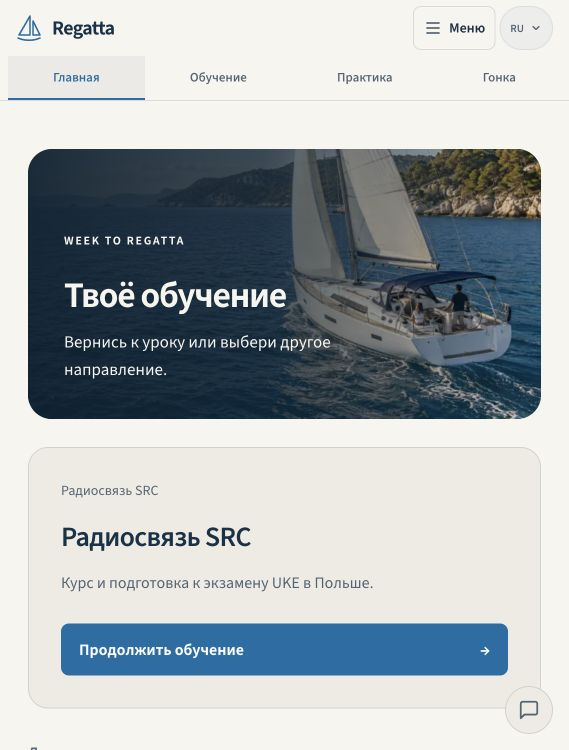
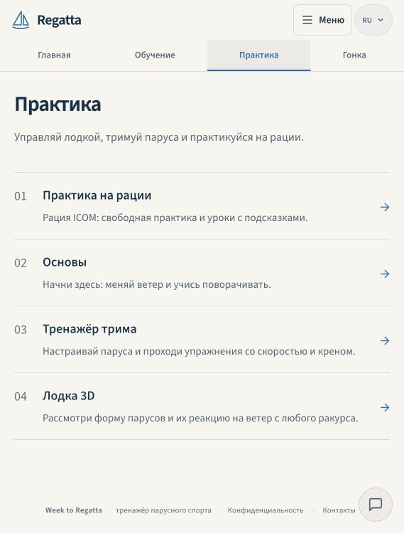
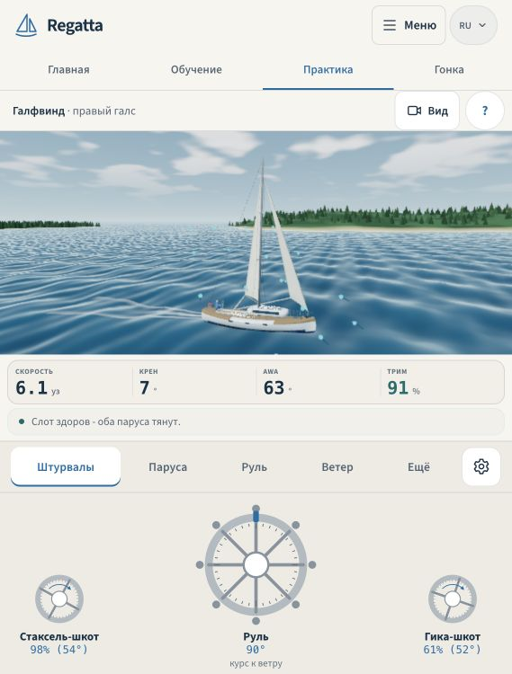
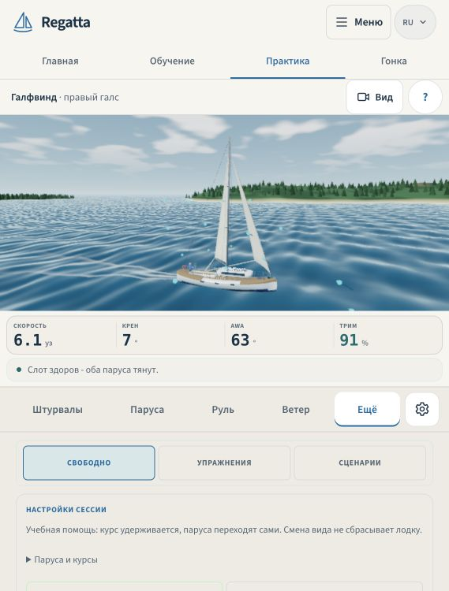
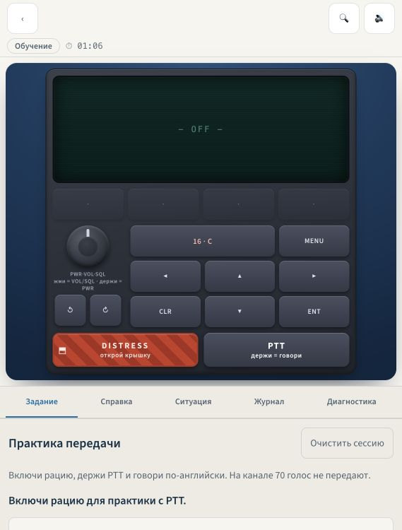
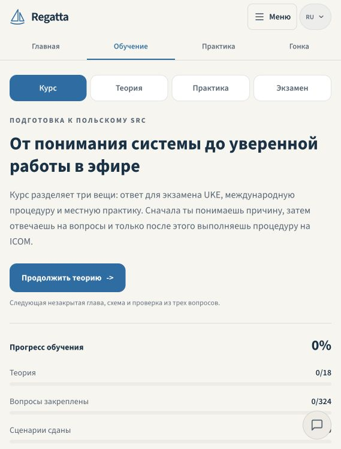
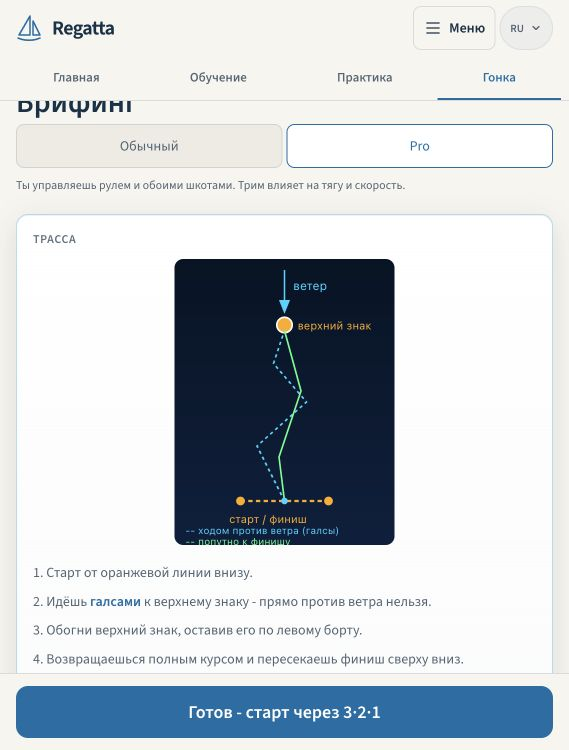
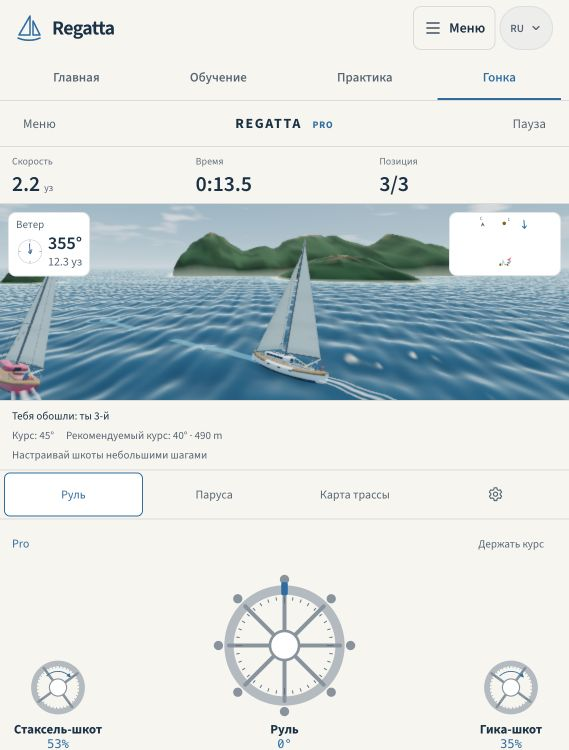
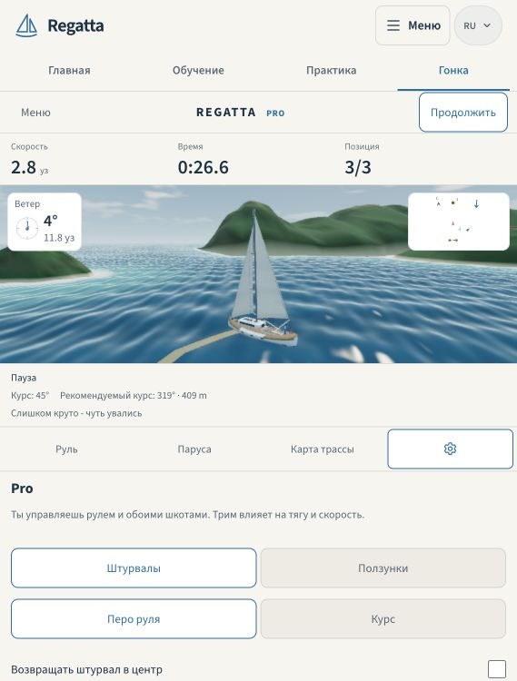

# Regatta: полный статус по аудиту и обратной связи

28 октября 2026, Europe/Warsaw. Отчет для владельца, перед следующим этапом.
Основная программа остается P00-P12. Это итог сверки, а не объявление готового продукта.

## 1. Главный вывод

**Направление продукта правильное, но согласованный объем не завершен.** Есть работающая основа: общий визуальный мир, одиночная 3D-гонка, ручной трим Pro, свободная камера, радио с обучением, локальные пакеты и более надежные результаты. Главный долг находится между этими частями: одинаковое движение, одинаковый смысл управления, законченный учебный результат, предсказуемый возврат и единое оформление.

Моя прежняя оценка «светлое чтение и темные инструменты уже образуют понятную систему» была ошибочно благоприятной. Она описывала замысел, а не качество пути. Ваша жалоба на светлую оболочку и темный тренажер обоснована. F12/V02 остаются открытыми до приемки исправленного приложения.

**Нельзя приравнивать «написано», «прошло тесты», «установлено», «доставлено в TestFlight» и «принято вами».** Не даю общего процента готовности: 65 требований различаются по объему, а несколько важных еще не доведены до пользователя.

## 2. Какое состояние мы обсуждаем

| Срез | Подтверждено | Граница |
| --- | --- | --- |
| TestFlight 1.7.0 (69) | Неизменяемый runtime `2ea498bc0fdd975e73d7aa1c393705d550ee7915`, tag `testflight-1.7.0-69`; точные Self/8notes доказательства от 27 октября | Это поставленная бета; новая тема 28 октября туда не входит |
| Рабочий исходник 28 октября | База `d8a7365a1a27fc468ae40ee9eadf6a3ab5d10cbb` и отдельная незавершенная доработка темы/сцены; состояние файлов зафиксировано в JSON | На момент визуального прохода изменения еще не закоммичены и не поставлены; нового installed-native proof нет |
| Сайт | Remote main по-прежнему `5df0ee5`; последний документированный main run40250393806 имеет успешную публикацию и красную конечную browser-проверку | APP66-69 и новая тема не считаются опубликованными на сайте |
| Публичное приложение | Новый публичный 1.7.0 этим проходом не подтвержден | Старую запись карты о 1.6.4(48) не выдаем за свежий Apple GET |

Опоры: [независимый аудит F01-F15](../2026-10-26/independent-product-audit.md), [программа](../2026-10-26/completion-program.md), [сверка после69](../2026-10-27/completion-reconciliation.md), [65-ID приемка68](../2026-10-26/acceptance68.md), [дельта69](../2026-10-27/acceptance69.md), [точная поставка69](../../design/mobile/testflight69-2026-10-27.md). Старые документы сохраняют свою дату и среду.

## 3. Все идеи и замечания: что сделано, что осталось

«В 69» означает наличие в поставленном runtime, а не полную приемку на каждом телефоне.

| Ваше пожелание | Что сделано | Что не завершено |
| --- | --- | --- |
| Убрать плоскую основную одиночную игру | В 69 native Solo использует общий локальный 3D host, старый race-3d перенаправлен туда | Учебные схемы/Основы остаются отдельными средствами объяснения; это не вторая основная гонка |
| Полноценный 3D и вращение мира | Общая перспективная сцена и orbit/zoom, вращение было реально подтверждено предыдущими проходами | Повтор жестов и сброса камеры на точном новом iPhone-пакете после изменения темы |
| Одна лодка в тренажере и игре | Общие Yacht, море, свет, camera rig и модель сил в 69 | Runtime движения еще различаются. Обещание полностью одинаковой управляемой лодки пока не выполнено |
| Обычный режим отличается от Pro | В 69 автотрим против ручных шкотов, состояние парусов/рифы влияют на модель и изображение | Одна понятная подготовка и полный human Simple/Pro путь на новой физике |
| Руль и шкотные колесики одинаковы | Общая панель, выбор колес/ползунков, чувствительность и сохранение предпочтений | В Trainer/Basics по умолчанию колесо задает курс, в Boat/Race перо. Одинаковая форма скрывает разный смысл |
| Убрать широкую дугу и проверить физику | Поворот игрока сделан отзывчивее; метрический fleet, фактический путь и контакты подготовлены | Действующая игра все еще использует legacy stepBoat с линейным масштабом около9.33x. Новый API не подключен, emission OFF |
| Разные длины гонок | Есть source-реестр120/300/600m и проверки метрических сценариев | Доступного пользователю выбора этих физических трасс нет; маршруты вокруг островов и полноценные трассы Гёджека не закончены |
| Свободно / гонка / полное обучение | Части свободной практики, самостоятельного заезда и упражнений есть | Общие понятные пресеты одной сессии и законченный ведущий учебный режим |
| Полоса направления и помощь с поворотом | Лента пути, рекомендации курса, отдельные переключатели path и trim hints в 69 | Причинное объяснение и рекомендации должны совпасть с фактической новой траекторией; Coach no-go расхождение открыто |
| Опциональный судья и штрафы | Ограниченный учебный набор, независимые правила/штрафы, пояснение об игровых секундах | Полные повороты, место у знака, препятствия, изменение курса, фазы старта/финиша и metric judge не завершены |
| Постоянные маленькие карта и ветер | В 69 угловые приборы, полная карта по нажатию, compass/air arrows/both/off, сохранение выбора | Повтор всей phone/landscape/large-text матрицы |
| Шестеренка настроек | Общий gear поставлен, виден в текущей сцене | Общая приемка контраста/имен/размеров всех кнопок |
| Ничто не закрывает лодку или рацию | Основные панели резервируют место снизу/сбоку, уголки оставляют центр свободным | Не все компоновки завершены. Текущая гонка все еще тесная, даже после улучшения trainer |
| Единая тема | **В новом исходнике:** дневной native chrome, передача темы в локальный HTML, web сохраняет Light/Dark/Auto; общая теплая дневная палитра | В 69 этого нет. Полноценной native-настройки Light/Dark/Auto пока нет. Полная приемка всех экранов впереди |
| Современные цвета и шрифты | В 69 локальный Source Sans3,400/600/700, базовые tokens, единая часть иконок/панелей | Не все локальные UI-цвета и компоненты согласованы; большой текст и все языки визуально не приняты |
| Графика как на первом рендере | Общая реальная вода/паруса/освещение есть | Рендер остается ориентиром. Силуэт берега, материалы и общий уровень картинки его не достигли; сначала измерить бюджет телефона |
| Схема / рисунок, понятная инфографика | В 67 один pilot: наполненный/полощущий грот и переключение Scheme/Picture | Не все схемы переработаны. Полной серии с проверенными стрелками ветра, усилий, снастей и переведенными легендами нет |
| Понятное обучение до результата | Исправлен конкретный Skia crash 66, общий первый урок и соответствующая3Dпрактика 67 | Все 8 Foundation/13 sail lessons, практическая оценка, объяснение ошибки и независимый повтор |
| Радио легко найти и учиться | В 69 прямой free-вход, закрепленный прибор, guide,15 уроков управления и19 ситуаций | Полный сквозной путь одного урока/ситуации/разбора и удобство маленького телефона |
| Крутилка пальцем, индекс и стрелки | В 69 rotary DIAL, видимый штрих, альтернативные web/native кнопки; исправления отмены удержаний | Ваш практический TestFlight отзыв по жестам, а не новая просьба пройти Simulator |
| Видеть, как распознана речь | В 69 временный текст, до 8 передач, typed fallback, выбранная English locale и native lifecycle logs | Настоящий PTT/микрофон/Reset и доступность локальной модели остаются вашей живой проверкой. Причина старого отказа не объявляется доказанно устраненной |
| Логи всех значимых действий | Есть bounded journal, часть controls/navigation/storage, отдельные ASR outcomes и экспорт с версией/сборкой | D02-D05/D07/D09 и часть recovery/progress связей не подключены полностью; схема события не равна записи фактического исхода |
| Радио на языке интерфейса | Источники SRC и интерфейса на 7 языках, исходный PL отдельно, English protocol сохранен | Полный естественный PL/RU/EN проход, затем остальные 4 локали; структурный audit не заменяет вычитку |
| Sternik только польский | Сохранен отдельный локальный польский курс/тест/экзамен/typed oral | Полная приемка всех экзаменационных веток остается отдельной |
| Офлайн все кроме игры с людьми | Локальные sailing/SRC/Sternik, модели/шрифты; live weather убран из native trainer 66 | Полный clean-install network-blackhole до результата и relaunch на физическом телефоне еще не доказан |
| Убрать погоду/рейсы из главного пути | Home ориентирован на обучение; погода не блокирует native практику | В web Menu остается «Места и погода», Daily/миссии существуют. Полного удаления разделов не было |
| Все Back и безопасные выходы | Исправлена History/Replay петля 68, есть guarded exit экзамена; несколько возвратов вновь проверены ниже | Полного каталога нет; теперь есть конкретный свежий дефект положения Back/заголовка брифинга |
| Результаты и прогресс не теряются | В 68 отдельные PB ACK, History, receipts/retry и собственный replay route | Остальные progress writers, все отказные исходы диска и upgrade/clear на телефоне |
| Онлайн с друзьями | Живые комнаты, invite, ready/countdown, отдельная лодка каждому | Совместное управление одной яхтой экипажем не реализовано |
| Заезд с исторической версией друга | Сохраненный replay можно смотреть | **Игрового ghost пока нет.** Нужны совместимые условия и отдельный класс сравнения |
| Swift / нативная реализация | Зафиксирована рекомендация поэтапной SwiftUI-оболочки с общим локальным3D | Рабочий Swift-прототип не создан; переписывание движка не начато и не является условием офлайна |
| APP и SITE отдельно, один репозиторий | Общий core и отдельные поставки сохранены | Сайт не догнал APP69, конечный production gate остается открытым |
| Убрать мусор и ветки |50 неактивных contained heads архивированы,52 recovery refs сохранены; сейчас32 локальные heads |18 ранее выделенных активных/уникальных историй не проверены целиком на уровне каждого патча. Dirty root защищен |
| Ads в настройках | В 69 локальные камеры/осмотр/тестовые поверхности | SDK и реальные signals выключены по вашему решению, это не незавершенная обещанная SDK-интеграция |
| eSail в фоне | Сохранены предварительные наблюдения и снимки | Полного надежного изучения controls/заданий нет. Это фоновая задача, не замена основной программы |
| Финальный максимальный релиз |69 точно доставлен в Self,68 сохранен для отката | Весь продукт, публичный App Store и сайт не финализированы |

После вашей проверки радио: **Меню > Настройки > Диагностика > Копировать журнал**, затем вставить его сюда. Обычный отзыв TestFlight не прикладывает этот журнал автоматически. В диагностическую копию не входят речь и аудио; временные распознанные слова видны отдельно в сессии практики.

## 4. Независимый аудит: все F01-F15

| ID | Что изменилось после исходного аудита | Открытое условие |
| --- | --- | --- |
| F01 | Конкретный crash исправлен66, первый путь обновлен67 | Остальные уроки, cold/phone |
| F02 | Новая метрическая реализация существенно подготовлена | Подключение полного runtime после human/bot/guidance/record/result gates |
| F03 | Общие wheels/preferences есть | Единая явная семантика руля |
| F04 | Первый урок общий в APP-source | Все 8/13 и отдельная публикация SITE |
| F05 | Некоторые упражнения оцениваются | Каждый приоритетный навык: действие, устойчивый результат, разбор, повтор |
| F06 | History/Replay исправлен68 | Весь Back, одна подготовка, новый T04 ниже |
| F07 | Free speech и native logs добавлены69 | Реальный owner radio test и полный учебный цикл |
| F08 | Path/trim hints и local Coach существуют | Проверенные причины и новая физика; no-go discrepancy |
| F09 | Exact binary/delivery стали прослеживаемыми | Сквозные текущие native-пути, а не сумма компонентных тестов |
| F10 | ASR и versioned export добавлены | Реальные assessment/progress/service/handoff/recovery outcomes |
| F11 | PB/History существенно улучшены68 | Все writers и полный offline-phone |
| F12 | **Переоткрыто.** T01/T02 исправляются отдельно в исходнике | Тема и иерархия всего пути, не только одного trainer |
| F13 | Переводы/шрифт локальны | Языковые и доступные пути, large text/VoiceOver/keyboard |
| F14 | Безопасная частичная уборка выполнена | Уникальные истории, короткий текущий индекс и APP/SITE сверка |
| F15 | Build проходит без поднятия лимита | Текущий запас83bytes практически исчерпан; phone startup/frame/thermal и SITE gate |

## 5. Что именно с темой и компоновкой сейчас

Физическая ситуация: новичок днем смотрит на телефон и должен перейти из объяснения к той же лодке без ощущения другого приложения. Дневная оболочка оправдана этим путем. Цвет корпуса рации, LCD и освещение моря являются отдельными слоями.

### T01, P1: переход яркости

Для поставленного69 дефект открыт. Новый исходник убирает forced-dark из web resolver/bootstrap, native hosts и трех offline HTML. Native `AppSurface` сейчас явно light. Web сохраняет пользовательские Light/Dark/Auto. Native сообщает выбранную поверхность до загрузки HTML, не переписывает web preference или учебные данные и повторяет ее после загрузки. Настройка всего native-приложения Dark/Auto еще не создана.

Проверены предварительные и последующие контракты hosts, storage guards и browser theme-color. Новая установленная визуальная приемка требуется отдельно. Карта темы: `src/lib/theme.ts`, `ThemeManager.tsx`, `mobile/src/design-system/surface.tsx`, `embedded-theme.ts`, `SimWebView.tsx`, `OfflineRadioCourse.tsx`, `LocalCourseWebView.tsx`, `SharedRaceHost.tsx`.

### T02, P1/P2: место лодке

Новый trainer в том же569x750 web-окне: canvas569x248.41 вместо прежних569x160, примерно33.1% высоты вместо21.3%. Вспомогательные Share/Lessons/Other trainers перенесены в «Ещё», панель резервирует место. Dev-browser suite9/9 проверяет также320x568 и доступность основных колес/Diagnostics.

**Это не завершение всей компоновки.** Свежая работающая Pro-гонка в том же окне имеет canvas569x196.22, около26.2%. У race dock остается минимум350px; дополнительная web-навигация занимает около101px. Нужна отдельная оптимизация с сохранением реальных шкотов, notice и доступности. Native embed не имеет той же web-шапки, поэтому эти числа ему не приписываются.

### T03, P2: общие детали не везде образуют один интерфейс

Source Sans3 реально bundled в обеих платформах, менять его сейчас не рекомендую. Доработать14-16px control labels,16/24 чтение, веса400/600/700 и стабильные приборные цифры. Общий шрифт не заменяет единую иерархию.

В GameClient остаются локальные цвета/градиенты и отдельные формы кнопок. Это места проверки, а не доказательство каждого конкретного нарушения контраста. Часть legacy native diagrams/scene colors намеренно отделена от UI. Нельзя массово перекрашивать проверенные схемы, аппаратные маркировки или красный DISTRESS ради светлой темы.

### T04, P1: новый подтвержденный дефект входа в брифинг

Два текущих входа из выбора гонки оставили `window.scrollY=101`. Заголовок «Брифинг»:y84.36,h36 при нижней границе sticky navigation около101. Кнопка «Назад к выбору» оказалась выше видимой области, верх заголовка скрыт. Это реальное обрезание продукта, а не кадрирование снимка.

Причина согласуется с кодом: меню и briefing в GameClient используют полный `h-dvh` плюс внешнюю sticky navigation, а running screen вычитает `--site-nav-h`. `openBriefing` меняет фазу на той же странице без сброса scroll/focus. Одного `window.scrollTo` недостаточно: привести menu/briefing/racing к одному viewport-контракту, одной внутренней прокрутке и явному фокусу. Проверить Start/Resume/повтор/Back, включая embed и клавиатуру. Точки: GameClient1165/1229/1343 и639-661 на зафиксированном срезе.

## 6. Движки, стратегия, обучение: идем ли мы туда

**Да, но общий опыт пока реализован частично.** Сохраняем один core и один визуальный мир. Не начинаем новую яхту, второй движок или массовое переписывание на Swift ради исправления нынешних связей.

Что уже общее: force/VPP source, геометрия Yacht/парусов, окружение и camera rig, значительная часть controls и контента. Что еще разное: legacy race displacement против метрической trainer session, defaults руля, обработчики сценариев, часть presentation/progress. Новый fleet API существует отдельно и не вызывается пользовательской игрой. `PHYSICAL_RACE_EMISSION_ENABLED=false` остается жесткой фактической границей.

Следующий физический этап сравнивает одинаковые ветер/лодку/руль/шкоты: угловую скорость, потерю хода, метры, фактический путь и финиш. Нельзя доказать реалистичность простым ускорением поворота или пересчетом координат. Старые рекорды сохраняют свой класс.

Учебная петля: понять -> увидеть -> сделать -> получить причинное объяснение -> повторить с другими условиями. Сначала один полностью законченный sail skill и один radio skill, затем расширять. Для «Схема / Рисунок» нужны сопоставимые состояния и проверенные кодовые стрелки/легенда; генератор изображения не определяет правильность физики.

Live multiplayer требует присутствия участников одновременно. Каждый управляет своей яхтой. Исторический ghost будет отдельной записью, которая не реагирует на нового игрока, не сталкивается с ним и не меняет его физику. Replay сейчас только просмотр. Сначала личный локальный ghost, затем обмен совместимой записью; не смешивать его рейтинг с живой гонкой.

SwiftUI рекомендую сначала как измеряемый прототип оболочки с тем же локальным3D. Возможная польза: navigation, large text, системные взаимодействия. Он не исправит автоматически масштаб гонки, контент или офлайн. До переноса нужен доказанный экспорт/импорт существующего прогресса.

Внешнего исследования с новичками еще не было. После технического завершения первых путей полезен небольшой наблюдаемый проход с 5 людьми: нашли ли действие без объяснений разработчика, завершили ли задачу, могут ли объяснить причину и повторить решение в новых условиях. Это предложение проверки учебной пользы, не уже полученный результат.

Использованы Product Design Audit для реальных экранов и маршрутов, Impeccable для темы/иерархии и project-map для единого текущего индекса. Первый выбранный рендер остается ссылкой направления; наличие скилла, общего компонента или сгенерированной картинки не засчитывает готовность функции. Логика и визуальные изменения проверяются по отдельным фактическим путям.

## 7. Поэтапный план, без новой параллельной программы

Сохраняем прежние P-ID. Каждый этап имеет один основной результат и отдельную точку отката.

| Порядок | Прежний этап | Что завершить | Как принять |
| --- | --- | --- | --- |
| 1 | P10 + F06/F12 | Закончить уже начатую тему, T04 Back/briefing и распределение сцены trainer/race/radio; освободить запас сборки до расширения | Один frozen-пакет, Home -> lesson -> practice -> Race -> Radio -> Back; короткий/landscape/large text; новая native-проверка, затем отдельная доставка |
| 2 | P04 + F02/F03 | Единицы движения, человеческая лодка и единый смысл руля | Сравнимые Simple/Pro траектории; recovery не зачитывает путь; bots/guidance/recorder/result/native/server gates до включения |
| 3 | P05/P06 | Доступные короткая/средняя/длинная дистанции, свободный/учебный режим | Реальный человек проходит каждую трассу; условия и помощь независимы; одна подготовка |
| 4 | P06 | Ограниченный честный судья и объяснения | Фазы старта/финиша, знаки, контакт/уступание и явные границы правил; помощь не меняет физику |
| 5 | P02/P07 | Полный sail skill и radio skill; затем остальные схемы/уроки | Действие -> результат -> ACK progress -> разбор -> самостоятельный повтор; radio по журналу вашего TestFlight |
| 6 | P08/P10 | Outcome logs, весь Back, PL/RU/EN и доступность | Negative paths, relaunch, clear/upgrade, VoiceOver/large text/keyboard, естественный язык |
| 7 | P09/P11 | Ghost и завершение разбора историй APP/SITE | Versioned условия/классы; уникальные изменения сохранены; сайт получает отдельный зеленый конечный gate |
| 8 | P12, позднее S01 | Публичная приемка и лишь затем SwiftUI spike | Физический телефон: cold/offline/background/startup/frame time/thermal, metadata/privacy, exact delivery |

Графику доводить внутри измеренного бюджета после сокращения лишней нагрузки, а не перед проверкой управляемости. Ads/eSail остаются фоновыми. Это тот же согласованный список, а не новые независимые ветки продукта.

## 8. Проверки и границы уверенности

На текущем срезе исходников проходят 1818 web-тестов в 175 файлах и 608 native-тестов в 82 наборах, проверка типов обеих платформ, native lint. Web lint: 0 ошибок, 15 предупреждений. После окончательной генерации еще 9 проверок пакетов проходят; radio636b981087ba, sailing e70083e42a6e, Sternik cdef6534874d свежие. Чистая production-сборка проходит; 112 файлов static chunks, 6815661 bytes при прежнем лимите 6815744, запас 83 bytes. Это размер всех static chunks, не стартовая загрузка и не FPS.

Совмещенная проверка production web содержит 84 сценария в 8 файлах. Первый проход по127.0.0.1: 83 пройдены, 1 отказ сохранения nickname из-за отсутствующего Secure session cookie в HTTP API-контексте этого адреса. Без изменения продукта и assertions тот же сценарий проходит по localhost, как в CI. Полный повтор на штатном localhost: **84/84 с первой попытки**, 0 пропусков, нестабильных и неожиданных исходов; 349.2 секунды. Исходники, assertions, тайм-ауты и Secure cookie policy не менялись. Предыдущие 82 browser-сценария релиза69 не приписываются новому исходнику.

Обратная связь сверена по этой переписке и сохраненным предыдущим доказательствам. Новая выгрузка входящих TestFlight отзывов/crash reports в этом проходе не выполнялась.

В этом аудите заново просмотрены реальные web-состояния на русском,569x750, локальный clean production. Физический iPhone, микрофон/PTT/Reset, все уроки, все языки/Back, полные Simple/Pro/MP финиши, cold network-blackhole и accessibility/thermal матрица заново не приняты. Ввод рации вы явно перенесли в свой TestFlight, повторно просить Simulator не требуется.

Уверенность 100% относится к прочитанному выключенному флагу и измеренным координатам в этом проходе. Около 90% в рекомендации сохранить один core и порядок этапов,80% в художественной оценке. Это экспертные оценки, не статистика и не процент готовности. Для фактического микрофона и производительности телефона данных недостаточно.

## 9. Свежий визуальный путь

Все приведенные JPEG сохранены целиком и просмотрены после записи. Это нынешний рабочий исходник, не TestFlight69.

| Шаг | Наблюдение | Состояние |
| --- | --- | --- |
| 1 | Home, светлая тема, реальное продолжение SRC | Работает; hero по-прежнему высок |
| 2 | Practice, радио и 3 учебных входа | Работает; разница задач должна оставаться понятной |
| 3 | Trainer, реальный кадр яхты и 248px сцены | Улучшено в source; новый native еще не принят |
| 4 | «Ещё», сцена сохраняет место | Работает в проверенном web; длинная панель прокручивается |
| 5 | Radio free, прибор/стрелки и задача | Вход работает; прибор OFF, речь здесь не проверялась |
| 6 | Видимый Back «К курсу SRC» | Возврат работает и открывает курс, не предыдущий Practice |
| 7 | Pro briefing после повторного входа | Дефект T04: Back/верх заголовка под nav, повтор режима |
| 8 | Реальная Pro-гонка | Кадр/часы/ручные шкоты/карта/ветер есть; сцена всего 196px |
| 9 | Pause -> Settings -> Menu | Проверенные действия работают; настройки помещаются в нижнюю прокручиваемую панель |

## 10. Все 65 исходных требований

Ни один ID не удален. «Готово в исходнике» в старой матрице не означает полную доставку/приемку. Два столбца статусов сохраняют baseline 27 октября, комментарий уточняет дельту 28 октября. Это не 65 новых повторных проверок.

| ID | Исходное требование | Исходник, базовая оценка | Приемка, базовая оценка | Уточнение28окт |
| --- | --- | --- | --- | --- |
| N01 | Пять разделов, последний Меню | готово | частично | Новая полная приемка не выполнялась; см. основной раздел |
| N02 | Найти и запустить SRC из приложения | готово | подтверждено | Free вход подтвержден27и28окт web; native mic отдельно |
| N03 | Инструмент и курс имеют явные отдельные входы | готово | подтверждено | Новая полная приемка не выполнялась; см. основной раздел |
| N04 | Честное продолжение последнего курса | готово | частично | Новая полная приемка не выполнялась; см. основной раздел |
| N05 | Предсказуемый Back и безопасный выход | готово | частично | 28окт: SRC-return/Pause/Menu проверены web; T04скрывает Backна briefing; весь native-каталог открыт |
| N06 | SRC: внутренний Back сохраняет контекст | готово | частично | Новая полная приемка не выполнялась; см. основной раздел |
| N07 | Повторный Stay/Exit незавершенного экзамена | готово | частично | Новая полная приемка не выполнялась; см. основной раздел |
| N08 | Нет потерянных функций и тупиков | частично | частично | Новая полная приемка не выполнялась; см. основной раздел |
| G01 | Один 3D Solo/Daily/mission вход | готово | частично | Native3D host поставлен; нет нового full native walkthrough |
| G02 | Свободный трехмерный осмотр мира | готово | подтверждено | Orbit подтвержден web27окт в baseline; 28окт жесты заново не повторялись |
| G03 | Общая яхта, море, свет и учебные камеры | готово | подтверждено | Общая геометрия, не полная эквивалентность движения |
| G04 | Simple автотрим, Pro ручные шкоты | готово | частично | Pro UI подтвержден27и28окт web; полного финиша этим проходом нет |
| G05 | Hoist/furl/reef меняют модель и изображение | готово | частично | Новая полная приемка не выполнялась; см. основной раздел |
| G06 | Отзывчивость без форка исходной физики | частично | частично | Legacy9.33x scale остается; physical API выключен |
| G07 | Маршрут и trim hints независимы и отключаются | готово | частично | Новая полная приемка не выполнялась; см. основной раздел |
| G08 | Учебные правила и прозрачные штрафы | готово | частично | Только ограниченный учебный набор, не полный judge |
| G09 | Правильные часы, pause/background/resume | готово | частично | Новая полная приемка не выполнялась; см. основной раздел |
| G10 | Solo offline с первой установки и локальными ресурсами | готово | частично | Полный physical phone network-blackhole открыт |
| G11 | WebGPU/WebGL2 fallback и честные FPS flags | готово | частично | Новая полная приемка не выполнялась; см. основной раздел |
| G12 | Настоящий finish и durable History | готово | подтверждено | Новая полная приемка не выполнялась; см. основной раздел |
| G13 | Правдивый saved3D replay и local coach | готово | частично | No-go Coach discrepancy открыт; ghost отсутствует |
| G14 | Честные local/global результаты | частично | частично | Новая полная приемка не выполнялась; см. основной раздел |
| G15 | Multiplayer: общий мир, cockpit, server authority | готово | частично | Новая полная приемка не выполнялась; см. основной раздел |
| U01 | Wheels default, saved sliders не теряются | готово | частично | Новая полная приемка не выполнялась; см. основной раздел |
| U02 | Одна настройка mapping/sensitivity/favorites | готово | частично | Разный default helm смысл еще есть |
| U03 | В задании остаются выбранные штурвалы | готово | непроверено | Новая полная приемка не выполнялась; см. основной раздел |
| U04 | Короткая цель и реальные основные controls прежде деталей | готово | непроверено | Новая полная приемка не выполнялась; см. основной раздел |
| U05 | Native recovery trainer без overlay/двойного руля | готово | непроверено | Новая полная приемка не выполнялась; см. основной раздел |
| U06 | Pose/inspect явно отличается от управления | готово | частично | Новая полная приемка не выполнялась; см. основной раздел |
| U07 | Settings/Views живут в reserved space | готово | частично | Новая полная приемка не выполнялась; см. основной раздел |
| U08 | Focus не сбрасывается каждым physics tick | готово | непроверено | Новая полная приемка не выполнялась; см. основной раздел |
| U09 | Основные touch targets не меньше 44px | готово | частично | Новая полная приемка не выполнялась; см. основной раздел |
| U10 | Сцена/метрики/controls без обрезания | частично | частично | 28окт: trainer source248pxвместо160; race196pxи T04 остаются; native отдельно |
| U11 | Единый звук и clicks только по общей настройке | готово | непроверено | Новая полная приемка не выполнялась; см. основной раздел |
| R01 | Прибор и задача вместе на коротком экране | частично | частично | Новая полная приемка не выполнялась; см. основной раздел |
| R02 | Простой запуск guided/free learning | готово | подтверждено | Новая полная приемка не выполнялась; см. основной раздел |
| R03 | Прямой стабильный free route | готово | подтверждено | Новая полная приемка не выполнялась; см. основной раздел |
| R04 | Tabs/Help/Listen/Log не вытесняют прибор | готово | частично | Новая полная приемка не выполнялась; см. основной раздел |
| R05 | Доступный Inspect и аппаратная семантика | готово | частично | Новая полная приемка не выполнялась; см. основной раздел |
| R06 | Весь SRC структурно адаптирован на 7 языков | частично | частично | Структурная адаптация не равна полному natural-language QA |
| R07 | English protocol и PL UKE original не повреждены | готово | частично | Новая полная приемка не выполнялась; см. основной раздел |
| R08 | Язык мигрирует, progress/другой курс сохраняются | готово | частично | Новая полная приемка не выполнялась; см. основной раздел |
| R09 | Локальные TTS/strict ASR и typed fallback | готово | частично | Новый locale probe/logs69; owner mic/PTT/Reset pending |
| R10 | Power/VOL/SQL/channel/PTT управляют речью станции | готово | непроверено | В новом проходе прибор OFF, речи не проверяли |
| R11 | Offline copy/ошибки соответствуют installed режиму | готово | частично | Новая полная приемка не выполнялась; см. основной раздел |
| R12 | Без ложной полноты аппаратных симуляций | будущее | непроверено | Новая полная приемка не выполнялась; см. основной раздел |
| V01 | Ocean Cockpit и защищенный объект | готово | частично | Первый concept остается ориентиром; новый daytime source не равен принятому редизайну |
| V02 | Paper learning и dark instruments | готово | частично | 28окт: дневной native/web inheritance исправляются в source;69старый, full native theme modes отсутствуют |
| V03 | Один semantic action/selected accent | частично | частично | 28окт: дневные tokens сближены, но локальные UI-цвета/состояния и все contrast gates открыты |
| V04 | Offline шрифт на 7 языков | готово | частично | Source Sans3 реально bundled в обеих платформах |
| V05 | Читаемые labels, AA и scaling | частично | частично | Полной AA/large-text/VoiceOver приемки нет |
| E01 | Foundation parity web/native | частично | частично | Один общий lesson и один Picture pilot, не весь курс |
| E02 | Эталонный sail lesson до result/resume | готово | частично | Новая полная приемка не выполнялась; см. основной раздел |
| E03 | Все 13 sail lessons честно по модулям | частично | частично | Новая полная приемка не выполнялась; см. основной раздел |
| E04 | Полный halyard/support/hoist/lower equipment loop | будущее | непроверено | Новая полная приемка не выполнялась; см. основной раздел |
| E05 | Library/Anatomy/Rules/Onboard/Checklist доступны | готово | частично | Новая полная приемка не выполнялась; см. основной раздел |
| D01 | Один источник физики/контента | готово | частично | Force/visual общие, movement runtime еще разные |
| D02 | Essential core локален с первой установки | готово | частично | Новая полная приемка не выполнялась; см. основной раздел |
| D03 | Sternik PL-only локальный theory/test/exam/typed oral | готово | частично | Новая полная приемка не выполнялась; см. основной раздел |
| D04 | Progress/clear/retry/upgrade без потери данных | готово | частично | Новая полная приемка не выполнялась; см. основной раздел |
| D05 | JS budget6.5MB не поднят | готово | частично | 28окт: текущий clean build запас83bytes; это не FPS/first-load, capне поднят |
| D06 | App/site разделены, dirty история сохранена | готово | частично | SITE5df отдельно; APP69 на сайт не поставлен |
| D07 | Текущая сборка реально доступна exact Self | готово | подтверждено | В 69 обновлено exact Apple Self proof, не phone install |
| D08 | Public candidate G0-G5/privacy/metadata/AppReview | частично | частично | Публичный релиз остается открытым |
| D09 | Актуальные docs и безопасная cleanup | частично | частично | 28окт: единый новый отчет и все65IDs;32local heads,18историй еще не разобраны целиком |
