# Regatta: полный статус по аудиту и обратной связи

28 октября 2026, Europe/Warsaw. Повторно сверен с исходным независимым аудитом, всеми 65 требованиями, F01-F15 и всеми 14 полученными отзывами TestFlight. Содержит датированные установленные upgrade/clean проходы D8 и пять новых web-экранов итоговой сверки. Отчет для владельца, перед следующим этапом.
Основная программа остается P00-P12. Это итог сверки, а не объявление готового продукта.

**У пользователя: TestFlight69. Новая дневная тема пока в кандидате70, который еще не отправлен.** Подробные версии и проверки приведены в разделе2.

**Продолжение после отчета, source147:** пятая Foundation footer-правка зафиксирована и pushed в`147ac837b98eca3ecbe02b0a55291e31b32bb6ab`. Generated22, web types/build и614native/82suites/types/lint проходят. Чистая Release Simulator сборка завершилась18:42:32UTC,43проверки пакета проходят; все121файл замороженной и установленной копии совпали. Прямое обновление публичной48 на новом iOS27QA сохранило все6старых записей побайтно до первого запуска; после запуска видны EN,1/8и тест3/3. Реальный3D -> тот же шаг практики -> следующий Back в оглавление подтвержден для Foundation1и sail3. Foundation footer после двух уроков -> оглавление -> Learn также подтвержден. Это ограниченная установленная приемка, не полныйG2или доставка70. Старые D8/acf доказательства не переносятся.

**Новая обратная связь владельца:** GET18:29:40UTC нашел3отзыва69, всего14; все3новых изображения просмотрены. TF12: начало теорииSRC; TF13: пояснения по касанию и плавный guide; TF14: оформление Foundation/Back. Позже владелец отдельно прислал журнал69, OWNER-J01:4native recognized и их4web-копии, питание/PTT и simulated DISTRESS имеют положительные исходы. Точность слов, Reset, полный guide и произвольные аппаратные действия этим не приняты;2239dropped не являются счетчиком неработающих кнопок. [Все14отзывов и журнал](testflight-feedback-review.md).

## Краткий ответ по вашим главным замечаниям

**Продукт стал лучше, но я не довел весь согласованный объем до готового релиза.** Главная ошибка работы: завершенность отдельных деталей иногда звучала как завершенность общего пути. Ниже все65требований и все15находок остаются в отчете; здесь короткий список для решения, что делать следующим.

| Что вы хотели | Что есть сейчас | Итог |
| --- | --- | --- |
| Одна современная тема от главной до тренажера | Дневной вариант работает в новом локальном исходнике и частично проверенном пакете70;69его не содержит | **Не доведено до пользователя.** F12/V02 открыты; одного перекрашенного экрана недостаточно |
| Та же лодка и те же ощущения в практике и гонке | Общие Yacht, паруса и VPP; разные движение, полный rig и default-смысл руля | **Частично.** Это главный архитектурный долгP04 |
| Полноценная3Dгонка, камера, Pro |3D, orbit и ручные шкоты есть; карта/ветер закреплены | **Рабочая основа есть.** Графика первого рендера и полный единый опыт не достигнуты |
| Естественный быстрый поворот и выбор длин трасс | Метрическая реализация и120/300/600m подготовлены отдельно | **Не включено в игру.** Действует старый масштаб около9.33x; островные маршруты не закончены |
| Подсказки, учебный судья и свободное/учебное плавание | Отдельные переключатели, лента пути, ограниченный набор правил | **Частично.** Полный причинный разбор, общий preset и metric judge впереди |
| Все Back работают | History/Replay исправлены68; найден новый реальный T05 | **Не завершено.** Пять известных возвратов исправлены в source, полный новый пакет еще не принят |
| Понятное обучение со схемой и рисунком | Общий первый урок, одна пара изображений и pilot Scheme/Picture | **Частично.** Не вся серия иллюстраций и не все8/13учебных циклов |
| Удобная рация, речь и журнал | Прибор, DIAL/индекс/стрелки, гид, ситуации, временный текст и ASR logs есть в69 | **Живая проверка открыта.** Вход в курс, аппаратные действия и микрофон не смешиваются в одну галочку |
| Всё кроме игры с людьми офлайн | Основные учебные пакеты и одиночная практика локальны | **Не буквально всё.** Gallery photos/video, погода и Ask имеют сетевые зависимости; полный offline-phone gate открыт |
| Логи на все важные действия | Общий журнал и несколько реальных outcome-цепочек подключены | **Частично.** Не все assessment/save-ACK/retry/service/handoff исходы |
| PL/RU/EN полностью довести | Общие переводы и локальный шрифт есть, SRC имеет7локалей | **Частично.** Естественный язык, переключение, короткий экран и доступность не закрыты целиком |
| Единый порядок в ветках и APP/SITE | Один repo, отдельные поставки,50heads безопасно архивированы | **Частично.**18историй требуют разбора, SITE отстает; полного публичного финала нет |

Моя рекомендация: сначала завершить небольшой текущий этап темы/возвратов, затем поведение одной лодки, затем трассы/помощь/судью и один законченный учебный навык. Сохраняем Source Sans3 и общий3Dcore. Новый игровой движок, массовый Swift-перенос и дополнительные декоративные экраны сейчас не решат основные разрывы. Уверенность в этом порядке около90%; это инженерное суждение, не процент готовности.

**Дополнение после отчета,17:43UTC:** дальнейший установленный проход D8 нашел T05: после возврата из практики следующий Back снова открывает тренажер. Это воспроизведено в третьем уроке парусов и первом Foundation. D8 не проходит этот пунктG2; новый исходник исправления и его установленная приемка требуются отдельно. Подробности и отрицательные кадры находятся ниже. Предыдущие успешные наблюдения возврата сохраняются в их узкой границе: они не проверяли следующий Back.

## 1. Главный вывод

**Направление продукта правильное, но согласованный объем не завершен.** Есть работающая основа: общий визуальный мир, одиночная 3D-гонка, ручной трим Pro, свободная камера, радио с обучением, локальные пакеты и более надежные результаты. Главный долг находится между этими частями: одинаковое движение, одинаковый смысл управления, законченный учебный результат, предсказуемый возврат и единое оформление.

Моя прежняя оценка «светлое чтение и темные инструменты уже образуют понятную систему» была ошибочно благоприятной. Она описывала замысел, а не качество пути. Ваша жалоба на светлую оболочку и темный тренажер обоснована. F12/V02 остаются открытыми до приемки исправленного приложения.

**Нельзя приравнивать «написано», «прошло тесты», «установлено», «доставлено в TestFlight» и «принято вами».** Не даю общего процента готовности: 65 требований различаются по объему, а несколько важных еще не доведены до пользователя.

**Текущая граница:** поставлен TestFlight69. Текущий замороженный source70,147ac83, собран в Release и проходит43package checks; прямое48->70 сохраняет прогресс и подтверждает два ранее сломанных пути следующего Back. Подробности в разделе2. ПредыдущийD8 остается частично проверенным пакетом с отрицательнымT05. Exactacf cloud40741168924 завершился FAILURE92/94: оба объединенных Simple/Pro пути исчерпали120sна всех3попытках. Остальные92прошли сразу;0skipped/flaky. Это не зеленый browser gate147. ПолныеG2/cloud/доставка70 открыты.

Что мы делали неправильно и что меняем в подходе:

1. Слишком легко считали общий компонент доказательством общего поведения. Одна картинка яхты еще не означает одинаковую лодку; закрываем движение, rig и смысл руля одним контрактом.
2. Расширяли функции быстрее, чем завершали пути. Приоритет: один урок, один заезд и один radio skill до результата, сохранения и повторного входа. Ads/eSail остаются фоном.
3. Принимали намерение дизайна за удачный пользовательский переход. Темный корпус рации допустим; внезапная смена всей поверхности между разделами не решена только названием темы.
4. Смешивали готовность исходника, локальные тесты и то, что получили вы. Теперь в каждом пункте отдельно указаны версия, среда и оставшаяся приемка. Доставка69 не закрывает новую тему70.
5. Накапливали технические проверки вместо короткого доказательства целого пути. Они нужны для регрессий, но финиш, сохранение, возврат и работа без сети должны подтверждаться на точном установленном пакете и затем на телефоне.

## 2. Какое состояние мы обсуждаем

**Точное текущее состояние:** TestFlight остается69. Source147ac83 содержит пять узких исправлений contextual return; compiled Release43/frozen121/installed121 и прямое обновление48->147 подтверждены отдельно. Реальные Foundation/sail возвраты и Foundation footer после двух уроков проходят на новом iOS27QA. Полная матрицаG2и новый exact cloud еще не приняты. Историческийacf compile намеренно остановлен18:08UTC/75до пятой правки; первая147попытка с перенесенным cache закончилась65из-за абсолютного SwiftShims пути, после чего чистая147сборка успешна. Эти события не смешиваются с продуктовымT05. Exactacf predeploy40741168924красный92/94, хотя его push/PR CI успешны.

| Срез | Подтверждено | Граница |
| --- | --- | --- |
| TestFlight 1.7.0 (69) | Неизменяемый runtime `2ea498bc0fdd975e73d7aa1c393705d550ee7915`, tag `testflight-1.7.0-69`; точные Self/8notes доказательства от 27 октября | Это поставленная бета; новая тема 28 октября туда не входит |
| Предыдущий собранный пакет70, D8 | Дневная тема зафиксирована в `29aaaf1571fe5abbc0a28c8aa6236009d2b1b1ce`; пакет`d8dbca39a32a51fd2b4fd09b349587e59ca3ea4f` после25baff1: briefing/Back, сцена, подписи, относительный ветер и сокращение дублированного контента | Release, generated22, package43 и121installed hashes проходят. Прямой48->70/iOS27 сохраняет6ключей до launch, EN/1из8после него; отдельный clean27 проходит первый урок/3D/возврат/cold-resume и Simple input. Затем найденT05. Exact cloud92/94красный, полныйG2открыт;70не доставлен. Прежний25baff1/SE26 остаются отдельными доказательствами |
| Историческийacf после D8 | Четыре contextual returns исправлены через dismissTo; passive ring сохраняет прежние действия/проверки/сроки |613native/1827web и local94/94проходят. Compile остановлен до пятой правки; пакетаacfнет. Exact cloud40741168924 FAILURE92/94,98attempts; публикация/деплой отсутствуют. Старые43/121/D8installed доказательства кacfне относятся |
| Текущий замороженный source147 | Foundation footer dismissTo и четыре прежних contextual returns;614native/82suites,types/lint,web types/build/generated22 | Release43 и frozen/installed121совпадают. Прямой48upgrade сохраняет6записей до launch, EN/1из8/3из3после него; Foundation/sail nextBack и Foundation footer->Learn подтверждены. ПолныйG2/cloud/70delivery открыты |
| Сайт | Remote main по-прежнему `5df0ee5`; последний документированный main run40250393806 имеет успешную публикацию и красную конечную browser-проверку | APP66-69 и новая тема не считаются опубликованными на сайте |
| Публичное приложение | Read-only Apple GET28октября12:41:43.898UTC подтверждает1.6.4(48), READY_FOR_SALE;1.7.0 PREPARE_FOR_SUBMISSION | На тот момент70 отсутствовал, максимум69. Это не новая проверка доступности Self и не резервирование номера |

Опоры: [независимый аудит F01-F15](../2026-10-26/independent-product-audit.md), [программа](../2026-10-26/completion-program.md), [сверка после69](../2026-10-27/completion-reconciliation.md), [65-ID приемка68](../2026-10-26/acceptance68.md), [дельта69](../2026-10-27/acceptance69.md), [точная поставка69](../../design/mobile/testflight69-2026-10-27.md). Старые документы сохраняют свою дату и среду.

## 3. Все идеи и замечания: что сделано, что осталось

«В 69» означает наличие в поставленном runtime, а не полную приемку на каждом телефоне.

| Ваше пожелание | Что сделано | Что не завершено |
| --- | --- | --- |
| Убрать плоскую основную одиночную игру | В 69 native Solo использует общий локальный 3D host, старый race-3d перенаправлен туда | Учебные схемы/Основы остаются отдельными средствами объяснения; это не вторая основная гонка |
| Полноценный 3D и вращение мира | Общая перспективная сцена и orbit/zoom, вращение было реально подтверждено предыдущими проходами | Свежий установленный70 подтверждает drag-orbit, разные ракурсы и живые часы. Zoom/reset и вся device-матрица еще не приняты |
| Одна лодка в тренажере и игре | Общие Yacht, море, свет, camera rig и VPP-база в 69 | Различаются runtime движения и rig: trainer использует stepWithRig/перенос парусов, race вызывает tick без полного rig state. Обещание полностью одинаковой управляемой лодки пока не выполнено |
| Обычный режим отличается от Pro | В 69 автотрим против ручных шкотов, состояние парусов/рифы влияют на модель и изображение | Одна понятная подготовка и полный human Simple/Pro путь на новой физике |
| Руль и шкотные колесики одинаковы | Общая панель, выбор колес/ползунков, чувствительность и сохранение предпочтений | В Trainer/Basics по умолчанию колесо задает курс, в Boat/Race перо. Одинаковая форма скрывает разный смысл |
| Убрать широкую дугу и проверить физику | Поворот игрока сделан отзывчивее; метрический fleet, фактический путь и контакты подготовлены | Действующая игра все еще использует legacy stepBoat с линейным масштабом около9.33x. Новый API не подключен, emission OFF |
| Разные длины гонок | Есть source-реестр120/300/600m и проверки метрических сценариев | Доступного пользователю выбора этих физических трасс нет; маршруты вокруг островов и полноценные трассы Гёджека не закончены |
| Свободно / гонка / полное обучение | Части свободной практики, самостоятельного заезда и упражнений есть | Общие понятные пресеты одной сессии и законченный ведущий учебный режим |
| Полоса направления и помощь с поворотом | Лента пути, рекомендации курса, отдельные переключатели path и trim hints в 69 | Причинное объяснение и рекомендации должны совпасть с фактической новой траекторией; Coach no-go расхождение открыто |
| Опциональный судья и штрафы | Ограниченный учебный набор, независимые правила/штрафы, пояснение об игровых секундах | Полные повороты, место у знака, препятствия, изменение курса, фазы старта/финиша и metric judge не завершены |
| Постоянные маленькие карта и ветер | В 69 угловые приборы, полная карта по нажатию, compass/air arrows/both/off, сохранение выбора | Повтор всей phone/landscape/large-text матрицы |
| Ветер относительно носа, уточнение TestFlight66 | В исходнике70 прибор показывает true TWA с указанием борта, нос на шкале сверху; TWD остается отдельным абсолютным показанием.3Dстрелки продолжают показывать вымпельный поток | Browser-поворот и локальный94gate прошли. В чистом installed70 Simple руль0->8°, курс45->50° иTWA40->46° наблюдались; это не полная проверка знака/всех галсов. Cloud92/94и доставка70остаются открыты |
| Шестеренка настроек | Общий gear поставлен, виден в текущей сцене | Общая приемка контраста/имен/размеров всех кнопок |
| Ничто не закрывает лодку или рацию | Основные панели резервируют место снизу/сбоку. Исправлены подписи IT short Pro и Trainer portrait/landscape, локальный94gate проходит; лодка остается видна | Cloud92/94красный; новая native/large-text матрица и все состояния рации еще не приняты |
| Единая тема | **В новом исходнике:** дневной native chrome, передача темы в локальный HTML, web сохраняет Light/Dark/Auto; общая теплая дневная палитра | В 69 этого нет. Полноценной native-настройки Light/Dark/Auto пока нет. Полная приемка всех экранов впереди |
| Современные цвета и шрифты | В 69 локальный Source Sans3,400/600/700, базовые tokens, единая часть иконок/панелей | Не все локальные UI-цвета и компоненты согласованы; большой текст и все языки визуально не приняты |
| Графика как на первом рендере | Общая реальная вода/паруса/освещение есть | Рендер остается ориентиром. Силуэт берега, материалы и общий уровень картинки его не достигли; сначала измерить бюджет телефона |
| Схема / рисунок, понятная инфографика | В 67 один pilot: наполненный/полощущий грот и переключение Scheme/Picture | Не все схемы переработаны. Полной серии с проверенными стрелками ветра, усилий, снастей и переведенными легендами нет |
| Понятное обучение до результата | Исправлен конкретный Skia crash 66, общий первый урок и соответствующая3Dпрактика 67 | Все 8 Foundation/13 sail lessons, практическая оценка, объяснение ошибки и независимый повтор |
| Радио легко найти и учиться | В 69 прямой free-вход, закрепленный прибор, guide,15 уроков управления и19 ситуаций | Полный сквозной путь одного урока/ситуации/разбора и удобство маленького телефона |
| Крутилка пальцем, индекс и стрелки | В 69 rotary DIAL, видимый штрих, альтернативные web/native кнопки; исправления отмены удержаний | Ваш практический TestFlight отзыв по жестам, а не новая просьба пройти Simulator |
| Видеть, как распознана речь | В 69 временный текст, до 8 передач, typed fallback, выбранная English locale и native lifecycle logs | Настоящий PTT/микрофон/Reset и доступность локальной модели остаются вашей живой проверкой. Причина старого отказа не объявляется доказанно устраненной |
| Логи всех значимых действий | Есть bounded journal, часть controls/navigation/storage, отдельные ASR outcomes и экспорт с версией/сборкой | Не закончены реальные исходы assessment, ACK прогресса/retry, сетевых сервисов, fallback-controls и внешнего handoff. Это отдельные diag-D02-D05/D07/D09 из diagnostics-followup, не одноименные65-ID требования |
| Радио на языке интерфейса | Источники SRC и интерфейса на 7 языках, исходный PL отдельно, English protocol сохранен | Полный естественный PL/RU/EN проход, затем остальные 4 локали; структурный audit не заменяет вычитку |
| Sternik только польский | Сохранен отдельный локальный польский курс/тест/экзамен/typed oral | Полная приемка всех экзаменационных веток остается отдельной |
| Офлайн все кроме игры с людьми | Локальные sailing/SRC/Sternik, модели/шрифты; live weather убран из native trainer66 | Gallery загружает фото с сайта и thumbnails сYouTube, полные media открывает черезLinking. Погода/Ask остаются online. Это реальные исключения требованию, а не только недостаток тестов. Нужен явный состав локального продукта; полный clean-install network-blackhole на телефоне еще не доказан |
| Убрать погоду/рейсы из главного пути | Home ориентирован на обучение; погода не блокирует native практику | В web Menu остается «Места и погода», Daily/миссии существуют. Полного удаления разделов не было |
| Все Back и безопасные выходы | Исправлена History/Replay петля68. T04 со скрытым Back/заголовком исправлен в source. D8 выявилT05: следующий Back из урока повторно открываетTrainer | Четыре contextual-return правки изacf и пятая footer зафиксированы в147. В69их нет;147installed подтверждает Foundation/sail nextBack и Foundation footer->Learn. Полный каталог возвратов и device-матрица открыты |
| Одна понятная подготовка заезда | Выбор режима и настройки существуют | Повторный выбор в native-хабе, GameMenu и briefing еще не объединен. Это исходный F06; исправление Back его не закрывает |
| Результаты и прогресс не теряются | В 68 отдельные PB ACK, History, receipts/retry и собственный replay route | Остальные progress writers, все отказные исходы диска и upgrade/clear на телефоне |
| Онлайн с друзьями | Живые комнаты, invite, ready/countdown, отдельная лодка каждому | Совместное управление одной яхтой экипажем не реализовано |
| Заезд с исторической версией друга | Сохраненный replay можно смотреть | **Игрового ghost пока нет.** Нужны совместимые условия и отдельный класс сравнения |
| Swift / нативная реализация | Зафиксирована рекомендация поэтапной SwiftUI-оболочки с общим локальным3D | Рабочий Swift-прототип не создан; переписывание движка не начато и не является условием офлайна |
| APP и SITE отдельно, один репозиторий | Общий core и отдельные поставки сохранены | Сайт не догнал APP69, конечный production gate остается открытым |
| Убрать мусор и ветки |50 неактивных contained heads архивированы,52 recovery refs сохранены; сейчас32 локальные heads |18 ранее выделенных активных/уникальных историй не проверены целиком на уровне каждого патча. Dirty root защищен |
| Ads в настройках | В 69 локальные камеры/осмотр/тестовые поверхности | SDK и реальные signals выключены по вашему решению, это не незавершенная обещанная SDK-интеграция |
| eSail в фоне | Сохранены предварительные наблюдения и снимки | Полного надежного изучения controls/заданий нет. Это фоновая задача, не замена основной программы |
| Фал, лебедка, стопор, нагрузка и порядок работы, идея расширения | Есть отдельные модели/схемы снастей | Полного управляемого equipment loop и учебной приемки нет. E04 является будущим расширением, не выполненной функцией текущего релиза |
| Финальный максимальный релиз |69 точно доставлен в Self,68 сохранен для отката | Весь продукт, публичный App Store и сайт не финализированы |

Журнал69уже получен отдельно в чате и разобран как OWNER-J01. Он подтверждает4native результата непустого распознавания и успешные power/PTTцепочки в сохраненном хвосте. Сами слова и аудио в диагностическую копию не входят. Вход в теорию, последовательность guide, Reset и корректность распознанной фразы требуют отдельных наблюдений; повторно запрашивать тот же журнал не нужно.

## 4. Независимый аудит: все F01-F15

| ID | Что изменилось после исходного аудита | Открытое условие |
| --- | --- | --- |
| F01 | Конкретный crash исправлен66, первый путь обновлен67 | Остальные уроки, cold/phone |
| F02 | Новая метрическая реализация существенно подготовлена | Подключение полного runtime после human/bot/guidance/record/result gates |
| F03 | Общие wheels/preferences есть | Единая явная семантика руля |
| F04 | Первый урок общий в APP-source | Все 8/13 и отдельная публикация SITE |
| F05 | Некоторые упражнения оцениваются | Каждый приоритетный навык: действие, устойчивый результат, разбор, повтор |
| F06 | History/Replay исправлен68; T04 Back/briefing исправлен в текущем source | Исходная проблема повторного выбора режима не устранена; весь native Back остается открытым |
| F07 | Free speech и native logs добавлены69 | Реальный owner radio test и полный учебный цикл |
| F08 | Path/trim hints и local Coach существуют | Проверенные причины и новая физика; no-go discrepancy |
| F09 | Exact binary/delivery стали прослеживаемыми; first91/94сохранен, новыйlocal94/94прошел, exactcloud92/94не прошел | Сквозные текущие native-пути, а не сумма компонентных тестов; полныйG2/cloud/archive/Apple gates еще открыты |
| F10 | ASR и versioned export добавлены | Реальные assessment/progress/service/handoff/recovery outcomes |
| F11 | PB/History существенно улучшены68 | Все writers и полный offline-phone |
| F12 | **Переоткрыто.** T01/T02 исправляются отдельно в исходнике | Тема и иерархия всего пути, не только одного trainer |
| F13 | Переводы/шрифт локальны | Языковые и доступные пути, large text/VoiceOver/keyboard |
| F14 | Безопасная частичная уборка выполнена | Уникальные истории, короткий текущий индекс и APP/SITE сверка |
| F15 | Build проходит без поднятия лимита; последний build сохраняет25423bytesзапаса | Это небольшой запас, не доказательство phone startup/frame/thermal. SITE gate открыт |

## 5. Что именно с темой и компоновкой сейчас

Физическая ситуация: новичок днем смотрит на телефон и должен перейти из объяснения к той же лодке без ощущения другого приложения. Дневная оболочка оправдана этим путем. Цвет корпуса рации, LCD и освещение моря являются отдельными слоями.

### T01, P1: переход яркости

Для поставленного69 дефект открыт. Исходник29aa убирает forced-dark из web resolver/bootstrap, native hosts и трех offline HTML. Native `AppSurface` сейчас явно light. Web сохраняет пользовательские Light/Dark/Auto. Native сообщает выбранную поверхность до загрузки HTML, не переписывает web preference или учебные данные и повторяет ее после загрузки. Настройка всего native-приложения Dark/Auto еще не создана. В следующей доработке фон splash в app.json согласован с дневным#f7f5f0. Непрозрачная фирменная иллюстрация остается темной; compiled launch color проверен в новом пакете. Upgrade и отдельный clean27 дали дневной Home; сам переход заставки и полная матрица еще требуют приемки.

Проверены предварительные и последующие контракты hosts, storage guards и browser theme-color. Свежая установленная часть приемки70 подтверждает дневные Home/Trainer/Race/Radio. Это один EN/iOS27 путь, не вся матрица. Карта темы: `src/lib/theme.ts`, `ThemeManager.tsx`, `mobile/src/design-system/surface.tsx`, `embedded-theme.ts`, `SimWebView.tsx`, `OfflineRadioCourse.tsx`, `LocalCourseWebView.tsx`, `SharedRaceHost.tsx`.

### T02, P1/P2: место лодке

Новый trainer в том же569x750 web-окне: canvas569x248.41 вместо прежних569x160, примерно33.1% высоты вместо21.3%. Вспомогательные Share/Lessons/Other trainers перенесены в «Ещё», панель резервирует место. Dev-browser suite9/9 проверяет также320x568 и доступность основных колес/Diagnostics.

**Последующая доработка, еще не поставлена:** свежая работающая Pro-гонка теперь имеет canvas569x250.22 вместо569x196.22. Dock ограничен296px/60%, на коротком экране62%; удержание курса перемещено в пятую кнопку панели. Сохранены реальные три колеса, их подписи, угловые карта/ветер и доступная полная подсказка. Усиленные проверки требуют одновременной видимости всех основных controls, без индивидуальной прокрутки к каждому. Повторное открытие мини-карты возвращает overview к началу.

Это не завершение всей компоновки. На промежуточном кадре08 нижняя подпись смысла руля не различима у края, хотя дерево доступности при входе содержит «курс к ветру»: край панели и смысл управления надо принять отдельно. Несколько коротких UI-подписей остаются10-12px. Native embed не имеет web-шапки, поэтому числа569x750ему не приписываются.

Последующий source follow-up исправляет подтвержденные причины:50pxдля трех строк подписи, реальная высота переводных вкладок, гибкий блок колес вместо фиксированных25dvh. В нижнем Trainer доке помощь и Diagnostics идут после основных controls, desktop column сохраняет старую внутреннюю структуру. Короткий landscape оставляет метрики видимыми и позволяет прочитать длинный комментарий прокруткой с клавиатуры. Узкие5cases уже подтверждают полные подписи в измененных состояниях; старые красные кадры ниже остаются историей, не текущим успешным UI. Полная native-матрица остается открытой.

Первый полный browser gate выявил отказ одновременной видимости controls в IT Pro на320x568. Поэтому успешные4узких RU journeys тогда не закрыли все локали/размеры. Отдельный Simple journey исчерпал120sпри возврате к «Руль». После follow-up все94cases проходят локально; в том локальном проходе landscape возвраты Simple/Pro заняли700/691ms. Причина старого timeout не установлена, пределы не увеличены. Этот успех не отменяет новый cloud92/94и не доказывает единственную причину прежней задержки.

### T03, P2: общие детали не везде образуют один интерфейс

Source Sans3 реально bundled в обеих платформах, менять его сейчас не рекомендую. Доработать14-16px control labels,16/24 чтение, веса400/600/700 и стабильные приборные цифры. Общий шрифт не заменяет единую иерархию.

В GameClient остаются локальные цвета/градиенты и отдельные формы кнопок. Это места проверки, а не доказательство каждого конкретного нарушения контраста. Часть legacy native diagrams/scene colors намеренно отделена от UI. Нельзя массово перекрашивать проверенные схемы, аппаратные маркировки или красный DISTRESS ради светлой темы.

На кадрах22и24увеличение стаксель-шкота переставляет его в центр, а руль влево. Это работает, но меняет пространственную память управления. Следующая доработка должна проверить фиксированные места руля/шкотов либо более явное обозначение выбранного элемента. Сам по себе этот риск удобства не доказывает неисправный ввод. Визуальную систему целиком еще не принимаем: светлый dock Trainer немного песочнее Race, а темный фотоhero Home остается отдельным сильным акцентом.

### T04, P1: новый подтвержденный дефект входа в брифинг

В baseline29aa два входа из выбора гонки оставили `window.scrollY=101`. Заголовок «Брифинг»:y84.36,h36 при нижней границе sticky navigation около101. Кнопка «Назад к выбору» оказалась выше видимой области. Красный regression сохранен: это было реальное обрезание продукта.

В текущем source menu/briefing/racing имеют один viewport-контракт. При смене фазы сбрасывается прокрутка и фокусируется заголовок; physics tick фокус не меняет. Start/Resume/повтор/Back и keyboard проверены в узких web/embed journeys. Свежий кадр05 показывает видимый Back, полный заголовок и CTA. Также исправлены контраст CTA/сложности и обрезание подписей preview SVG. В новом установленном70 Back, заголовок и CTA брифинга видимы; выход из работающей Pro через Menu и Back to races сработал. Полная installed-приемка70 остается открытой.

### T05, P1: после практики Back возвращает в тренажер

Дальнейший clean27 проход точногоD8 воспроизвел: урок3 парусов -> «На яхте» ->3D -> «Вернуться к уроку» -> тот же этап3. Но следующий нативный Back из урока открывает тренажер снова. Повторено через AX и нажатием на видимую кнопку. Та же последовательность воспроизведена в первом Foundation. Это ошибка адреса возврата, а не доказательство потери сохраненного этапа.

Причина по установленному router и исходнику: contextual return использовал `navigate`, оставляющий практику под экраном урока в стеке. Обычный следующий `back` снова открывал эту практику. Минимальная доработка исходника использует `dismissTo` только для известных назначений sail/Foundation урока, программы парусов и validated выхода из учебной гонки. Вход в практику остается `push`, общий ActivityBack не меняется.41целевой и613полных native-тестов проходят, включая настоящий StackRouter, исходные key/params, следующий Back и сохранение5непустых записей. Это подтверждение исходника/тестовой модели. Новый установленный пакет еще не принят.

Следующая read-only сверка нашла тот же риск у нижней кнопки «Программа курса» Foundation. Пятая узкая правка уже сохранена в source. Для нее отдельный StackRouter regression проверяет возврат после двух уроков, исходный Course key, следующий Back к Learn и четыре непустых progress/position/quiz/lastViewed записи. Targeted10/10, затем новый полный native614/82suites, types и штатный lint проходят; оба footer-файла неизменны до/после проверки. Установленное воспроизведение именно этого footer и новый исправленный бинарник пока не заявлены.

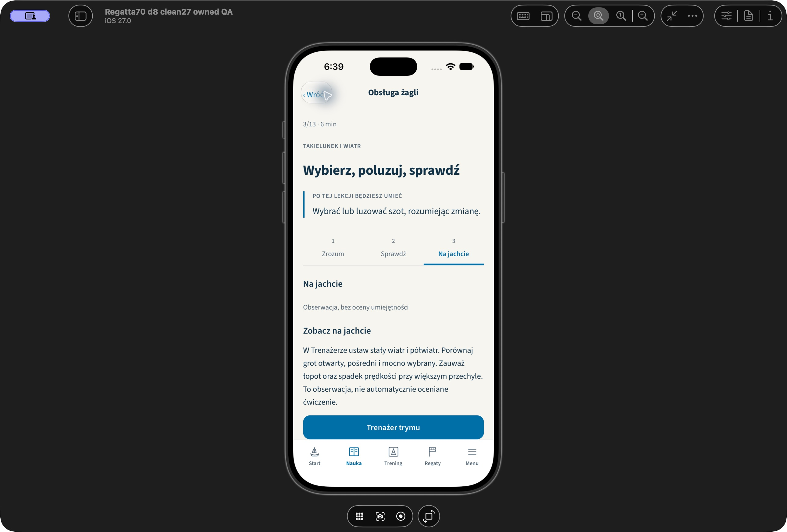
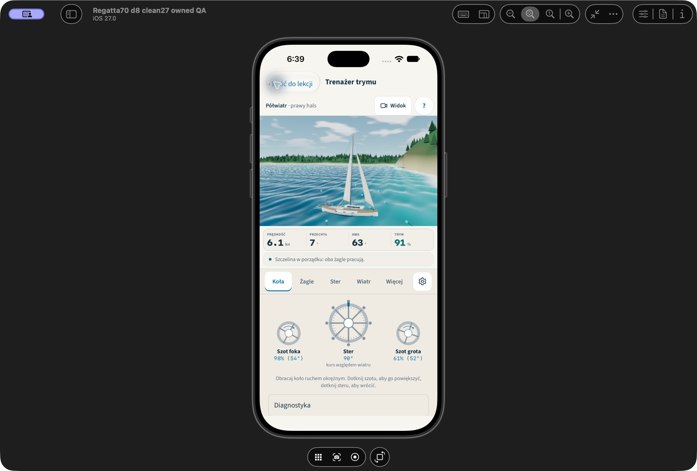
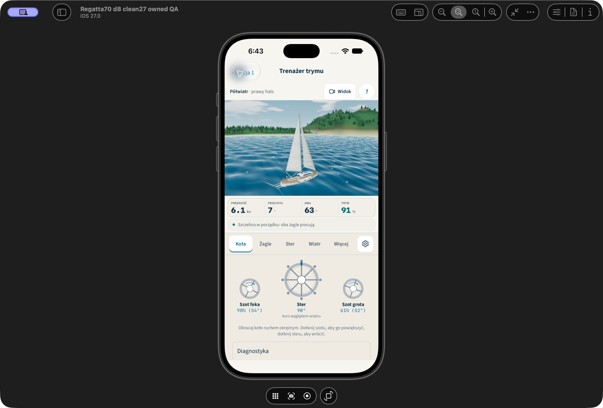

## 6. Движки, стратегия, обучение: идем ли мы туда

**Да, но общий опыт пока реализован частично.** Сохраняем один core и один визуальный мир. Не начинаем новую яхту, второй движок или массовое переписывание на Swift ради исправления нынешних связей.

Что уже общее: force/VPP source, геометрия Yacht/парусов, окружение и camera rig, значительная часть controls и контента. Что еще разное: legacy race displacement против метрической trainer session, полный rig state/перенос парусов, defaults руля, обработчики сценариев, часть presentation/progress. Новый fleet API существует отдельно и не вызывается пользовательской игрой. `PHYSICAL_RACE_EMISSION_ENABLED=false` остается жесткой фактической границей.

Следующий физический этап сравнивает одинаковые ветер/лодку/руль/шкоты: угловую скорость, потерю хода, метры, фактический путь и финиш. Нельзя доказать реалистичность простым ускорением поворота или пересчетом координат. Старые рекорды сохраняют свой класс.

Базовый архитектурный долг: общий компонент яхты пока скрывает разные контракты поведения. Нужна одна неизменяемая настройка сессии: модель, трасса, ветер, режим управления, помощь и длительность. От нее должны зависеть движение, подсказки, судья, запись, результат и replay. Защита отдельных классов рекордов уже есть. Одного включения флага до завершения связей недостаточно: неполная интеграция создает риск несогласованных условий и записей и не выполнит обещание «та же лодка».

Проверка «действительно ли общее используется везде»:

| Слой | Реальное повторное использование | Оставшийся разрыв |
| --- | --- | --- |
| Физика | `src/lib/sailing-physics/`, серверный JS генерируется из TS | Legacy race motion и trainer rig/session различаются |
| Мир и камеры | Yacht/сцена/camera rig общие для3Dпутей | Качество берега, ракурсы входа и масштаб сцены еще не одинаково удобны |
| Управление | `src/features/trainer-controls/`, wheels/sliders/preferences | Default course-assist против rudder; MP пока с автопарусами |
| Тема | Общие web tokens, native embedded-theme boundary и согласованный day splash source; day upgrade/clean27 наблюдались | Native modes отсутствуют; сам переход splash, локальные цвета/типоразмеры и полная установленная приемка остаются |
| Учебные данные | `src/data/` и общие цели/модули | Единый первый урок не означает паритет всех8/13уроков и оценок |
| Журнал | Общие bounded schemas/parser/export | Не каждый настоящий outcome подключен к этим схемам |
| Офлайн | Bundled HTML,3Dassets и шрифты | Clean phone приемка открыта; голос зависит от установленной локальной модели |

Учебная петля: понять -> увидеть -> сделать -> получить причинное объяснение -> повторить с другими условиями. Сначала один полностью законченный sail skill и один radio skill, затем расширять. Для «Схема / Рисунок» нужны сопоставимые состояния и проверенные кодовые стрелки/легенда; генератор изображения не определяет правильность физики.

Live multiplayer требует присутствия участников одновременно. Каждый управляет своей яхтой. Исторический ghost будет отдельной записью, которая не реагирует на нового игрока, не сталкивается с ним и не меняет его физику. Replay сейчас только просмотр. Сначала личный локальный ghost, затем обмен совместимой записью; не смешивать его рейтинг с живой гонкой.

SwiftUI рекомендую сначала как измеряемый прототип оболочки с тем же локальным3D. Возможная польза: navigation, large text, системные взаимодействия. Он не исправит автоматически масштаб гонки, контент или офлайн. До переноса нужен доказанный экспорт/импорт существующего прогресса.

Внешнего исследования с новичками еще не было. После технического завершения первых путей полезен небольшой наблюдаемый проход с 5 людьми: нашли ли действие без объяснений разработчика, завершили ли задачу, могут ли объяснить причину и повторить решение в новых условиях. Это предложение проверки учебной пользы, не уже полученный результат.

Использованы Product Design Audit для реальных экранов и маршрутов, Impeccable для темы/иерархии и project-map для единого текущего индекса. Первый выбранный рендер остается ссылкой направления; наличие скилла, общего компонента или сгенерированной картинки не засчитывает готовность функции. Логика и визуальные изменения проверяются по отдельным фактическим путям.

Из eSail стоит брать связь действия с конкретной снастью, камеры рабочих мест и объяснение причины результата. Это идеи для следующих упражнений; они не заявляются уже реализованными. Не рекомендую сейчас добавлять еще один движок, менять семейство шрифта или заменять все учебные схемы фотографиями. Сохраняем проверяемую схему рядом с наглядным рисунком.

## 7. Поэтапный план, без новой параллельной программы

Сохраняем прежние P-ID. Каждый этап имеет один основной результат и отдельную точку отката.

| Порядок | Прежний этап | Что завершить | Как принять |
| --- | --- | --- | --- |
| 1 | P10 + F06/F12 | Принять на установленном пакете уже исправленные source тему, T04, подписи и компоновку; проверить настоящий splash, cold-start и сохранение прогресса | Полный browser gate без ослабления assertions, один frozen-пакет, Home -> lesson -> practice -> Race -> Radio -> Back; short/landscape/large text; новая native-проверка, затем отдельная доставка |
| 2 | P04 + F02/F03 | Единицы движения, человеческая лодка и единый смысл руля; сначала закрытая интеграция с emission OFF | Сравнимые Simple/Pro траектории, rig contract, recovery без зачета пути; bots/guidance/recorder/result/native/server gates. Никакой публичной активации до обязательных судейских/finish-clear контрактов пункта4(P06) |
| 3 | P05/P06 | Доступные короткая/средняя/длинная дистанции, свободный/учебный режим | Реальный человек проходит каждую трассу; условия и помощь независимы; одна подготовка |
| 4 | P06 | Ограниченный честный судья и объяснения до активации metric гонки | Фазы до старта/после финиша, знаки, контакт/уступание и явные границы правил; помощь не меняет физику. Виновность не выводится только из факта столкновения |
| 5 | P02/P07 | Полный sail skill и radio skill; затем остальные схемы/уроки | Действие -> результат -> ACK progress -> разбор -> самостоятельный повтор; radio по журналу вашего TestFlight |
| 6 | P08/P10 | Outcome logs, весь Back, PL/RU/EN и доступность | Negative paths, relaunch, clear/upgrade, VoiceOver/large text/keyboard, естественный язык |
| 7 | P09/P11 | Ghost и завершение разбора историй APP/SITE | Versioned условия/классы; уникальные изменения сохранены; сайт получает отдельный зеленый конечный gate |
| 8 | P12, позднее S01 | Публичная приемка и лишь затем SwiftUI spike | Физический телефон: cold/offline/background/startup/frame time/thermal, metadata/privacy, exact delivery |

Графику доводить внутри измеренного бюджета после сокращения лишней нагрузки, а не перед проверкой управляемости. Ads/eSail остаются фоновыми. Это тот же согласованный список, а не новые независимые ветки продукта.

Ближайший технический срез P04: зафиксировать контракт сессии и выделить общий шаг из Trainer с полным rig и метрическим движением. Только затем подключать fleet. Доказательство: одинаковые начальные условия и команды дают одинаковые курс, скорость, крен, снасти и пройденный путь. Подключение текущего metric adapter без rig эту задачу не завершит. До человеческих/судейских/записывающих/потребительских gates emission остается OFF.

P08 сопровождает каждый этап: новое действие получает реальные success/cancel/error/save-ACK исходы вместе с реализацией. Поздний итоговый пункт по журналам не означает, что базовое логирование или проверки данных откладываются до конца.

## 8. Проверки и границы уверенности

Срез собранного пакетаD8: `d8dbca39a32a51fd2b4fd09b349587e59ca3ea4f`. Для него проходят1827web-тестов/175files,608native-тестов/82suites, обе проверки типов, native lint, web lint с0ошибок/15прежних warnings, socket lifecycle и content sync. Три локальных пакета актуальны: sailing662cb2493d8d, radio636b981087ba, Sternikcdef6534874d. Production build:111файлов `.next/static/chunks`,6790321bytes при лимите6815744, запас25423bytes. Это бюджет JS+CSS chunks; он не измеряет FPS/thermal/startup и не включает отдельные media/fonts. ДоработкаT05отдельно проходит613native/1827web и те же source checks; ее новый пакет еще не принят.

Полный локальный browser gate **D8**: **94/94 с первой попытки**,0skipped/flaky/unexpected/errors,622.515613s, те же8файлов и прежние deadlines. SHA отчета: `e2f5362fe0881297fc7332887fb0f8a4600b33817bdaa777f5141a1dd7c3f71f`. Более поздний **acf** проходит94/94за620.658683s и успешные push/PR CI; это отдельный source-срез. Ни один из этих прогонов не сертифицирует пятую footer-правку. **Exact D8 non-main predeploy40728700280 завершился failure:92/94**, остальные2Simple/Pro journeys истекли120sна retry0/1/2. Все94case IDs совпали с локальным набором;0skipped/flaky,92прошли с первой попытки. Artifact12836202433 имеет совпавший API/download SHA256`83f0111ab07f4b324587653f15176609f6e691dbd622a431a93dbefe8f0b8fba`; run/artifact/embedded metadata относятся кD8. Публикация/деплой пропущены, remote writes при разборе0.

Шесть таймингов D8 показывают накопление задержек, а не одну доказанно сломанную кнопку: два Simple успели завершить первый web-путь и начали embedded только около112s; Pro останавливались в разных поздних местах. Успешные clicks занимали4-6s, DOM reads1-3s. Не установлено, какая доля принадлежит продукту, renderer, тестовому протоколу или наблюдениям. Вacf уже реализован ограниченный passive ring для измерения событий и наблюдаемого обновления без ослабления действий, assertions, качества или deadlines. Exactacf cloud повторил92/94с6timeout: последняя выгрузка ring недоступна5раз и сама истекла1раз; это не failed ring и не доказательство полной остановки приложения. Retry1 показывает живые часы и реальные изменения helm/main/jib, но успешные clicks занимают5.4-5.9s. Причина задержек не установлена. Разделение web/embedded как самостоятельных контрактов изучается с сохранением каждого полного пути; суммарный доступный лимит при этом возрастет и должен быть раскрыт.

Новый native Release завершился успешно, generated22 и package43 проходят, включая compiled named splash color. Заморожены все121файл `.app`; установленная копия совпадает полностью. **Прямой48->70 на новом, не клонированном iOS27 QA** сохранил все6старых ключей bytes/SHA до первого запуска. Первый Home:EN,1/8; cold relaunch и возвраты сохраняют1/8. После намеренного посещения Radio главным продолжением стал SRC, а Foundation остался в других курсах. Это наблюдение навигационной иерархии, не потеря Foundation.

Наблюдались реальный дневной3Dкадр/More/Back тренажера, вход в выключенную рацию/Exit, Pro с тремя колесами, ручной шкот53%->45%, orbit с другим видом носа/кормы, часы0:21.2->0:31.8, угловая карта/ветер, полная карта, Settings->Helm, Menu->Back to races. В одном немедленном AX-снимке после Pro нативный hub еще показывал Simple; после cold launch был Pro, обратный контроль Simple->Back совпал. Устойчивый дефект синхронизации этим не доказан; не маркируем его ни исправленным, ни потерей данных. Повторная подготовка в трех местах подтверждена непосредственно.

**Отдельный clean27:** новый прямой QA, без clone, впервые запустил D8 после проверки121файла и принадлежности App+Data. PL Home0/8 -> урок1/практика -> настоящий3D -> изменение курса90->70° -> возврат к практике. После cold launch восстановился шаг3. Simple дал настоящий первый кадр, часы0:08.8->0:25.4 и реакцию руля0->8°/курса45->50°; Menu вернул выбор. Открытие упражнения не засчитано навыком. Этот ограниченный путь не заменяет полныйG2.

**Не принято:** полный G2, переход splash и previous-major/short/landscape/large-text матрица нового пакета, полные Simple/Pro/MP финиши, network-blackhole до результата на физическом телефоне, VoiceOver, thermal/frame-time, все уроки/Back/языки и точные archive/IPA/Apple gates. Ваш ручной radio/PTT/Reset/микрофон/model test остается в TestFlight по вашему решению. Новых просьб сделать это в Simulator нет.70еще не загружен.

Красные browser-прогоны91/94и90/94 exact25baff1, прежний локальный94/94за638.47s, ошибочное clone upgrade-сравнение и его ownership-квалификация сохранены в [P10 harness](cockpit-navigation-harness.md) и [proof](checks/cockpit-navigation.json). Шесть ключей старого clone-сравнения остались в исходном QA; тестовые действия через alias меняли исходный QA. Это ошибка границы проверки, не доказанная потеря данных приложением. Новый прямой27путь проверяет владельца App+Data до UI/чтения и после install.

Сверены все14текстовых полей и14вложений TestFlight: [разбор](testflight-feedback-review.md). Прежний нулевой счетчик69от14:20исторический: новый полный GET18:29:40UTC содержит3отзыва69. TF12говорит о начале уже открытой теорииSRC, а старый radio60показывает отказ входа до прибора; это разные пути. Польский Sternik остается согласованным исключением.0crash submissions не доказывает отсутствие сбоев, скриншот включенной рации не подтверждает микрофон. Сырые данные тестеров остаются приватными.

Уверенность100% относится к прочитанному выключенному physical-флагу, точным файлам/записям и сохранению65IDs/F01-F15. Около90% в рекомендации сохранить один core и порядок этапов;80% в художественной оценке. Это экспертные оценки, не статистика и не процент готовности. Реальный радиус поворота и производительность физического телефона пока не установлены. OWNER-J01подтверждает4непустых native ASRрезультата69, но не точность слов или весь radio skill.

## 8a. Проверка исправленных возвратов source147

После прямого обновления48на147подтверждены все пять известных узких путей: Foundation1иsail3 возвращаются из настоящего3Dна тот же шаг, следующийBack ведет в существующее оглавление; нижние кнопки Foundation/sail после перехода между двумя уроками возвращают к оглавлению, откудаBack ведет вLearn. Foundation8также прошел selection/briefing/настоящий3D/Menu/возврат на step3/следующийBack. Это проверка выхода, не финиш гонки или зачет навыка.

После cold launch сохранились EN,1/8, прежний тест3/3 и шаг3мини-гонки. Все6записей были неизменны до первого запуска; после проверочных действий5остались побайтно прежними,1ожидаемо изменились черезUI. Не утверждаем неизменность всего хранилища после тестирования. Все121файл установленного пакета совпадает с freeze147.

| Foundation: следующий Back | Паруса: следующий Back |
| --- | --- |
| 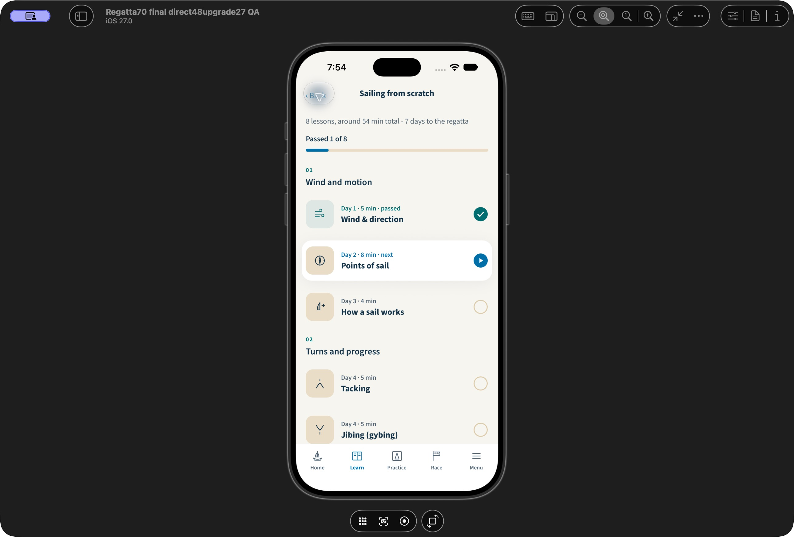 | 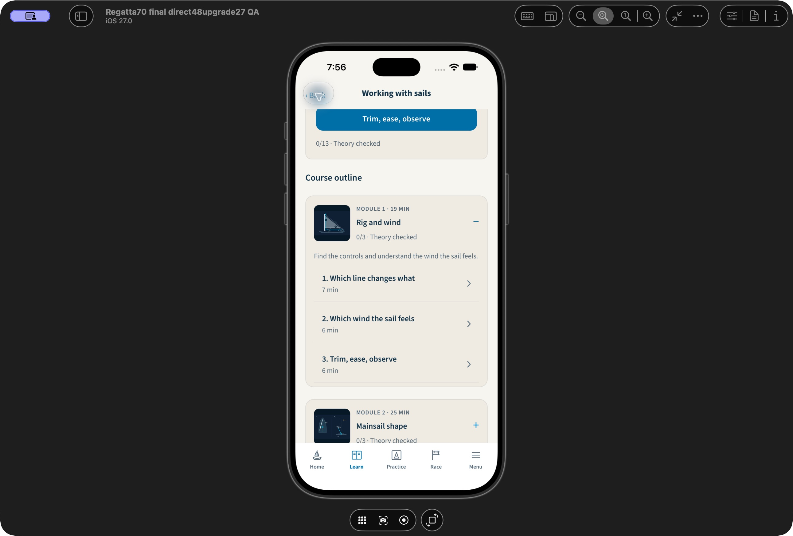 |

| Мини-гонка: следующий Back | Старый quiz после cold launch |
| --- | --- |
| 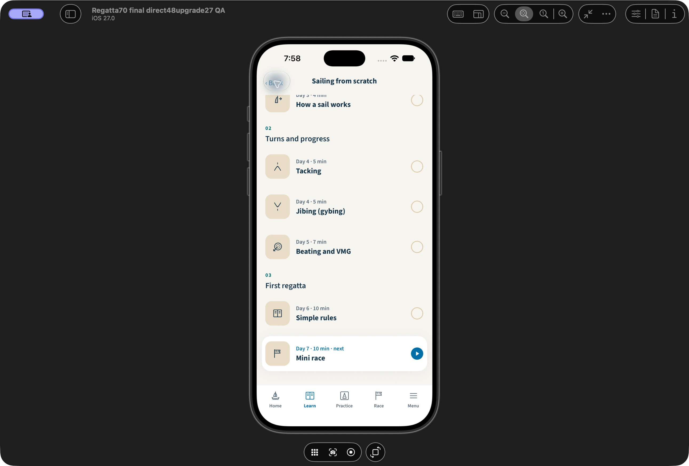 | 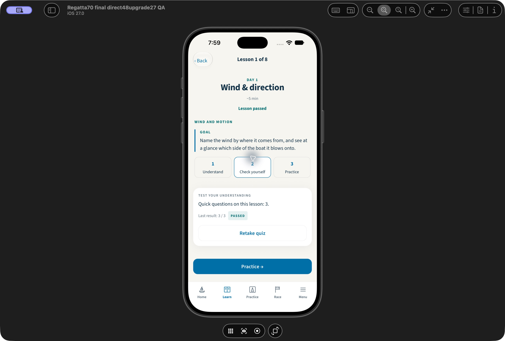 |

Эти кадры относятся к новому147/iOS27Simulator, не к доставленной69. Старые отрицательныеD8кадры28-30сохранены. ПолныйG2, clean147, меньший/landscape/увеличенный экран, все языки, browsercloud и физический телефон остаются открытыми.70не отправлен.

## 9. Свежий установленный визуальный путь

Снимки ниже сняты и просмотрены28октября в точном Release кандидате70/d8dbca3 после прямого обновления48 на отдельном iPhone18Pro/iOS27 Simulator. Они показывают новый пакет, **не доставленный TestFlight69**. Копии совпадают с оригиналами побайтно; hashes добавлены в текущий proof. Это ограниченный аудит пути, не полный релизный G2.

| Шаг | Что проверено | Состояние и оставшийся риск |
| --- | --- | --- |
|1|Home после48->70 и cold relaunch|EN/1из8сохранены. Дневная поверхность. Отдельный clean27 дополняет шаги8-10; другие размеры/устройства впереди|
|2|Practice->Trainer->More->Back|Настоящий3D, три подписанных колеса, резерв нижней панели, возврат в Practice. Мелкие ярлыки и смена смысла руля требуют доводки|
|3|Radio entry->Exit|Прибор целиком, индекс и кнопки видны, обучение снизу, Exit вернул Practice. PTT/Reset/mic не проверялись|
|4|Native Race->GameMenu->Briefing|Три последовательных экрана повторяют режим/условия. Back/заголовок/CTA видимы; F06 открыт|
|5|Pro->orbit->ручной шкот|Перспективная камера меняет ракурс, три колеса видимы, стаксель-шкот53%->45%. Полного Pro финиша и phone performance нет|
|6|Mini-map->Course map->Settings->Helm|Панели меняются, лодка остается видима, карта/ветер закреплены в углах. Карта пока схематическая; полного берегового плана нет|
|7|Menu->Back to races->Home|Возврат сработал,1/8сохранены. Весь каталог Back и отказные пути не приняты|

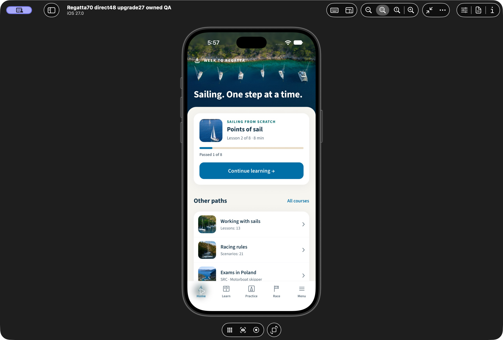
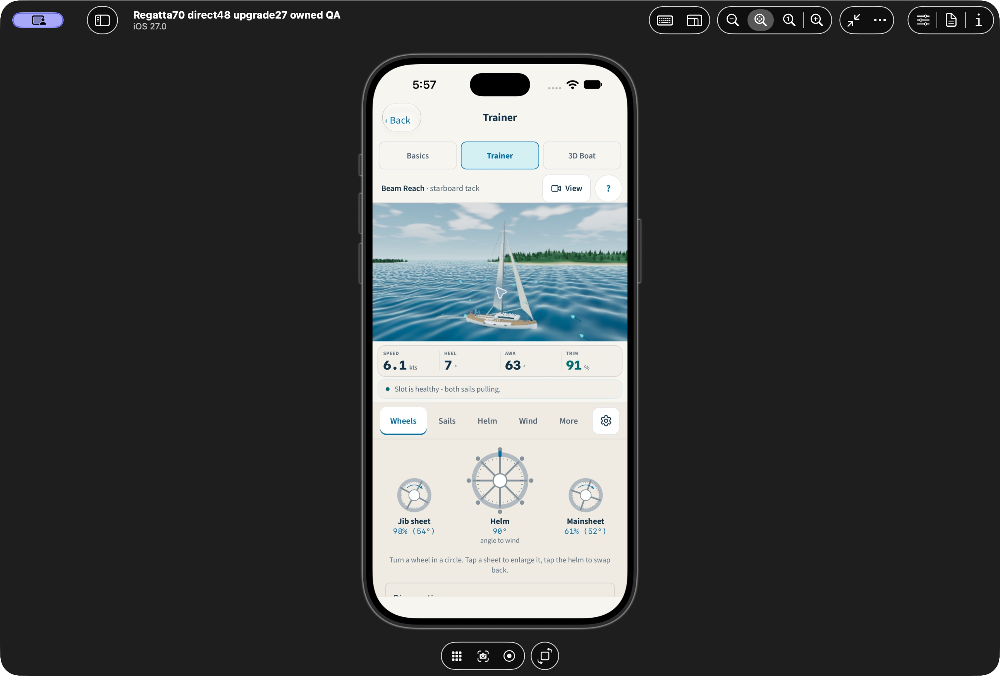
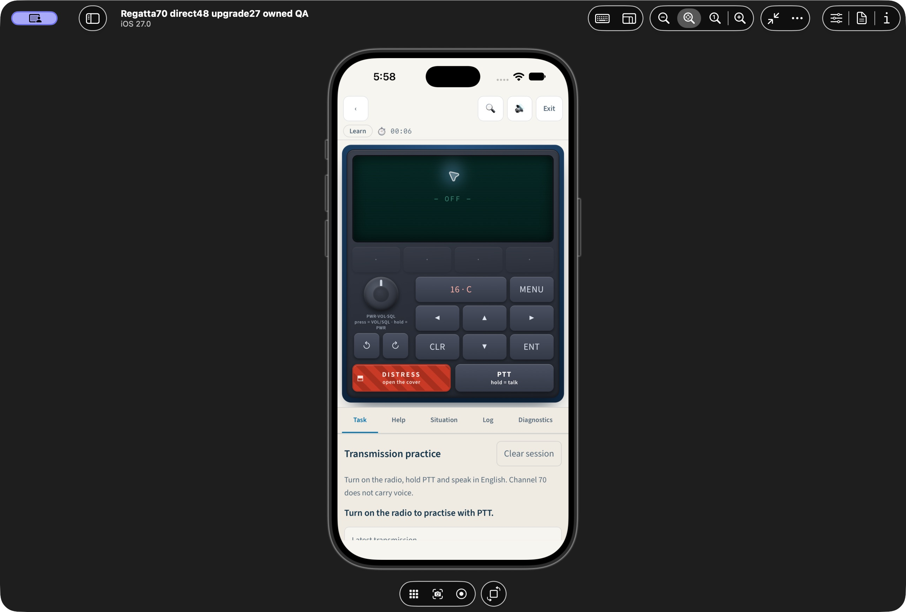
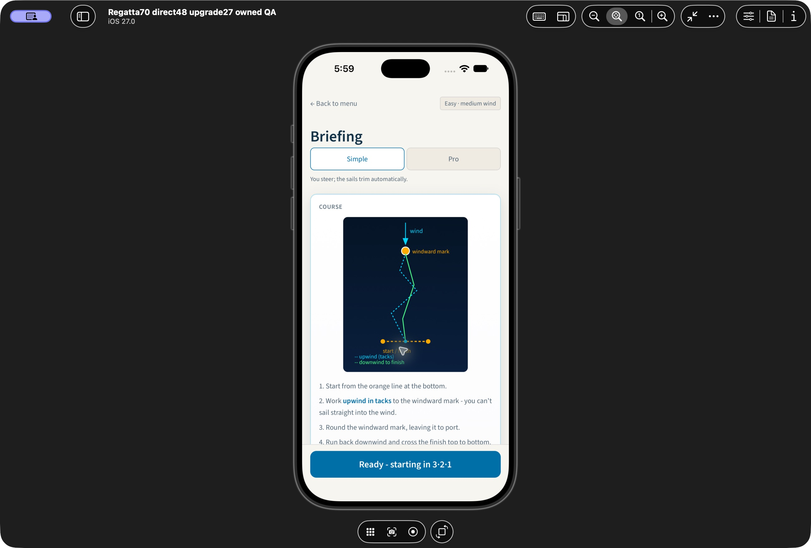
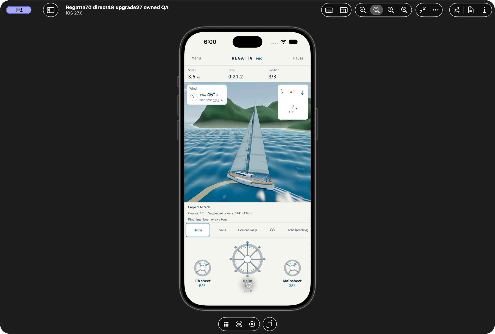
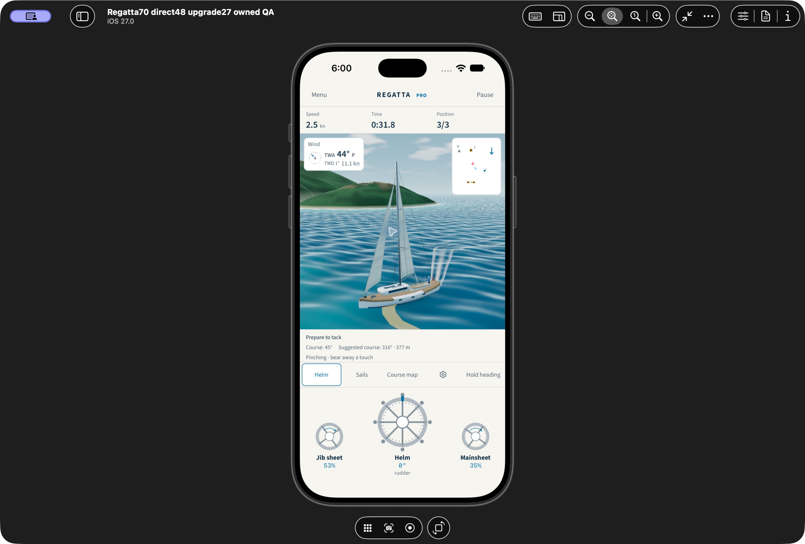
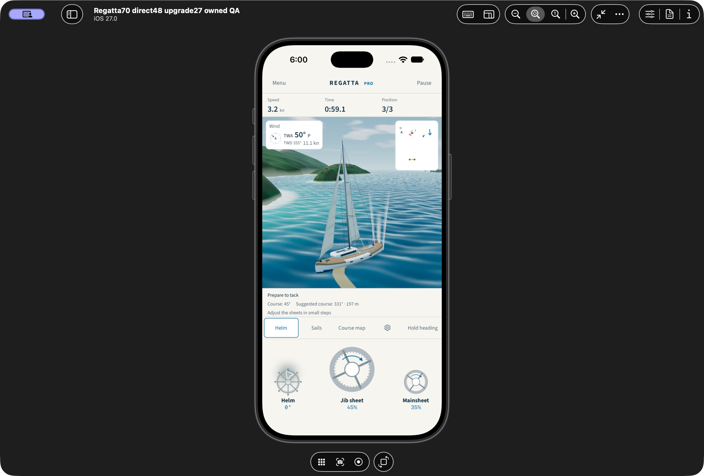

Из этих кадров видны оставшиеся дизайнерские проблемы: берег условный и угловатый, фотография на входе обещает более реалистичный мир, чем текущая сцена; отдельные ярлыки/легенды мелки; повторные настройки удлиняют старт. Общая дневная оболочка делает переход спокойнее, но не завершает эти задачи. AX Device Hub не раскрывает controls внутри локального WebView; доступность скринридером этим не принята.

Прежние web-картинки05-17и красные IT/Simple/DE кадры остаются в `cockpit-screens/` и текущем proof как датированная история. Промежуточные08/02не являются финальной компоновкой. Их исправленные web-пары15/16/17и новый локальный94gate не заменяют красныйcloud92/94или остальные native/phone проверки.

Дополнение: отдельная чистая установка D8 на iPhone18Pro/iOS27, PL. Три следующих шага относятся к новому QA, не к upgrade-устройству выше.

| Шаг | Состояние | Граница |
| --- | --- | --- |
|8|Первый урок открыл настоящий3Dтренажер; изменение руля изменило курс|Полный навык и все состояния парусов не оценены|
|9|Возврат, cold launch, продолжение восстановили шаг3«Практика»|Это сохранение места, не подтверждение завершения урока|
|10|Simple: реальный кадр, часы, руль8°, курс50° иTWA46°; Menu вернул выбор|Полного финиша/всех галсов/phone performance нет|

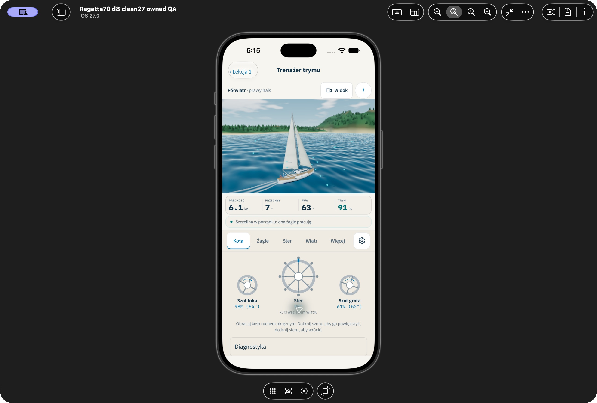
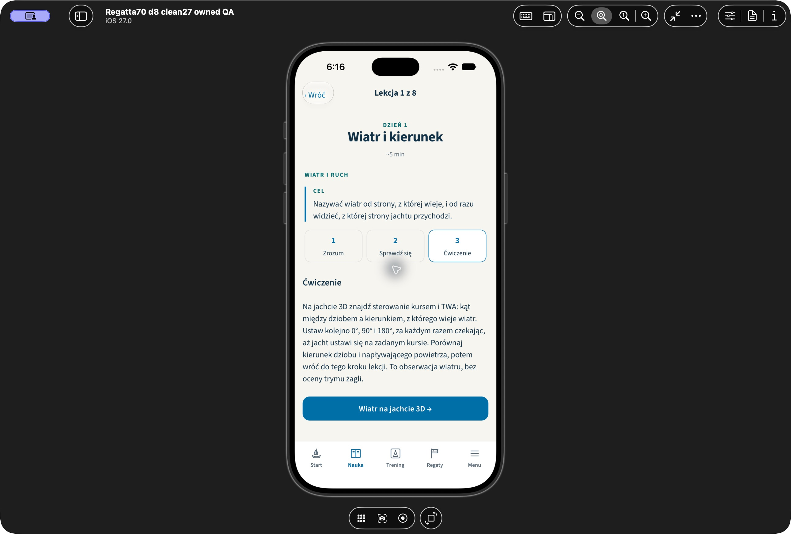
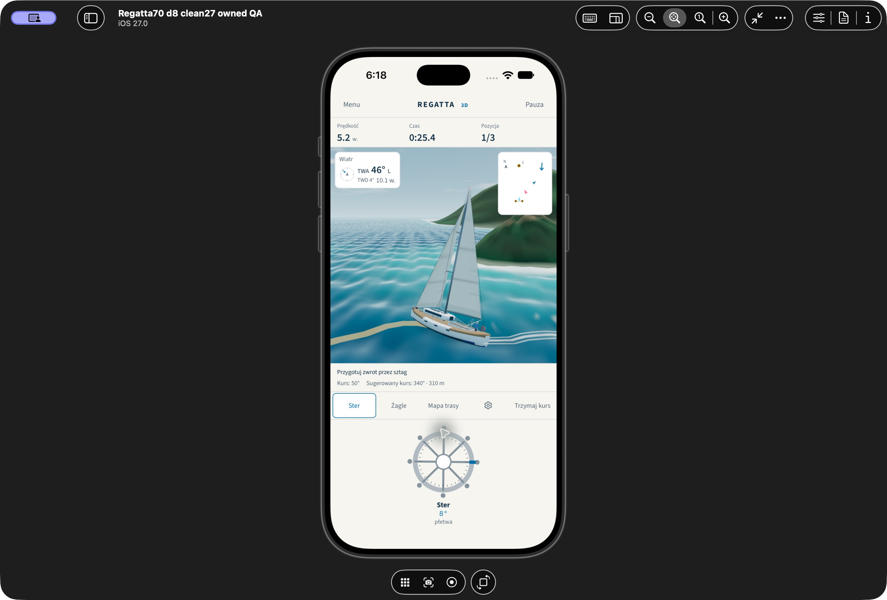

## 10. Все 65 исходных требований

Ни один ID не удален. «Готово в исходнике» в старой матрице не означает полную доставку/приемку. Два столбца статусов сохраняют baseline 27 октября, комментарий уточняет дельту 28 октября. Это не 65 новых повторных проверок.

| ID | Исходное требование | Исходник, базовая оценка | Приемка, базовая оценка | Уточнение28окт |
| --- | --- | --- | --- | --- |
| N01 | Пять разделов, последний Меню | готово | частично | Новая полная приемка не выполнялась; см. основной раздел |
| N02 | Найти и запустить SRC из приложения | готово | подтверждено | Free вход подтвержден27и28окт web; новый installed70 entry/Exit тоже наблюдались; native mic отдельно |
| N03 | Инструмент и курс имеют явные отдельные входы | готово | подтверждено | Новая полная приемка не выполнялась; см. основной раздел |
| N04 | Честное продолжение последнего курса | готово | частично | Новая полная приемка не выполнялась; см. основной раздел |
| N05 | Предсказуемый Back и безопасный выход | готово | частично | T04исправлен; дальнейшийD8nativeпроход нашелT05: следующийBackпосле sail/Foundation practice снова открываетTrainer. Новыйфикс/installedприемка требуются; весь каталог открыт |
| N06 | SRC: внутренний Back сохраняет контекст | готово | частично | Новая полная приемка не выполнялась; см. основной раздел |
| N07 | Повторный Stay/Exit незавершенного экзамена | готово | частично | Новая полная приемка не выполнялась; см. основной раздел |
| N08 | Нет потерянных функций и тупиков | частично | частично | Новая полная приемка не выполнялась; см. основной раздел |
| G01 | Один 3D Solo/Daily/mission вход | готово | частично | Native3D host поставлен; нет нового full native walkthrough |
| G02 | Свободный трехмерный осмотр мира | готово | подтверждено | Orbit подтвержден web27окт и повторным настоящим drag на installed70/d8; zoom/reset и вся матрица открыты |
| G03 | Общая яхта, море, свет и учебные камеры | готово | подтверждено | Общая геометрия, не полная эквивалентность движения |
| G04 | Simple автотрим, Pro ручные шкоты | готово | частично | Pro UI подтвержден web и installed70; ручной jib53%->45% наблюдался. Полного финиша нет |
| G05 | Hoist/furl/reef меняют модель и изображение | готово | частично | Новая полная приемка не выполнялась; см. основной раздел |
| G06 | Отзывчивость без форка исходной физики | частично | частично | Legacy9.33x scale остается; physical API выключен |
| G07 | Маршрут и trim hints независимы и отключаются | готово | частично | Новая полная приемка не выполнялась; см. основной раздел |
| G08 | Учебные правила и прозрачные штрафы | готово | частично | Только ограниченный учебный набор, не полный judge |
| G09 | Правильные часы, pause/background/resume | готово | частично | Новая полная приемка не выполнялась; см. основной раздел |
| G10 | Solo offline с первой установки и локальными ресурсами | готово | частично | Полный physical phone network-blackhole открыт |
| G11 | WebGPU/WebGL2 fallback и честные FPS flags | готово | частично | Новая полная приемка не выполнялась; см. основной раздел |
| G12 | Настоящий finish и durable History | готово | подтверждено | Новая полная приемка не выполнялась; см. основной раздел |
| G13 | Правдивый saved3D replay и local coach | готово | частично | No-go Coach discrepancy открыт; ghost отсутствует |
| G14 | Честные local/global результаты | частично | частично | Новая полная приемка не выполнялась; см. основной раздел |
| G15 | Multiplayer: общий мир, cockpit, server authority | готово | частично | Новая полная приемка не выполнялась; см. основной раздел |
| U01 | Wheels default, saved sliders не теряются | готово | частично | Новая полная приемка не выполнялась; см. основной раздел |
| U02 | Одна настройка mapping/sensitivity/favorites | готово | частично | Разный default helm смысл еще есть |
| U03 | В задании остаются выбранные штурвалы | готово | непроверено | Новая полная приемка не выполнялась; см. основной раздел |
| U04 | Короткая цель и реальные основные controls прежде деталей | готово | непроверено | Новая полная приемка не выполнялась; см. основной раздел |
| U05 | Native recovery trainer без overlay/двойного руля | готово | непроверено | Новая полная приемка не выполнялась; см. основной раздел |
| U06 | Pose/inspect явно отличается от управления | готово | частично | Новая полная приемка не выполнялась; см. основной раздел |
| U07 | Settings/Views живут в reserved space | готово | частично | Новая полная приемка не выполнялась; см. основной раздел |
| U08 | Focus не сбрасывается каждым physics tick | готово | непроверено | Новая полная приемка не выполнялась; см. основной раздел |
| U09 | Основные touch targets не меньше 44px | готово | частично | Новая полная приемка не выполнялась; см. основной раздел |
| U10 | Сцена/метрики/controls без обрезания | частично | частично | ITshortPro иTrainerportrait/landscape исправлены, локальный94проходит; cloud92/94красный, native/large-text приемка остается отдельной |
| U11 | Единый звук и clicks только по общей настройке | готово | непроверено | Новая полная приемка не выполнялась; см. основной раздел |
| R01 | Прибор и задача вместе на коротком экране | частично | частично | Новая полная приемка не выполнялась; см. основной раздел |
| R02 | Простой запуск guided/free learning | готово | подтверждено | Новая полная приемка не выполнялась; см. основной раздел |
| R03 | Прямой стабильный free route | готово | подтверждено | Новая полная приемка не выполнялась; см. основной раздел |
| R04 | Tabs/Help/Listen/Log не вытесняют прибор | готово | частично | Новая полная приемка не выполнялась; см. основной раздел |
| R05 | Доступный Inspect и аппаратная семантика | готово | частично | Новая полная приемка не выполнялась; см. основной раздел |
| R06 | Весь SRC структурно адаптирован на 7 языков | частично | частично | Структурная адаптация не равна полному natural-language QA |
| R07 | English protocol и PL UKE original не повреждены | готово | частично | Новая полная приемка не выполнялась; см. основной раздел |
| R08 | Язык мигрирует, progress/другой курс сохраняются | готово | частично | Новая полная приемка не выполнялась; см. основной раздел |
| R09 | Локальные TTS/strict ASR и typed fallback | готово | частично | Новый locale probe/logs69; owner mic/PTT/Reset pending |
| R10 | Power/VOL/SQL/channel/PTT управляют речью станции | готово | непроверено | В новом проходе прибор OFF, речи не проверяли |
| R11 | Offline copy/ошибки соответствуют installed режиму | готово | частично | Новая полная приемка не выполнялась; см. основной раздел |
| R12 | Без ложной полноты аппаратных симуляций | будущее | непроверено | Новая полная приемка не выполнялась; см. основной раздел |
| V01 | Ocean Cockpit и защищенный объект | готово | частично | Первый concept остается ориентиром; новый daytime source не равен принятому редизайну |
| V02 | Paper learning и dark instruments | готово | частично | Старая формулировка baseline не означает принятую целостность. Day source/splashисправлены;43package/частичныйinstalled70пройдены,69старый; полныйG2открыт |
| V03 | Один semantic action/selected accent | частично | частично | 28окт: дневные tokens сближены, но локальные UI-цвета/состояния и все contrast gates открыты |
| V04 | Offline шрифт на 7 языков | готово | частично | Source Sans3 реально bundled в обеих платформах |
| V05 | Читаемые labels, AA и scaling | частично | частично | Полной AA/large-text/VoiceOver приемки нет |
| E01 | Foundation parity web/native | частично | частично | Один общий lesson и один Picture pilot, не весь курс |
| E02 | Эталонный sail lesson до result/resume | готово | частично | Новая полная приемка не выполнялась; см. основной раздел |
| E03 | Все 13 sail lessons честно по модулям | частично | частично | Новая полная приемка не выполнялась; см. основной раздел |
| E04 | Полный halyard/support/hoist/lower equipment loop | будущее | непроверено | Новая полная приемка не выполнялась; см. основной раздел |
| E05 | Library/Anatomy/Rules/Onboard/Checklist доступны | готово | частично | Новая полная приемка не выполнялась; см. основной раздел |
| D01 | Один источник физики/контента | готово | частично | VPP/visual общие, movement и rig runtime еще разные; полный смысл «одна лодка» не закрыт |
| D02 | Essential core локален с первой установки | готово | частично | Новая полная приемка не выполнялась; см. основной раздел |
| D03 | Sternik PL-only локальный theory/test/exam/typed oral | готово | частично | Новая полная приемка не выполнялась; см. основной раздел |
| D04 | Progress/clear/retry/upgrade без потери данных | готово | частично | Direct48->70/d8/iOS27 сохраняет6ключей до launch и1/8 после cold. Все writers/clear/retry и phone-матрица открыты |
| D05 | JS budget6.5MB не поднят | готово | частично | Текущие111chunks6790321bytes, запас25423, capнеподнят; phoneperfнеизмерен |
| D06 | App/site разделены, dirty история сохранена | готово | частично | SITE5df отдельно; APP69 на сайт не поставлен |
| D07 | Текущая сборка реально доступна exact Self | готово | подтверждено | В 69 обновлено exact Apple Self proof, не phone install |
| D08 | Public candidate G0-G5/privacy/metadata/AppReview | частично | частично | Публичный релиз остается открытым |
| D09 | Актуальные docs и безопасная cleanup | частично | частично | 28окт: единый новый отчет и все65IDs;32local heads,18историй еще не разобраны целиком |

## 11. Заключительная сверка экранов для этого отчета

Пять новых снимков сняты и открыты заново в заключительном проходе28октября около18:13-18:17UTC. Это локальная production-web сборка`nxugNMA4jmTyt34ewz_yq` изacf,1280x720,RU,Light. Последующая незакоммиченная footer-правка относится только к native и не входит в эти web-экраны. Это не публичный SITE, не TestFlight и не новый nativeG2. Исторические native/TF доказательства выше сохраняют свои версии и ограничения.

| Шаг | Проверенный путь | Здоровье шага и вывод |
| --- | --- | --- |
|1|Главная после выбораRU|Работает, дневная поверхность и одно основное продолжение. Темная фотография остается заметным отдельным акцентом; она не заменяет общую тему |
|2|Практика -> тренажер трима, настоящий кадр|Работает, дневная панель и свободная сцена. Колесо явно показывает90° «курс к ветру». Мелкие пояснения остаются; это desktop, не проверка Dynamic Type |
|3|Практика -> свободная рация|Прибор загрузился, корпус/LCD темные, окружающий интерфейс светлый. Видны стрелкиDIAL, поле передачи и журнал сессии. Питание/PTT/микрофон не проверялись |
|4|Гонка -> Pro -> брифинг|Back, заголовок и Start видимы. Режим повторно выбирается в menu и briefing;F06остается открыт |
|5|СтартPro -> часы/3D -> Меню|Настоящая объемная сцена, угловые карта/ветер, три колеса и рабочий возврат в выбор. Руль показывает0° «перо»: внешний вид общий, смысл с Trainer все еще различается. Это не полный финиш/судейство/performance |

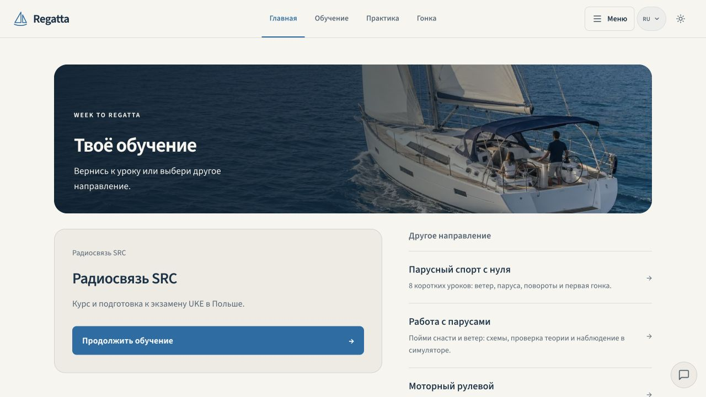
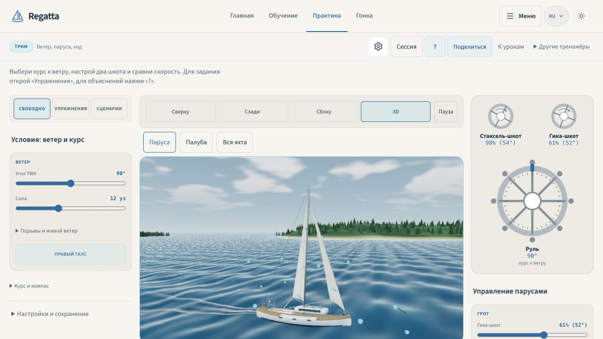
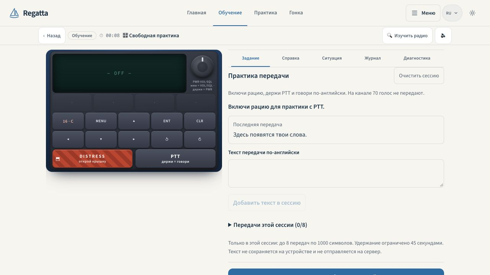
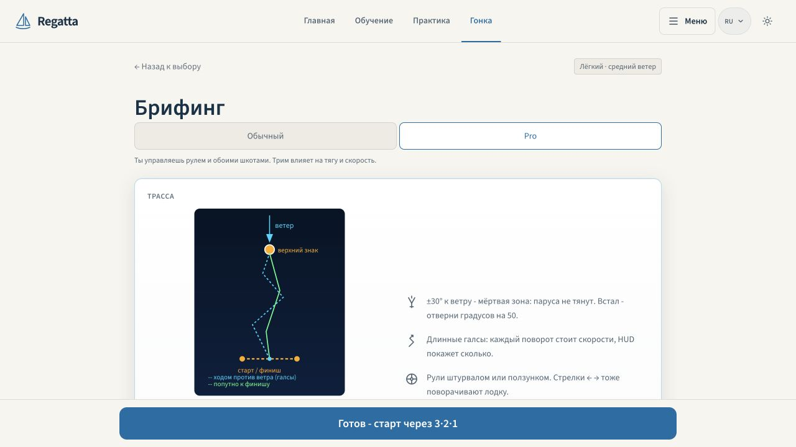
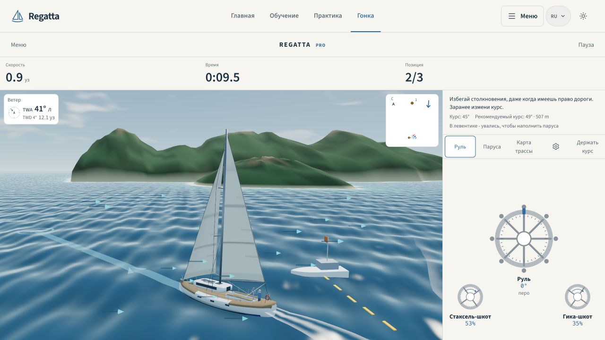

Дополнительное наблюдениеP2/F13: после переключенияIT->RU через видимый языковой selector имя skip-link в дереве доступности осталось итальянским «Vai al contenuto» на последующих client-переходах. После обычного reload стало «К содержимому». Это проверенная граница живого переключения, не утечка польского в SRC и не утверждение о всех языках. RootLayout получает имя на сервере (`src/app/layout.tsx`), а клиентский интерфейс уже сменил язык. ДваAX-снимка сохраняются приватно; требуется узкое согласование служебных подписей при переключении. Полного VoiceOver/AA-аудита этим не выполнено.

Конкретная офлайн-граница подтверждена исходником`mobile/app/gallery/index.tsx`: thumbnail/full photo используютWEB_BASE, видеоYouTube, открытиеLinking. `src/lib/product/catalog.ts` сохраняет online«Места и погода» и«Спросить ассистента». Основной локальный trainer этим не блокируется, но исходное максимальное обещание «всё кромеMPофлайн» пока не выполнено буквально. На следующем этапе надо определить и реализовать состав локальной установки, а оставшиеся сетевые материалы обозначать явно.
