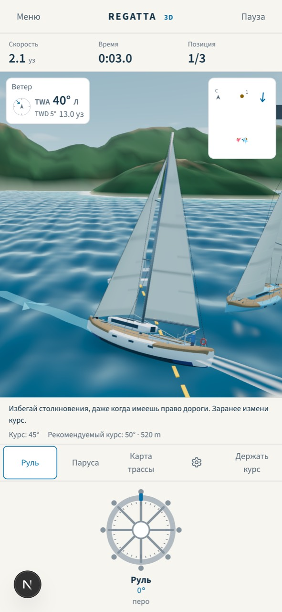
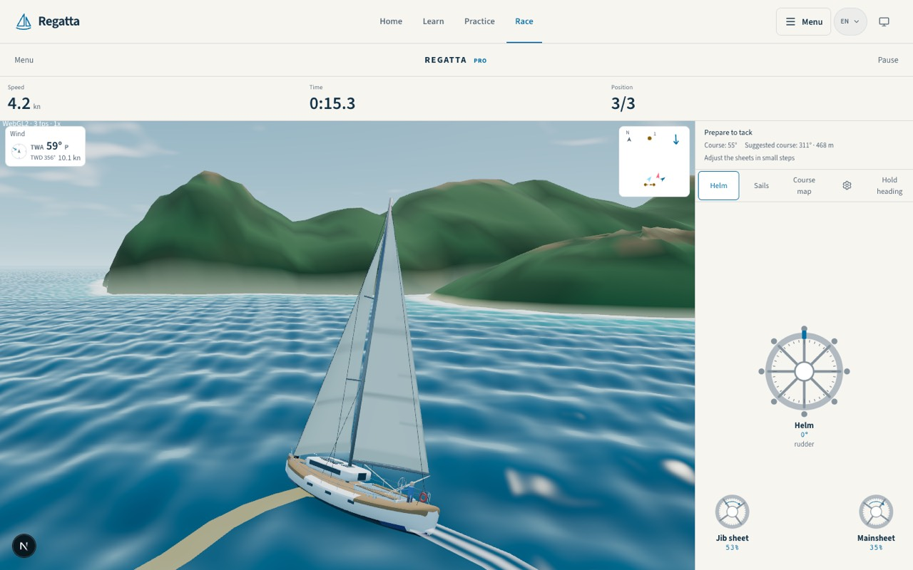
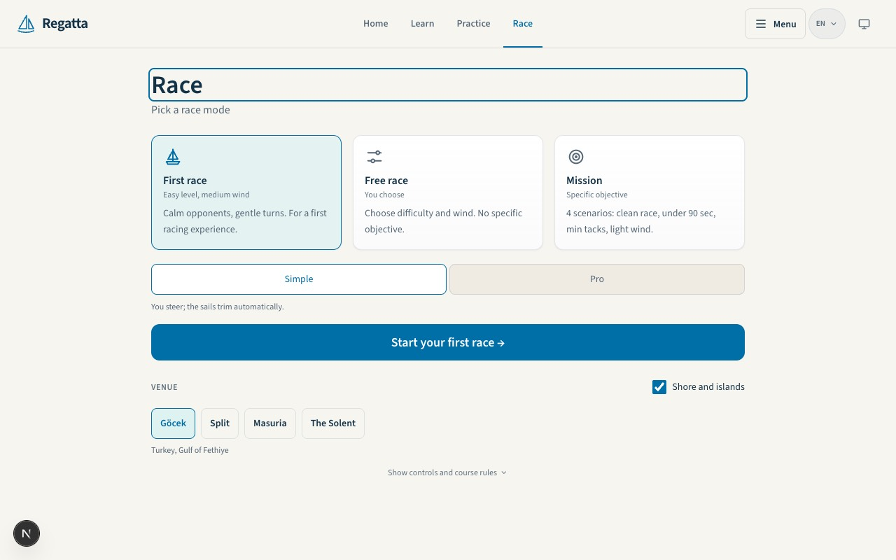
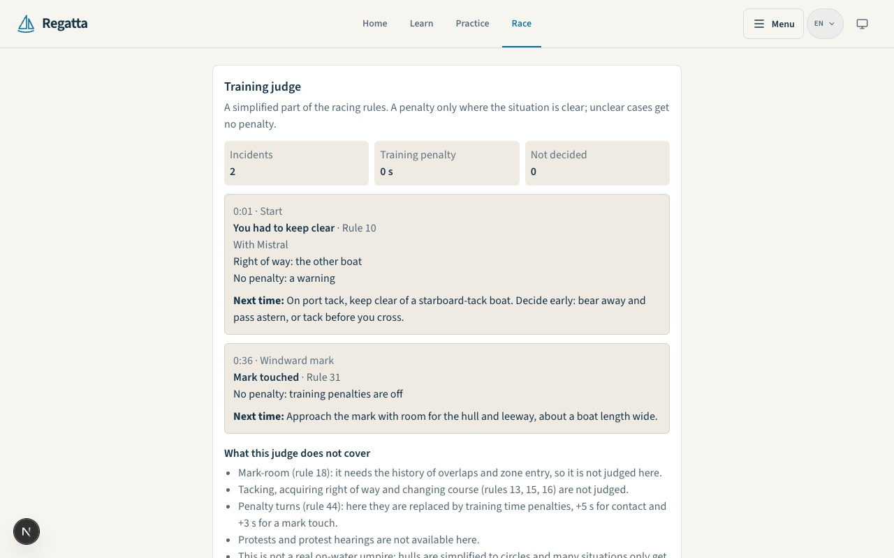

# Игра «Гонка»: где мы и что делать дальше, 2026-10-30

Запрос владельца: разобраться, что еще нужно сделать, переделать и перевести
в игре целиком. Цель: обучающая игра, которая выглядит и ощущается как
современная игра, удобная в первую очередь игроку.

Источник истины по коду: ветка `claude/app-next` (`ff8e065`). Прежние документы
по игре: аудит `docs/audits/2026-10-22-game-audit.md` (пункты A-G) и концепция
графики `docs/design/game-graphics-concept.md` (ADR-0008). Этот документ их не
отменяет, а сводит в один план и отмечает, что из них сделано.

## 1. Как проверяли

- 8 агентов разобрали области: физика, ветер, боты и правила; 3D-сцена и
  производительность; путь игрока и HUD на сайте; гонка в приложении; учебный
  цикл и прогресс; звук, отклик и мультиплеер; живая игра в браузере на
  десктопе (1280 и 1440) и на телефоне (390x844, 844x390, 375x667, RU, PL, EN).
- Каждую находку отдельный агент перепроверил в коде и пытался опровергнуть:
  устаревшие пункты выброшены, оценки поправлены.
- 3 агента изучили внешние источники: современные парусные и гоночные игры,
  исследования по обучающим играм, технологии 2026 года (three.js WebGPU,
  WKWebView, звук, сжатие моделей).
- 3 независимых плана (игрок, обучение, риск), сведенные в один, затем критик
  искал пропуски и противоречия правилам. Его замечания учтены ниже.
- Ключевые факты я перечитал в коде сам: стартовые позиции
  (`src/app/game/GameClient.tsx:618-650`), окно финиша флота 15 с
  (`src/lib/race-completion.ts:7`), звук выключен по умолчанию
  (`src/features/trainer-controls/prefs.ts:48`), надпись «Анализирую повороты и
  лейлайны» без такого анализа (`GameClient.tsx:1947`), Draco с внешнего CDN
  (`src/features/simulator-3d/Yacht.tsx:81`), выбор камеры (`useRaceView.ts:22`).
- Чего нет: ни одного замера FPS, нагрева и памяти на настоящем iPhone; ни одной
  гонки, пройденной человеком на устройстве до финиша. Все браузерные выводы
  получены в headless Chromium с программным WebGL.

## 2. Коротко

- Основа сильная: одна 3D-сцена для сайта, приложения, повтора и мультиплеера,
  с откатом WebGPU на WebGL2; честный учебный судья; общий шаг лодки с
  тренажером; игра работает офлайн в приложении; Skia-гонки больше нет.
- Игрой это пока не ощущается по пяти причинам:
  1. **Нечестная первая минута.** Боты стартуют курсом наперерез игроку, и судья
     в 0:01 пишет «Правило 10, ты должен был уступить» за то, чего избежать было
     нельзя. На среднем уровне один бот стоит в 20 единицах за игроком и всегда
     сходит с дистанции.
  2. **Гонка в рамке сайта.** На телефоне сцена занимает около 40% высоты
     экрана, над ней шапка сайта, полоса инструментов и строка чисел, два
     «Меню». Меню гонки и хаб выглядят как веб-форма.
  3. **Тишина и мало отклика.** Звук гонки выключен по умолчанию, и даже
     включенный это шесть бипов. Нет ветра, воды, хлопанья паруса, гудка,
     хаптики. Финиш обрывается в тот же кадр, результаты начинаются с карточки
     судьи, а не с места и времени.
  4. **Нечему учиться в тактике.** Ветер одинаков по всей трассе, поворот почти
     ничего не стоит (0.5-0.8 с), старт это отсчет 3-2-1. Подсказка просит
     поворачивать каждые несколько секунд, а потом тренер ругает за лишние
     повороты.
  5. **Нет причины вернуться завтра.** Между гонками сохраняются только личный
     рекорд и призрак (и тот только на сайте). Нет медалей, следующей цели,
     связи «ошибка в гонке -> упражнение -> назад в гонку».
- Unity и смена движка по-прежнему не нужны: все пункты ниже делаются на текущем
  стеке.

| Сейчас (телефон, 390x844) | Сейчас (десктоп) |
|---|---|
|  |  |

| Меню гонки | Результат начинается с судьи |
|---|---|
|  |  |

## 3. Состояние по областям

| Область | Что хорошо | Что плохо |
|---|---|---|
| Физика, ветер, боты, правила | Детерминированный шаг; один шаг лодки для тренажера и метрической гонки (ADR-0014); 0 контактов в 40 сценариях флота; честный судья с этапами и списком «что не проверяю»; ветер меняется во времени (+-8 градусов, порывы 0.83-1.17); фальстарт уже определяется (`race-rules.ts:117-125`) | Ветер однороден в пространстве, одиночная гонка всегда на seed 0; поворот стоит 0.5-0.8 с; старт 3 с, правила выключены до выстрела; стартовые позиции нечестные (раздел 2); после финиша игрока боты получают 15 с, медленные сходят; судья на метрических трассах считает в старом масштабе (1.25 с вместо 9.1 с); подсказка маршрута пуста на всех метрических трассах; боты переносят паруса мгновенно; метрическую гонку никто не прошел до финиша |
| 3D-сцена и производительность | Одна сцена ADR-0008 везде; вода на TSL с полосами и пеной у берега, небо, следы, тени-пятна, цвет и метки соперников, судейское судно; без внешних ассетов | Нет замеров на iPhone, хотя ADR-0008 требовал их до переноса; `?fps=1` в приложении не включить (`race-entry.ts` его отбрасывает); единственный рычаг качества: снижение плотности пикселей; вода 80 тыс. треугольников; сцена рисует на полной частоте во время паузы; каждый соперник полная копия модели; клин мертвой зоны и стрелка за край экрана выпали вместе со старым видом; линия маршрута выглядит как песчаная коса; указатель знака циановый (правило 11); латентная ловушка CSP: Draco с gstatic.com (`Yacht.tsx:81`); камера по умолчанию orbit, а ADR-0008 говорит «тактика» |
| Путь игрока и HUD (сайт) | Все цели в кабине от 44 px; карточка ветра относительно носа; тексты через `tl()` на 7 языках; пауза при сворачивании; кнопка «Еще раз» главная | Шапка сайта в гонке (C1 ждет владельца); пауза только меняет подпись кнопки, выход без подтверждения; режим спрашивают 2 раза на сайте и 3 в приложении (F06); «Еще раз» снова ведет через брифинг; HUD C2 частично мертвый код (SpeedCard, WindCompass, Standings, RaceToast); 7-секундное правило прячет 2.6-секундные события; сход с дистанции получает 52-65 из 100; невидимая стена держит лодку минутами, а HUD показывает 3.5 уз; утечки текста: «Replay гонки», « m», «+N s»; таблица лидеров смешивает «Простой» и «Про» и не помещается в 390 px |
| Гонка в приложении | Та же сцена из офлайн-пакета; мост хранилища с подтверждениями; альбомная раскладка есть | Свайп назад не отключен в гонке; нет боковых safe-area в альбомной ориентации; нет хаптики и keep-awake; падение процесса WebView показывает экран ошибки; призрак выключен, пробная гонка недоступна; в сборке остались мертвые модули Skia-гонки |
| Учебный цикл и прогресс | Судья, подсказки маршрута, тренер трима общие с тренажером; цифры событий (цена поворота, отрыв на знаке, обгоны); призрак на сайте; ежедневная гонка в логике; упражнения тренажера открываются ссылкой `?drill=` | Результаты миссий живут только в памяти React; нет медалей и следующей цели в меню; оценка тренера начинается с 70 и дает бонус за место; следующая цель выбирается по месту, а не по ошибке; разбор не ведет ни в упражнение, ни в момент повтора; повтор только своей лодки, открывается на паузе с подписью «Продолжить»; у ежедневной гонки на сайте нет входа |
| Звук, отклик, мультиплеер | Шесть синтезированных сигналов; движок ветра, воды и хлопанья уже есть для Лодки 3D (`useSailAudio.ts`); сигнал заполаскивания есть (`race-trim-coach.ts:14`); мультиплеер в той же сцене, финиш двоих и переподключение покрыты тестом | Новый игрок гоняет в тишине; нет гудка, звука контакта, хаптики, брызг, толчка камеры, учета «Уменьшить движение»; мультиплеер: только руль, автотрим, без правил, крен 0 у всех, события сервера клиент выбрасывает; лобби с дефектами D4; нагрузочный отчет от 2026-04-18 |
| Процесс | Полный локальный гейт зеленый 2026-10-29; STATUS актуален | Запас JS-бюджета около 15 КБ; `GameClient.tsx` 2186 строк; ни одного теста с живым человеком |

### Что из аудита 2026-10-22 закрыто

Закрыто или почти закрыто: A1 (сложность ботов), B1, B3, B5, B6 (небо, цвет
соперников, блики, стартовая линия), D1-D3 (меню, брифинг, подписи хабов), E1,
E2, E4, E5 (нативная гонка; Skia-гонка удалена), F2 (цифры событий).
Откатилось или частично: C2 (HUD), B4 (тактика на воде выпала с переходом на
новую сцену), C6 (разделение `GameClient`). Открыто: A2-A5, B2, B7-B9, C1, C3,
C5, D4, F1, G1-G3.

## 4. Что говорят лучшие игры и исследования

Подробности и ссылки: в журнале работы (`full.json` в рабочей папке сессии);
сюда вынесено то, что прямо меняет план.

- **Короткие честные заезды и мгновенный повтор.** Trackmania, Mario Kart Tour,
  Virtual Regatta Inshore: заезд 1-3 минуты, «Заново» одним касанием, призрак
  лучшего заезда, сплиты на контрольных точках. Медали по времени
  (бронза, серебро, золото) настраиваются по игре людей, а не по оптимуму
  движка.
- **Ветер виден на воде.** VR Inshore и трансляции SailGP: темные пятна порывов,
  лейлайны и «лестница» поперек ветра нарисованы на воде, а не в углу экрана.
- **Старт как главный навык.** Во всех серьезных парусных играх есть предстарт с
  таймером, гудками и фальстартом.
- **Учить в момент, когда это впервые важно.** Лицензионные тесты Gran Turismo
  и FTUE-практика: каждое правило и прием объясняются, когда они впервые
  встречаются в заезде, а подсказки постепенно убираются (иначе игрок от них
  зависит, «гипотеза подсказки»).
- **Разбор после действия с объективной записью** дает большой эффект
  (метаанализы AAR, d около 0.7-0.8), если показан конкретный момент и одна
  следующая цель, а не список всего подряд.
- **Звук учит.** Процедурные ветер и вода от вымпельного ветра и скорости,
  хлопанье паруса при заполаскивании: игрок слышит ошибку трима раньше, чем
  видит.
- **Технологии.** three.js с WebGPURenderer и откатом на WebGL2 остается верным
  путем; на телефоне предел это заполнение пикселей, поэтому нужны профили
  качества и дешевые дальние соперники; iOS может тихо убить процесс WebView,
  это надо пережить без потери понимания, что случилось. Обновление three.js и
  Expo вести отдельной дорожкой, не внутри игровых этапов.

## 5. План

Принципы: каждый этап заканчивается сборкой TestFlight в группу Self (доставку
подтверждает живой ASC GET), потом кандидатом сайта с согласия владельца.
Физика и UI не смешиваются в одном этапе (правило 1). Константы движка только
через ADR. Новые тексты через `tl()` на 7 языках, без длинных тире. Циан только
для действий. Никаких внешних ассетов. Оценки в днях работы одного агента с
проверкой; на перевод и языковую адаптацию закладывать еще 10-20%.

### Этап M0. Честная и измеренная первая минута (логика и нативная оболочка, около 2.5 недель, TestFlight 72)

Игрок: гонка больше не наказывает на старте, не держит лодку у невидимой стены
без объяснения, не пропадает от случайного свайпа или падения WebView, тренер
не противоречит подсказкам. Команда: первые числа FPS с настоящих iPhone.

| # | Что | Дни |
|---|---|---|
| M0-1 | Разделить `GameClient.tsx` на брифинг, результаты и цикл гонки без изменения поведения (существующие тесты и e2e держат) | 1 |
| M0-2 | Честный старт: стартовые позиции чистой функцией (параллельные курсы, не ближе 22 единиц, не на знаках). Тест сначала красный на сегодняшних позициях; проверяет сырые события правил и контакты, а не вывод судьи. Решить, нужна ли ревизия класса записи (`race-record-class.ts`), чтобы старые рекорды не сравнивались с новым стартом. Боты, `race-physics.ts` и сервер не меняются | 1.5 |
| M0-3 | Судья: контакты в первые секунды после старта группируются как «толкотня на линии», без урока игроку | 0.5 |
| M0-4 | Честный журнал и тренер: фордевинды отдельно, флипы на полных курсах и у стены не считаются поворотами; один признак мертвой зоны для похвалы; следующая цель из самой большой измеренной потери; сход без положительной оценки. Подсказка маршрута для игрока реже (гистерезис в `race-guidance.ts`), без правки `race-physics.ts` | 2 |
| M0-5 | Пропущенный знак: локализованное объяснение при пересечении финиша без огибания; скорость в HUD по пройденному пути у стены | 1 |
| M0-6 | После финиша игрока боты доплывают до своего финиша или лимита времени, а не 15 с | 0.5 |
| M0-7 | Оболочка приложения: свайп назад выключен в гонке, safe-area слева и справа, экран не гаснет в гонке, после падения процесса WebView возврат в меню гонки с понятным текстом | 1.5 |
| M0-8 | Рендер: потеря устройства или контекста записывается в журнал и один раз перезапускается на WebGL2; `useGLTF` без Draco и проверка, что в моделях нет Draco (CSP) | 0.7 |
| M0-9 | Журнал производительности на устройстве: бэкенд, средний и p5 FPS, итоговая плотность пикселей, вызовы отрисовки, время до первого кадра; `fps` пропускается в `race-entry.ts` | 2 |
| M0-10 | Запас JS-бюджета: убрать остатки старого вида и мертвые модули Skia, замерить; затем вынести данные радио и курсов из клиентского бандла (размер работы оценить в начале этапа) | 1.5 + оценка |
| M0-11 | Быстрые исправления неправды: «Анализирую повороты и лейлайны», «ИИ-тренер» в уроке 8, где его нет | 0.2 |
| M0-12 | События воронки первой гонки (отсчет, первый поворот, первый знак, финиш, повтор) в allow-list аналитики с тестом | 0.5 |
| M0-13 | Две разведки по одному дню без изменения констант: причина зависания пробной метрической гонки в браузере и причина почти бесплатного поворота | 2 |
| M0-14 | Локальный гейт, G1-G3, TestFlight 72 с просьбой пройти гонку 3-10 минут и прислать журнал | 1 |

Готово, когда: тесты пунктов M0-2..M0-6 зеленые на трех уровнях и трех seed;
на симуляторе в обеих альбомных ориентациях кнопки внутри safe area; журналы с
iPhone владельца и одного старого iPhone дают FPS и время до первого кадра в
`docs/STATUS.md` и `docs/design/mobile/BUILDS.md`. **На разборе M0 решаем:**
если p5 ниже 30 FPS, этап M2 (производительность) идет раньше M1.

### Этап M1. Играется как игра (UI, около 3 недель, TestFlight 73, затем кандидат сайта)

Игрок: гонка на весь экран, одна настройка заезда, настоящая пауза, повтор одним
касанием, отклик рядом с лодкой, финиш как событие, место и время первыми.

| # | Что | Дни |
|---|---|---|
| M1-1 | Одна настройка заезда (F06): в приложении только хаб, на сайте одна карточка; брифинг только при первом заходе на трассу или по кнопке «i»; «Еще раз» и «Заново» из паузы сразу в отсчет | 2.5 |
| M1-2 | Игровой слой без шапки сайта (решение владельца C1): одна строка поверх сцены, пауза листом поверх затемненной сцены (продолжить, заново, настройки, выход с подтверждением), Esc и P, на десктопе предложение полного экрана | 2 |
| M1-3 | Шина отклика: крупный отсчет поверх сцены, скорость против цели, тосты рядом с лодкой с тоном (успех и опасность, не циан), цена поворота в момент минимума скорости, красная рамка при контакте; правило больше не прячет событие; учет «Уменьшить движение» | 3 |
| M1-4 | Финиш и результат: сцена держится 2-3 с с плашкой места, затем место, время, отрыв от победителя, разница с рекордом; одна главная ошибка; «Еще раз» главной кнопкой; судья, тренер и «поделиться» свернуты; отдельный ободряющий экран схода. **Раскладка сразу со слотами** под полосы навыков, «Посмотреть» и «Потренировать» из M4, чтобы не строить экран дважды | 2.5 |
| M1-5 | Звук гонки включен по умолчанию отдельно от щелчков штурвалов (решение владельца), переключатель в строке гонки и в паузе, AudioContext запускается от первого касания | 0.5 |
| M1-6 | Лобби гонки вместо веб-формы: хаб и меню как игровой экран (кадр гонки, акватории карточками с картинкой, одна главная кнопка), без новой декоративной анимации | 2 |
| M1-7 | Тексты и цвета: единицы через `race-copy`, «Повтор гонки», локализованный aria-label, иконки вместо эмодзи, цвет игрока и флота не циан; таблица лидеров помещается в 390 px; затем языковая адаптация | 1.3 |
| M1-8 | Пять новичков проходят первую гонку (за столом или по видео), по воронке M0-12 видно, где бросают | 1 |

Готово, когда: Playwright на 390x844, 844x390 и 1280x800 показывает, что в гонке
одно «Меню», сцена занимает не меньше 70% высоты в приложении и 60% на сайте;
повтор из результатов одним касанием; JS-бюджет зеленый; сканер кириллицы ноль;
владелец прошел сборку 73 до финиша на своем iPhone.

### Этап M2. Всегда понятно, куда плыть, и плавно (картинка и производительность, около 2 недель, TestFlight 74)

| # | Что | Дни |
|---|---|---|
| M2-1 | Камера: смена одним касанием по сцене, вариант «за лодкой», который следует курсу и мягко возвращается после ручного вращения; ADR-0008 и концепцию поправить под выбранную камеру по умолчанию | 1.5 |
| M2-2 | Тактика на воде: клин мертвой зоны, стрелка к знаку за краем экрана, кольцо зоны знака, контрастная линия маршрута с точкой поворота; все величины берутся из активной модели гонки, чтобы пережить переход на метры (M5) | 2 |
| M2-3 | Видимая граница трассы вместо невидимой стены (линия и подсказка заранее) | 0.5 |
| M2-4 | Мини-карта становится радаром вокруг лодки с автомасштабом до знака и ближайших соперников, темная полупрозрачная, не закрывает метки | 1 |
| M2-5 | Профили качества (сетка воды, шум, облака, отсечение деревьев, дальние соперники) по измеренному времени кадра, с сохранением на устройство; пауза снижает частоту отрисовки | 2 |
| M2-6 | Дешевые соперники: слияние статичных мешей, дальний LOD для соперников и призрака | 2 |
| M2-7 | Старт быстрее: модель через gltf-transform (meshopt, квантование, без лишних morph targets) со своим декодером; прогрев шейдеров `compileAsync` за экраном загрузки | 0.8 |
| M2-8 | Лобби мультиплеера (D4): «<- Гонка», имя по умолчанию для новичков, кнопка «Создать» никогда не выглядит выключенной, текст 14 px, `navigator.share` | 1 |

Готово, когда: после поворота на 90 градусов знак в кадре или показан стрелкой
во всех камерах на 390x844 и 844x390; на том же устройстве p5 FPS не хуже
прежнего с полным флотом и призраком; офлайн-пакет меньше; `?gl=webgl2`
рисует все.

### Этап M3. Звучит и выглядит живо (около 2.5 недель, TestFlight 75)

| # | Что | Дни |
|---|---|---|
| M3-1 | ADR о звуке: процедурный звук, без музыки в гонке, будущие сэмплы только CC0 со своего домена, не больше 300 КБ | 0.3 |
| M3-2 | Процедурный звук гонки на одном AudioContext: ветер от вымпельного ветра, шум воды и шлепки от скорости и крена, хлопанье паруса в мертвой зоне и при заполаскивании (в «Простом» и «Про»), лебедки, звук контакта; Лодка 3D тоже слушается общей настройки звука | 3.5 |
| M3-3 | Гудок и флаги поверх отсчета, выстрел в 0, сигнал отзыва при фальстарте; мультиплеер получает гудок и события сервера через ту же шину | 1.5 |
| M3-4 | Хаптика только на событиях (старт, знак, контакт, финиш), не чаще раза в 300 мс, переключатель «Вибрация»; штурвалы остаются только со звуком (решение владельца) | 0.7 |
| M3-5 | Брызги у носа по скорости и крену, короткий толчок камеры только на контакте и старте; выключаются при «Уменьшить движение» и на низком профиле | 2 |
| M3-6 | Художественный проход по согласованной с владельцем доске референсов: теплый свет и цветокоррекция по акватории, свечение только бликов и пены на среднем и высоком профиле, спокойнее вода вблизи | 4 |

Готово, когда: тесты отображения «ветер, скорость, крен, трим -> громкость и
частота» на трех входах; на iPhone владельца звук слышен в обычном режиме и
выключается переключателем бесшумного режима; 10-минутная гонка на «Сложном»
держит p5 не ниже 30 FPS.

### Этап M4. Вернуться завтра и научиться одному (цикл и обучение, около 3.5 недель, TestFlight 76 и сайт с согласия)

| # | Что | Дни |
|---|---|---|
| M4-1 | `race-skill-metrics.ts`: VMG против цели, угол и потеря на поворот, время в мертвой зоне, перебор лейлайна, потеря на огибании, опоздание на старт; 3-4 полосы навыков в результатах, слово «лейлайны» только там, где они измерены | 3 |
| M4-2 | Разбор -> практика: каждая ошибка судьи и тренера ведет в упражнение тренажера или карточку правила и возвращает в гонку; урок 8 с возвратом «К уроку / Следующий урок» | 3.5 |
| M4-3 | Повтор, который учит: автозапуск, скорость 0.5-4x, кнопки камер, лента событий (старт, повороты с потерей, знак, разбор судьи), переход к моменту t-5 с из разбора | 1.5 |
| M4-4 | Призрак в приложении из нативной истории рекордов класса, сплиты на знаках зеленым и красным | 2 |
| M4-5 | Локальный прогресс и медали бронза, серебро, золото по трассе и ветру, **с версией класса гонки**, чтобы после перехода на метры (M5) пересчитать пороги, а не строить заново; пороги по игре людей из M1-8 | 2.5 |
| M4-6 | Главный экран гонки: одна карточка «следующий шаг» (цель из прошлой гонки, недобранная медаль или ежедневная гонка), рекорд и прогресс; вход в ежедневную гонку на сайте; мягкий счет «дней на этой неделе» без сгорающих серий | 2.5 |
| M4-7 | Первая гонка с подсказками в момент: мертвая зона, первый поворот, подход к знаку, первое расхождение показываются один раз на устройство, повторяются из настроек | 2.5 |

### Следующий квартал: одна модель гонки, затем тактика

- **M5. Одна модель гонки (физика, около 3 недель).** ADR-0015: одиночная гонка
  в метрах по умолчанию, старая модель только для сохраненных рекордов и
  повторов, мультиплеер помечается как «быстрая онлайн-гонка». Починить
  зависание пробной гонки (после разведки M0-13), судья и подсказки маршрута в
  метрах, флот доплывает, боты на общем экипаже без контактов, сохранения с
  классом и режимом, фильтр «Простой/Про» в таблице лидеров; затем включить
  запись (`PHYSICAL_RACE_EMISSION_ENABLED`). Перенастроить масштабы следа,
  волн и камеры под реальную скорость. Пересчитать пороги медалей M4-5.
- **M6. Тактика, которая окупается (сначала физика, потом отдельный UI-этап,
  около 6-7 недель).** ADR о цене поворота (затрагивает Основы, Тренажер и
  приложение: нужно согласие лейнов и пересъем золотой траектории); ADR о поле
  ветра как новом классе гонки (старые записи не меняются, для новичков ровный
  ветер); предстарт 60 с с сигналами 60/30/10/0 и фальстартом. Затем пятна
  порывов и барашки на воде, лейлайны и заход/отход в HUD, лестница
  испытаний по понятиям (выйти на лейлайн, огибание, расхождение
  правым/левым галсом с бот-сценарием, поворот на заходе, выгодная сторона,
  старт) с медалями и угасающими подсказками, запись треков соперников в
  повтор.

### Отложено и отклонено

- Острова из Blender по акваториям: после профилей качества и замеров.
- Обновление three.js 0.184 -> 0.186, R3F и drei, Expo SDK 54 -> 58: отдельная
  дорожка после релиза, не внутри игровых этапов.
- Нативный рендер react-native-wgpu: только если замеры M0 провалятся.
- Полное восстановление гонки после падения процесса: позже, в M0 только
  возврат в меню и экран без сна.
- Тактика ботов, правила 13/16/18 и штрафные повороты: после поля ветра и цены
  поворота.
- Мультиплеер v2 на той же модели (около 8 дней) и публичные быстрые комнаты:
  следующий сезон.
- Отклонено: музыка в гонке и платные наборы звуков; FFT-океан и
  EffectComposer в гонке (нет отката на WebGL2); тени картами теней; пятна
  порывов и лейлайны до ADR о поле ветра (они бы врали); флот больше 5 лодок;
  принудительная темная тема гонки (против `DESIGN.md`); косметика за деньги.

## 6. Решения за владельцем

| # | Вопрос | Рекомендация |
|---|---|---|
| 1 | Порядок: сначала довести гонку, которую видят игроки (M0-M4), а доделку метрической пробной гонки (этап 2 из STATUS) отложить до M5? | Да. В M0 сделать только две однодневные разведки, чтобы ADR были готовы к M5. План в `docs/STATUS.md` обновить |
| 2 | Скрывать шапку сайта во время отсчета, гонки и повтора (C1)? | Да |
| 3 | Звук гонки включен по умолчанию, отдельно от щелчков штурвалов? | Да, умеренная громкость, переключатель в гонке, бесшумный режим iPhone выключает |
| 4 | Хаптика только на событиях гонки? | Да, по умолчанию включена, не чаще раза в 300 мс, штурвалы без вибрации |
| 5 | Камера по умолчанию | Оставить orbit (по отзыву TF07), добавить смену одним касанием и камеру «за лодкой» |
| 6 | JS-бюджет | Больше не поднимать: платить удалением старого кода и выносом данных радио и курсов из бандла |
| 7 | Доска референсов перед художественным проходом M3 | Да: стилизация, теплый свет по акватории, свечение только бликов и пены |
| 8 | Медали и подсказки | Пройти можно всегда; золото только без подсказок маршрута и трима; без сгорающих серий |
| 9 | Тема гонки | Оставить светлую, темную и авто, как в `DESIGN.md` |
| 10 | Политика звука (ADR) | Процедурный звук, без музыки, сэмплы только CC0 и не больше 300 КБ |
| 11 | Первая гонка с подсказками и лестница испытаний | Первая гонка в M4 на текущей физике; лестница испытаний после перехода на одну модель |
| 12 | ADR-0015: метры по умолчанию в одиночной гонке | Да после гейтов M5; мультиплеер остается старым и помечен «быстрая онлайн-гонка»; старые смешанные строки таблицы в архив |
| 13 | ADR о цене поворота | Да, после разведки, цель около 1.5-3 длин корпуса потери, техника должна иметь значение |
| 14 | ADR о поле ветра | Да, как новый класс гонки; ветровая тень отдельным ADR потом |
| 15 | Предстарт и фальстарт | 60 с с сигналами 60/30/10/0; новичку штраф по времени вместо возврата, в «Про» возврат за линию |
| 16 | Границы продукта: инерция поворота (A3), больше 5 лодок, публичные комнаты | Не делать в ближайшие два квартала |

## 7. Риски и что не проверено

- Производительность на iPhone неизвестна совсем. Если M0 покажет p5 ниже 30
  FPS, этап M2 идет раньше M1, а художественный проход M3 уменьшается.
- WebGPU в офлайн-WKWebView (file://) на iOS 26-27 не проверен; какой бэкенд
  выберет телефон владельца, покажет журнал M0-9.
- Запас JS-бюджета 15 КБ: вынос данных радио и курсов может понадобиться уже в
  M0, его объем еще не оценен, и он затрагивает чужие лейны.
- Причины зависания метрической гонки и бесплатного поворота только
  предположены; M5 может вырасти на неделю.
- Свайп назад и кнопки под Dynamic Island выведены из кода, не воспроизведены.
- Время финиша человека на «Легком» (около 80 с) взято из автопилота.
- Внешние игры изучены по описаниям и статьям, а не по собственной игре.
- Сумма M0-M4 около 75 агенто-дней с проверкой и переводами, то есть около 15
  недель. Тактика (поле ветра, цена поворота, предстарт, испытания) приходит в
  следующем квартале; в заметках к релизам этого квартала ее не обещать.
- Задержка решений владельца блокирует части M1, M3, M5, M6; для каждого
  пункта есть вариант по умолчанию, если решения нет (например, шапку не
  скрывать, а только увеличить сцену в кабине).

## 8. Первый шаг

M0-1 и M0-2: разделить `GameClient.tsx` без изменения поведения, затем честный
старт с тестом, который сначала красный. Решения из раздела 6 для M0 не
нужны, поэтому этап можно начинать сразу.
