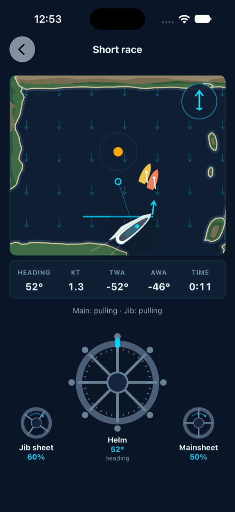
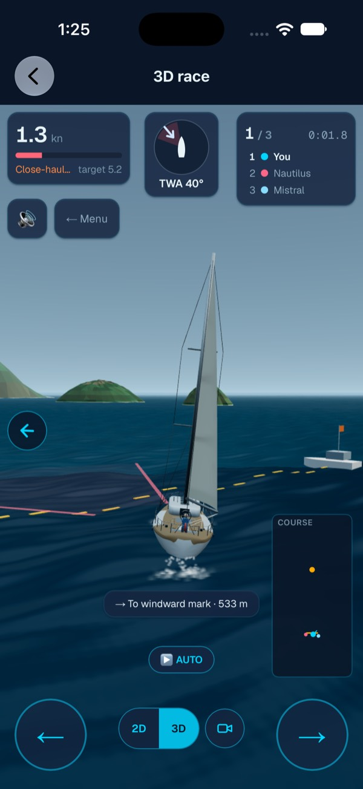
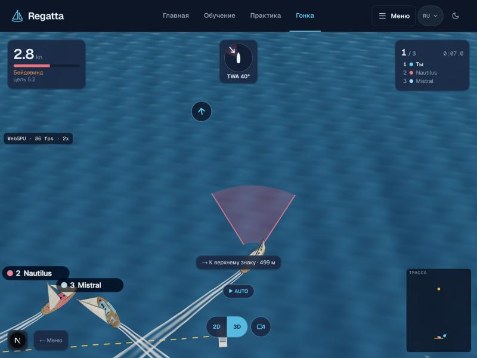
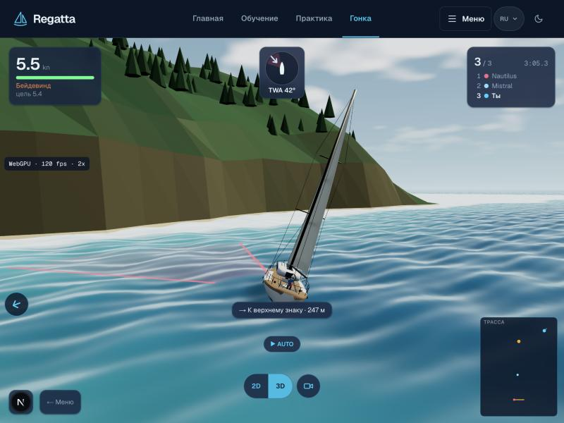
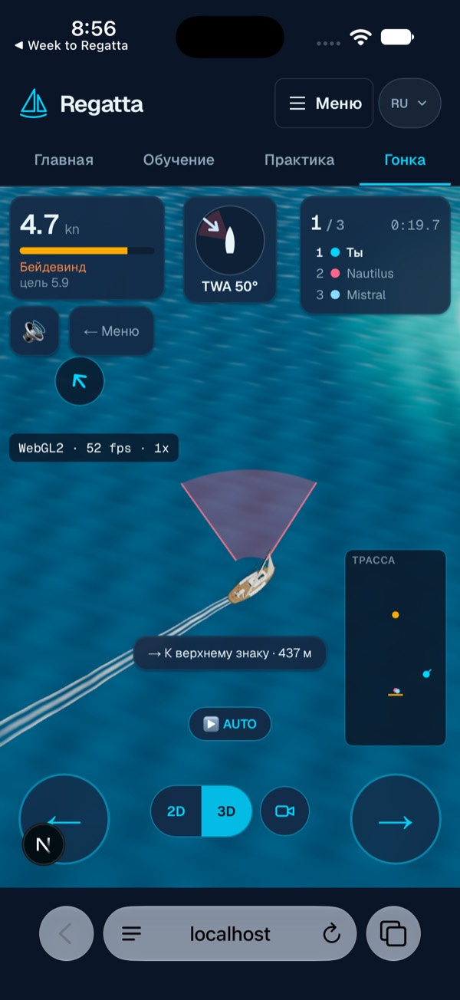

# Графика и движок гонки: концепция

Дата: 2026-10-24. Статус: принята владельцем 2026-10-24 (стилизация, тактическая
камера, three.js с WebGPU, одна гонка), решение записано в ADR-0008 в
`DECISIONS.md`. В работе этап 0, вертикальный срез.

**Направление владельца (2026-10-24).** Гонку развиваем как игру: красивая
графика и правдоподобная физика на уровне eSailing (Virtual Regatta Inshore)
и других игр, в которые залипают. Именно этим продукт должен отличаться. Значит,
каждую работу по гонке оцениваем по трем вещам вместе: картинка (этот
документ), ощущение физики (аудит игры A3, A5, звук F1) и игровой цикл
(короткие заезды, прогресс, лиги и рейтинговые гонки, повторы финиша).
Поводом стал снимок владельца: в приложении лодка в гонке плоская, «страшная и
не 3D, нужно современное, как игра». Документ отвечает на вопрос, какой
должна быть картинка гонки и на чем ее рисовать, а не на мелкие правки.
Основа: аудит игры `docs/audits/2026-10-22-game-audit.md`, два исследования
(движки и пути отрисовки в 2026 году, внешний вид современных парусных и
гоночных игр) и проверка текущих сборок на iPhone 18 Pro, iOS 27.

## 1. Коротко

- В продукте сейчас два разных мира гонки. В приложении основная «Одиночная
  гонка» нарисована плоско на Skia: векторные корпуса, сетка стрелок ветра. 3D-гонка
  с настоящей моделью яхты существует, но в хабе стоит третьим пунктом и
  открывается веб-страницей. Плоский вид и есть то «старое», которое увидел
  владелец.
- Предложение: **одна гонка, один движок, один вид**. Гонку везде рисует
  three.js-сцена, общая для сайта и приложения. «Карта» становится не отдельным
  рисунком, а той же 3D-сценой с высокой наклонной камерой, как в Art of Rally.
  Плоская Skia-гонка уходит после того, как 3D-гонка научится работать офлайн.
- Движок остается three.js. Рендер переводим на WebGPURenderer и шейдеры TSL с
  автоматическим откатом на WebGL2: на iOS 26+ это WebGPU, на симуляторе и старых
  устройствах WebGL2. Unity, Godot, Babylon и Filament не берем (раздел 5).
- Стиль: «чистая стилизация» с тактическими линиями на воде (раздел 4). Не
  фотореализм: его не вытянуть на телефоне маленькой командой, а учебная гонка
  должна в первую очередь показывать ветер и тактику.
- Первый шаг: вертикальный срез «одна красивая минута» на Гёджеке за 2-3 дня и
  замер FPS на настоящем iPhone. Только после него переносить все остальное.

## 2. Что есть сейчас

| Где | Чем рисуется | Как выглядит |
|---|---|---|
| Сайт, вид «Карта 2D» | canvas 2D | плоская схема сверху |
| Сайт, вид «С лодки 3D» | three.js 0.184 через React Three Fiber, WebGL | модель яхты 1.3 МБ с креном и парусами, вода из четырех синусоид на видеокарте, небо-градиент, острова низкополигональными конусами |
| Приложение, «Одиночная гонка» | Skia (`mobile/app/game/index.tsx`) | плоские векторные корпуса, сетка стрелок, штурвалы режима «Про» |
| Приложение, «3D-гонка» | та же веб-страница сайта в WKWebView (`mobile/app/race-3d/index.tsx`) | как на сайте, только онлайн; офлайн откатывается на Skia-гонку |

Что мешает 3D-виду выглядеть игрой (по снимку выше):

- Острова как зеленые конусы без фактуры, небо ровно-серое, у воды нет пены,
  кильватер короткий, нет тени лодки на воде.
- HUD собран из веб-карточек, а кнопки «← Меню», звук, стрелки и «AUTO»
  похожи на кнопки сайта. Над сценой две шапки: нативная «3D race» и веб-меню.
- Ветер виден только в компасе. На воде его нет, хотя моряк читает порывы
  именно по воде.
- В приложении штурвалы режима «Про» есть только в плоской гонке.

## 3. Как выглядят современные парусные и гоночные игры

Что делает картинку современной (вывод из обзора, ссылки в разделе 10):

1. Настоящие 3D-лодки, которые кренятся и показывают парус, а не плоские
   спрайты.
2. Вода сама показывает ветер: рябь по направлению ветра, темные пятна
   порывов, пена у берега и в кильватере.
3. Тактическая графика нарисована на воде, а не в углах экрана: стартовая линия,
   лейлайны, «лестница» поперек ветра (SailGP LiveLine), кольцо знака, флажки
   с местом над мачтами.
4. Камера сверху и сбоку, наклоненная на 40-55 градусов, с узким полем зрения;
   Art of Rally и Absolute Drift настраивали ее до самого релиза.
5. След как запись решений: каждый поворот остается на воде, как следы шин в
   Absolute Drift.
6. Короткий отклик на события: легкая тряска камеры, хаптика, звук (50-300 мс).

Ближайший к нам пример: CapCôtier (июль 2026), учебная игра на правах на
катер, тоже React Three Fiber. Свой стилизованный шейдер воды, след-лента, которая
стареет прямо в шейдере, и три профиля качества, которые переключаются по FPS.

## 4. Предлагаемый стиль: «чистая стилизация» плюс тактическая доска

Три направления, которые рассматривались:

| | A. Трансляционный реализм (SailGP) | B. Чистая стилизация (Art of Rally, Sail Forth) | C. Тактическая доска (тренерский вид) |
|---|---|---|---|
| Камера | погоня и вертолет | наклонная сверху | почти сверху |
| Вода | реалистичная, отражения | 2-3 цветовые полосы, пена, рябь | карта глубин, линии ветра |
| Риск на iPhone | высокий | низкий-средний | самый низкий |
| Учит ветру и тактике | слабее (виден кусок трассы) | хорошо | лучше всего |

Рекомендация: **B как стиль, C как камера по умолчанию, A как вторая камера и
повтор**. Все три живут в одной сцене и на одних ассетах:

- **Камера «Тактика»** (по умолчанию): наклон около 50 градусов, лодка в нижней
  трети, впереди виден следующий знак. Заменяет и Skia-гонку, и сайт «Карта 2D».
- **Камера «С лодки»**: нынешний вид сзади. Позже повтор финиша с камерами в
  духе трансляции.
- **Вода**: волны Герстнера в шейдере TSL, рябь по ветру, пятна порывов темнее и
  шершавее, полоса пены и подкраска мелководья у берега из заранее посчитанной
  текстуры «расстояние до берега» (берега уже есть в `src/data/venues/`).
- **Лодки**: один набор для своей и соперников, цвет корпуса и номер на парусе,
  крен и форма паруса видны сверху, мягкая тень-пятно на воде, брызги у носа
  по скорости, белая лента кильватера, которая гаснет за 20-30 секунд.
- **Берег и острова**: низкополигональные, но со скалой, пляжем и зеленью, без
  «конусов». Делаются в Blender (есть MCP) и сжимаются, внешних ассетов нет (CSP).
- **Свет**: одно солнце, небо с облаками, тон-маппинг, легкое свечение бликов
  на половинном разрешении. Палитра теплая и одна на все акватории.
- **Линии на воде**: старт, лейлайны, «лестница», кольцо знака, мертвая зона.
  Белые, желтые или цвета команд: циан по правилам `DESIGN.md` только для
  действий.
- **HUD**: тонкие игровые плашки вместо веб-карточек, одна шапка, игровой
  режим без шапки сайта (C1), штурвалы «Про» поверх сцены и в приложении.

Ограничение из `DESIGN.md`: новой декоративной анимации не добавляем. Рябь,
пятна порывов и след здесь не украшение: они показывают ветер и путь, ради
которых гонка существует.

## 5. Движок и путь отрисовки

| Вариант | Нативно в приложении | Общая TS-физика | Объем | Риск | Вердикт |
|---|---|---|---|---|---|
| three.js WebGPU/TSL в WKWebView | через WebView (WebGPU на iOS 26+, WebGL2 на симуляторе) | да | средний: переписать шейдер воды на TSL | низкий | **основной путь** |
| react-native-webgpu + three/webgpu | да | да | средне-высокий | средне-высокий: версия 0.19, сбой с тенями (#333) | проба позже, если WebView не вытянет |
| expo-gl + three | да | да | малый | three r163+ не рисует (expo #51543), R3F v10 его убирает | тупик |
| Filament (Margelo) | да | да | высокий: вторая сцена и шейдеры `.mat` | средне-высокий | нет |
| Babylon React Native | нет: только старая архитектура RN | да | высокий | очень высокий | нет |
| Unity as a Library | да | только через мост сообщений | очень высокий | высокий, +20 МБ | нет |
| Godot (react-native-godot) | да | да | очень высокий | высокий: проект не обновлялся с 2025-11 | нет |
| PlayCanvas | только WebView | да | высокий: переписать сцену | средний | нет |

Почему основной путь именно этот:

- Одна сцена и один код для сайта и приложения; физика остается общей TS
  (форк движка запрещен правилами).
- WebGPU в Safari включен с iOS 26, и это общая настройка WebKit, поэтому
  WKWebView должен его получить. На физическом устройстве не проверено
  (раздел 8).
- На симуляторе iOS 27 `requestAdapter()` возвращает null, и three.js сам
  откатывается на WebGL2. Гейт G2 (проверка на симуляторе) не ломается.
- Шейдеры TSL, написанные сейчас, без переделки пойдут в нативный холст
  react-native-webgpu, если он понадобится.
- Цена: `onBeforeCompile` и `EffectComposer` в WebGPURenderer не работают,
  океан и свечение переписываются на TSL. Сам three.js называет WebGPURenderer
  «experimental», поэтому откат на WebGL2 обязателен и проверяется тестом.

Офлайн: гонку собрать в офлайн-пакет приложения так же, как уже собраны
Тренажер и Лодка 3D (`mobile/scripts/build-sailing-offline.mjs`). Тогда 3D-гонка
работает без сети, и Skia-гонку можно удалить. Штурвалы «Про» уже умеют жить
поверх WebView: так сделан тренажер (`mobile/app/simulator/index.tsx`,
`mobile/src/simulator/WheelDeck.tsx`).

## 6. Бюджет производительности

- Цель 60 FPS на iPhone 13 и новее, нижняя граница 30 FPS.
- Плотность пикселей не выше 1.5-2, тени пятнами вместо карт теней,
  соперники одной моделью через инстансы, вызовов отрисовки около 100.
- Три профиля качества (низкий, средний, высокий), переключение по замеру FPS
  в первые секунды, как в CapCôtier.
- Модель яхты сжать (meshopt или Draco плюс KTX2) с локальным декодером:
  офлайн-сборка сейчас прямо запрещает сжатую модель без встроенного декодера.
- Все ассеты со своего домена (CSP).

## 7. План

### Этап 0. Вертикальный срез, 2-3 дня

Одна акватория (Гёджек), одна гонка, новая картинка:

1. WebGPURenderer с откатом на WebGL2, океан на TSL с рябью по ветру и пеной.
2. Камера «Тактика» по умолчанию, переключатель на «С лодки».
3. След-лента, брызги, тень-пятно, соперники одним набором с номерами.
4. Острова и берег из Blender вместо конусов.
5. Счетчик FPS в отладочном режиме, сборка TestFlight, замер на iPhone владельца.

Готово, когда: срез идет не ниже 30 FPS на iPhone владельца, на симуляторе
откатывается на WebGL2 без ошибок, и владелец согласен, что «это игра».

**Сделано 2026-10-24** (`src/features/race-scene/`, флаг `/game?view=3d&scene=next`,
`?fps=1` показывает бэкенд и FPS; в приложении так открывается «3D-гонка» сборки 57):

- WebGPURenderer с откатом на WebGL2: Chrome на Mac идет на WebGPU (около 120
  FPS), Safari на симуляторе iOS 27 сам уходит на WebGL2 (52 FPS при плотности
  пикселей 1, симулятор рисует программно).
- Вода на TSL: общие волны, полосы по ветру, мелководье и пена у пляжа из
  поля расстояний до берега; небо с облаками.
- Тактическая камера по умолчанию (наклон 54 градуса, наветренная сторона
  вверху, лодка чуть ниже середины экрана), «С лодки» второй камерой.
- Белые следы V за всеми лодками, тени под корпусами, сосны на склонах, песок
  только на полосе пляжа.
- Не сделано в срезе: острова из Blender (пока процедурные), брызги у носа,
  свечение. Остров-«конус» стал склоном с соснами и скалой.

### Этап 1. Одна гонка в приложении, около недели

- «Одиночная гонка» в приложении открывает новую сцену; пункт «3D-гонка» уходит.
- Гонка в офлайн-пакете, штурвалы «Про» поверх сцены.
- Игровой режим без шапки сайта (C1), HUD тонкими плашками.
- Skia-гонку удалить после проверки офлайна.

### Этап 2. Тактика на воде, 1-2 недели

- Лейлайны, «лестница», флажки мест над мачтами.
- Поле порывов в физике и на воде (A2/B2, нужен ADR).
- Звук ветра и воды (F1), тряска и хаптика на событиях.
- Повтор финиша с камерами.

### Этап 3. Позже

- Мультиплеер в той же сцене.
- Проба нативного react-native-webgpu, если WebView упрется в FPS.
- FFT-океан, если WebGPU на устройствах это позволит.

## 8. Что не проверено

- WebGPU внутри WKWebView нашего приложения на физическом iPhone с iOS 26+:
  выведено из исходников WebKit, а не замерено. Самая дешевая проверка: открыть
  страницу-пробу `three/webgpu` в нашей WebView на устройстве.
- FPS 3D-гонки на настоящем iPhone (пункт G1 аудита): на симуляторе WebGL
  программный.
- Сколько добавит к размеру приложения каждый вариант.
- Внешний вид отдельных игр в части камер и HUD помечен в исследовании как
  непроверенный.

## 9. Решения за владельцем

1. Стиль: «чистая стилизация» с тактической камерой по умолчанию (рекомендуется)
   или трансляционный реализм?
2. Одна гонка: убрать плоскую Skia-гонку, когда 3D-гонка заработает офлайн?
3. Движок: three.js с WebGPU в WebView как основной путь, нативный WebGPU только
   пробой позже?
4. Начинать с вертикального среза (этап 0) и замера на твоем iPhone?
5. Ветер по трассе (A2) для пятен порывов: делать по ADR на этапе 2?

После решений по пунктам 1-3 записать ADR в `DECISIONS.md`.

## 10. Источники

Движки и платформы:

- react-native-webgpu: https://github.com/wcandillon/react-native-webgpu (R3F:
  `apps/docs/content/docs/integrations/react-three-fiber.mdx`, сбой с тенями #333)
- expo-gl и three r163+: https://github.com/expo/expo/issues/51543
- react-native-filament: https://github.com/margelo/react-native-filament (#322)
- Babylon React Native и новая архитектура:
  https://github.com/BabylonJS/BabylonReactNative/issues/777
- WebGPU в Safari 26: https://webkit.org/blog/17333/webkit-features-in-safari-26-0/
- Safari 27: https://webkit.org/blog/18325/webkit-features-for-safari-27-0/
- WebGPURenderer в three.js:
  https://github.com/mrdoob/three.js/blob/dev/manual/pages/webgpurenderer.html
- FFT-океан на WebGPU: https://github.com/Spiri0/Threejs-WebGPU-IFFT-Ocean
- Unity, размер сборки: https://docs.unity3d.com/Manual/iphone-playerSizeOptimization.html
- react-native-godot: https://github.com/borndotcom/react-native-godot

Внешний вид:

- SailGP LiveLine: https://www.tvbeurope.com/live-production/sailgps-livelinefx-charts-a-new-course-in-on-screen-graphics
- Камера Art of Rally: https://jalopnik.com/how-a-small-change-in-camera-angle-completely-transform-1849152549
- Sail Forth: https://store.steampowered.com/app/1031460
- CapCôtier: https://discourse.threejs.org/t/capcotier-a-3d-game-to-learn-the-coastal-boat-license-r3f-synthesized-audio/93050
- Virtual Regatta Inshore: https://apps.apple.com/us/app/-/id1182301199
- Мультяшная вода для веба: https://code.tutsplus.com/creating-toon-water-for-the-web-part-1--cms-30447t
- Волны Герстнера на TSL: https://sbcode.net/tsl/gerstner-water
- Ветер частицами (Mapbox): https://blog.mapbox.com/how-i-built-a-wind-map-with-webgl-b63022b5537f
