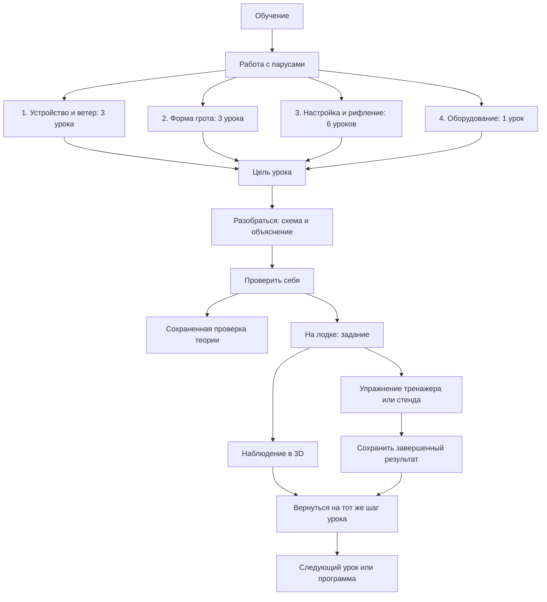
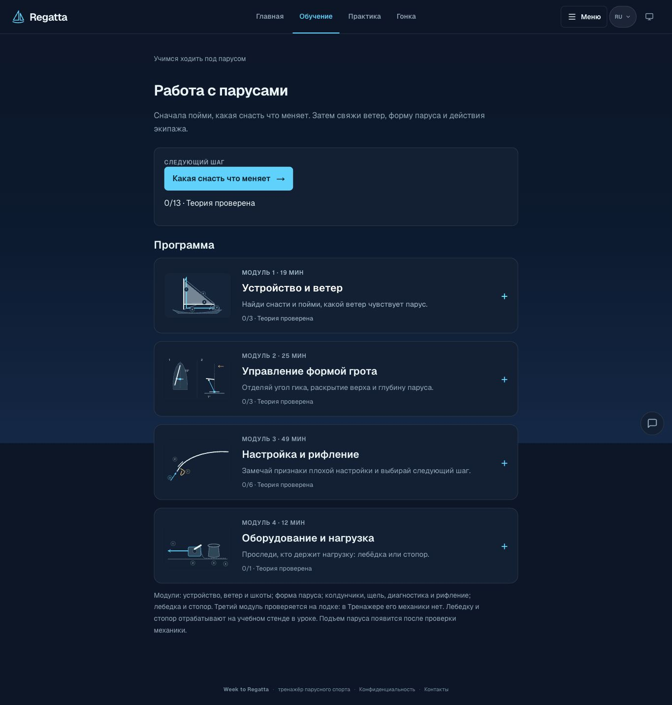

# Учебные модули: выполненный срез и дальнейший порядок

> 2026-11-02: «Следующие законченные срезы» ведутся в `docs/BACKLOG.md`
> (пакеты 24-25).

Дата: 2026-10-15. Ветка `codex/learning-modules`, основана на актуальном
`design/v3` (`946ca15`). Старый измененный корневой checkout не затронут.
Это локальная реализация, не обновление production или App Store.

## Что доведено

Курс «Работа с парусами»: все 13 уроков имеют цель, схему, объяснение,
проверку теории и подходящую практику. Четыре прежних модуля получили
раскрываемые иллюстрированные заголовки, длительность и счетчик теории.
Изначально открыт модуль следующего урока. Все остальные доступны без блокировок.

На сайте и в native-приложении сохраняются шаг урока и вариант схемы.
Возврат из тренажера и Лодки 3D ведет к конкретному уроку. В native-практике
кнопка возврата заменяет переключатель трех симуляторов, чтобы не уводить
новичка из задания. В свободной практике переключатель остается.

Успешные упражнения сохраняются отдельно, после нажатия кнопки:

| Упражнение | Что подтверждает запись | Где видно |
| --- | --- | --- |
| Гротшкот | Завершен опыт с исходным состоянием, двумя изменениями и объяснением | Практика урока «Гротшкот» |
| Раскрытие верха | Выполнены условия задания, выдержана стабилизация и выбрано объяснение | Практика урока Outhaul |
| Глубина низа | Выполнены условия задания, выдержана стабилизация и выбрано объяснение | Практика урока Outhaul |
| Лебедка и стопор | Модель достигла завершенного безопасного состояния | Практика урока оборудования |

Это результаты учебной модели. Они не увеличивают счетчик проверок теории
и не подтверждают работу с настоящей снастью. Для других уроков наблюдение
остается наблюдением: оценка не создается из просмотра страницы.

## Карта пути

Четыре разных вида данных:

- Теория: старый ключ `regatta.sailing.theory.v1`, без миграции и обнуления.
- Место: `regatta.sailing.position.v1`, шаг и вариант схемы для каждого урока.
- Упражнения: `regatta.sailing.practice.v1`, четыре разрешенных ID и время записи.
- Снимок тренажера: прежний checkpoint, восстанавливает сессию отдельно.

При ошибке чтения нельзя записать поверх неизвестного прогресса пустой.
При ошибке записи результат не называется сохраненным, доступен повтор.
Native bridge ограничен двумя назначениями и объединяет результаты упражнений.

## Графика и проверка

Существующие интерактивные SVG сохранены. Схемы теперь имеют темную подложку
в обеих темах сайта и на светлой native-странице. В программе те же изображения
помогают узнать модуль. Фотографический пилот первого native-урока сохранен;
новых фотографий или Blender-моделей в этом срезе нет.

Проверено:

- 461 web-тест, 223 native-теста.
- Native lint, TypeScript и синхронизация контента.
- В браузере: раскрытие модулей, выбранная схема, переход в тренажер,
  возврат в практику того же урока, восстановление варианта схемы.
- Полный стенд из 11 действий, сохранение результата, перезагрузка страницы:
  результат остается, незавершенные попытки и оценки теории не создаются.
- Ширины 320, 390 и 1365 CSS px, светлая и темная темы. На ширине 390 px
  нет горизонтального переполнения.
- Production-сборка Next.js, web TypeScript и ESLint измененных компонентов.
- Offline-пакет пересобран и проверен: 3.70 MiB, SHA-256 начинается с
  `060a99b9827f`. Новые результаты доступны без сети через native bridge.
- Xcode Release для iOS Simulator успешно собран и установлен поверх
  существующей тестовой установки. Прежний прогресс сохранен.
- В iPhone 17 Pro Max / iOS 27 вручную пройден цикл: программа, урок
  гротшкота, изменение схемы, шаг практики, offline-тренажер, возврат.
  Возврат сохраняет шаг практики, при переходе к объяснению остается
  выбранный вариант схемы. В тренажере есть кнопка возврата к уроку.

Подтверждения из настоящего приложения: [программа](learning-modules-2026-10-15/ios-modules.png),
[урок](learning-modules-2026-10-15/ios-lesson.png),
[практика](learning-modules-2026-10-15/ios-practice.png),
[возврат](learning-modules-2026-10-15/ios-return.png).
Адаптивная версия сайта: [практика на узком экране](learning-modules-2026-10-15/web-practice-mobile.png).

Это проверка текущего учебного изменения, не полный выпускной гейт.
Чистая установка, обновление именно с магазинной версии, метаданные и
следующий номер TestFlight остаются частью отдельного релизного прохода.
Эта работа не опубликована на сайте, в TestFlight или App Store.

Замечание по графике вне этого среза: в заднем ракурсе тренажера яхта на
телефоне слишком мала относительно области сцены. Нужно отдельно настроить
масштаб и композицию заднего и бокового видов, затем проверить обе платформы.
Возврат к уроку исправлен, качество всех ракурсов пока не считается завершенным.

## Следующие законченные срезы

| Порядок | Задача | Критерий готовности |
| --- | --- | --- |
| 1 | Пройти выпускной гейт для завершенного курса | Проверки этого среза пройдены; перед публикацией нужны чистая установка, обновление с магазина и остальные пункты RELEASE_CHECKLIST |
| 2 | Применить учебную структуру к восьми урокам «С нуля» | Цель, схема, вопрос, подходящая практика и возврат для каждого урока |
| 3 | Довести графику остальных тем | Для каждого сложного понятия одна читаемая схема с легендой; фото только для узнавания деталей |
| 4 | Согласовать главную, обучение и практику | На всех трех экранах один следующий урок; упражнения сгруппированы по учебной цели |
| 5 | Пройти радио и моторный курс как ученик | Сохранение, задания, ошибки и экзамен; польские официальные формулировки сохранены |
| 6 | Углублять гонку и 3D после учебного пути | Каждое изменение помогает читать ветер, положение паруса или ситуацию гонки |

Не объединять все пункты в одну незавершенную переделку. Каждый срез включает
обе платформы, реальные данные, состояния ошибок, тесты и визуальную проверку.
Релиз сайта, TestFlight и публичный App Store фиксируются раздельно.
