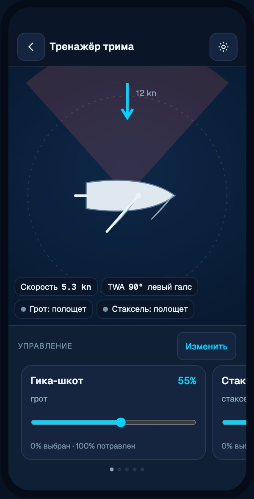
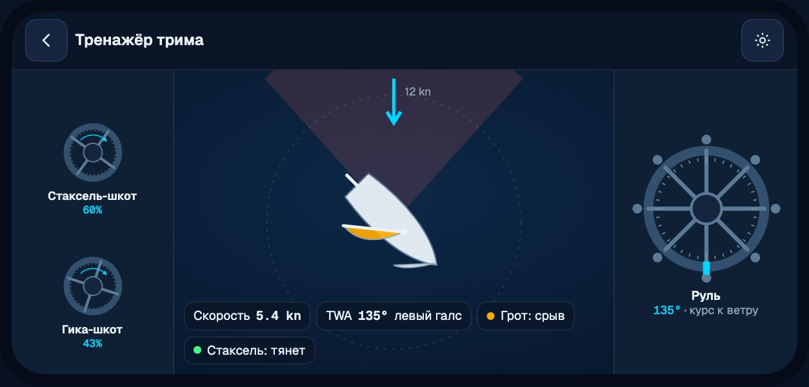
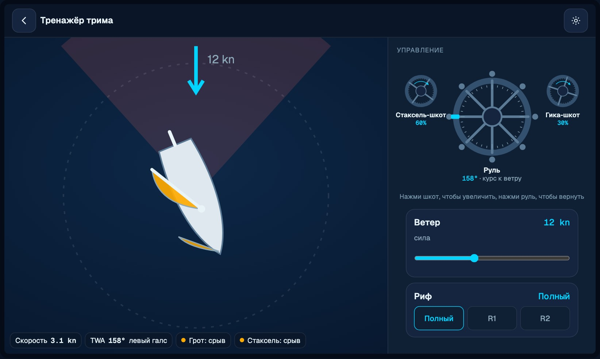
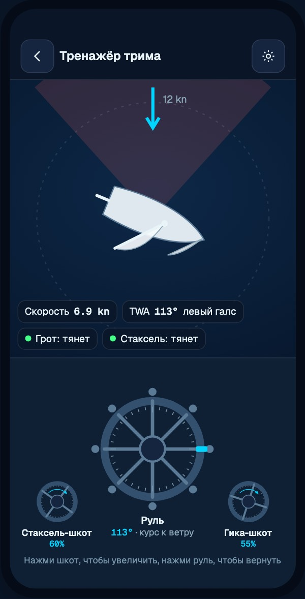
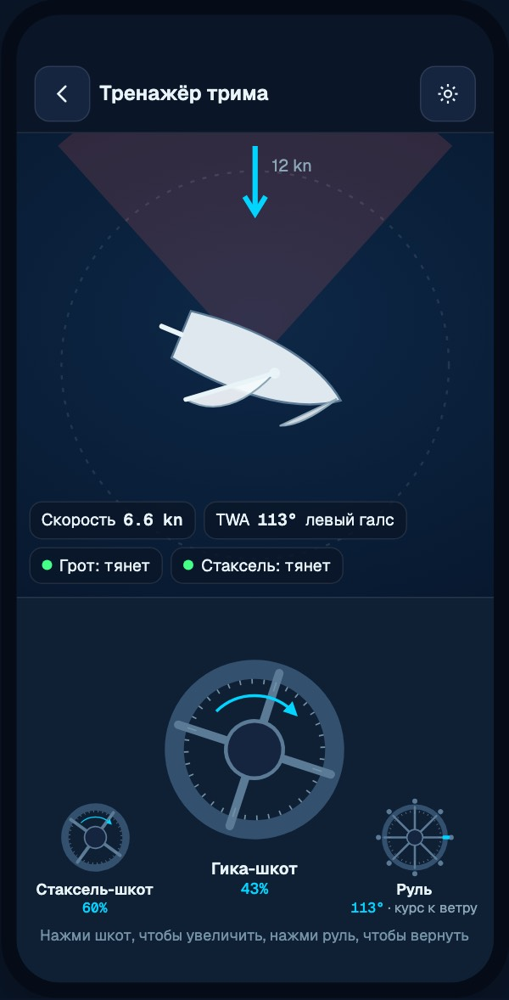
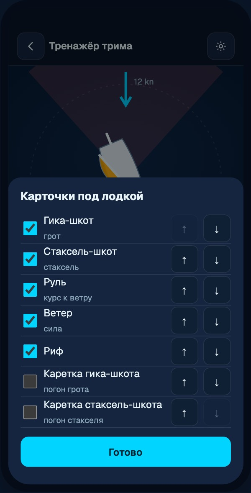
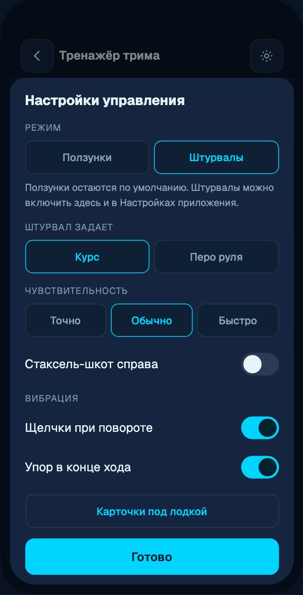

# Управление тренажерами: концепция

Статус: СОГЛАСОВАНО владельцем 2026-10-19, в работе. Решения ниже главнее
текста разделов 1-10 там, где они расходятся. Прототип: [trainer-controls/prototype.html](trainer-controls/prototype.html)
(открывается локально в браузере), макеты: [trainer-controls/mockups/](trainer-controls/mockups/),
снимки текущего состояния: [trainer-controls/current/](trainer-controls/current/).
Названия поверхностей по [SIMULATORS.md](SIMULATORS.md): Основы (`/simulator`),
Тренажёр трима (`/simulator-v3`), Лодка 3D (`/simulator2`). Внутренние имена
V1/V2/V3 ниже только для ссылок на код.

## Решения владельца (2026-10-19)

1. Русский термин везде «Гика-шкот» и «Стаксель-шкот». Каждая подсказка
   коуча называет шкот: не «потрави шкот», а «потрави гика-шкот».
2. Значение шкота: главное число это насколько шкот потравлен, в скобках угол
   паруса к ДП: «Гика-шкот 61% (52°)». 0% выбран, 100% потравлен, одинаково в
   вебе и в приложении (натив разворачивается под веб). Основание: в
   тренажерах трима каждая снасть названа и управляется отдельно (North U
   Sail Trim Simulator: mainsheet, traveler, jib sheet, jib lead; в eSail
   каждый шкот своя линия своего цвета на своей лебедке), рука работает
   шкотом, а угол паруса это результат. Цвета грота и стакселя одни и те же
   на сцене, в HUD и на контроле.
3. Тренажёр трима: штурвал по умолчанию задает курс, перо руля доступно как
   опция в настройках.
4. Штурвал по умолчанию НЕ возвращается в центр (как в жизни: повернул,
   верни сам). «Возвращать в центр» включается в настройках.
5. Ползунки: вкладки дока «Паруса / Руль / Ветер / Ещё» вместо карусели.
   Во вкладке «Паруса» оба шкота видны сразу (их триммят вместе), свайп ленты
   не спорит с ползунком. Состав и порядок карточек настраиваются.
6. Вибрации нет. Щелчки штурвалов это звук и звучат, только когда звук
   включен (общий переключатель «Звук» в настройках управления, по умолчанию
   выключен, как сейчас в Лодке 3D).
7. Правка раскладки Основ (`src/app/simulator/page.tsx`) разрешена.
8. Выпуск вместе с 1.7.0, все фазы сразу.
9. Горизонтальная ориентация на экранах тренажеров в приложении разрешена.
   Плюс единый цветовой стиль всех тренажеров (сейчас часть экранов светлая,
   часть темная).

## Коротко

1. Лодка всегда на экране. На телефоне сцена сверху занимает всю свободную
   высоту, под ней фиксированный док управления; страница не прокручивается,
   прокручивается только содержимое дока. Так уже устроена Лодка 3D в
   приложении, остальные поверхности приводим к этому образцу.
2. Ползунки остаются по умолчанию. Они живут в горизонтальной ленте карточек под
   лодкой; пользователь выбирает и упорядочивает карточки.
3. Режим «Штурвалы» включается в настройках: большой штурвал руля по центру,
   слева стаксель-шкот, справа гика-шкот. Маленький шкотовый штурвал по нажатию
   меняется местами с рулевым и крутится как лебедка. Щелчки вибрации на ходу,
   упор в конце хода.
4. Каждый ярлык говорит, какой это шкот: «Гика-шкот» и «Стаксель-шкот» во всех
   семи языках, вместо «Угол», «Шкот» и «ГРОТ».
5. Физика не меняется: штурвалы и ленты кормят те же входы сессии (целевой курс,
   перо руля -1..1, шкот 0..1). ADR по движку не нужен.

## 1. Что сейчас

Снимки сделаны 2026-10-19 с прода (https://weektoregatta.com, `?lang=ru`),
375x812 и 1440x900, плюс встраивание приложения (`?embed=1`).

| Поверхность | Телефон 375 (веб) | Приложение (embed или натив) | Десктоп |
|---|---|---|---|
| Основы `/simulator` | Холст сверху, панель под ним; карточка «Управление» седьмая по счету, лодка уходит вверх при прокрутке ([top](trainer-controls/current/m375-basics-top.jpg), [scrolled](trainer-controls/current/m375-basics-scrolled.jpg)) | Экран `/simulator-v1` грузит ту же страницу с `scrollEnabled`, страница прокручивается целиком ([embed](trainer-controls/current/embed375-basics.jpg), [scrolled](trainer-controls/current/embed375-basics-scrolled.jpg)) | Лодка видна, но ползунки курса и ветра ниже первого экрана правой колонки ([desk](trainer-controls/current/desk-basics-top.jpg)) |
| Тренажёр трима `/simulator-v3` | Сцена `clamp(270px, 32dvh, 310px)` не закреплена, под ней ветер, грот, стаксель; при прокрутке лодки нет ([top](trainer-controls/current/m375-trainer-top.jpg), [scrolled](trainer-controls/current/m375-trainer-scrolled.jpg)) | В embed вся колонка (сцена плюс панели) прокручивается как одно целое, лодка уезжает ([embed](trainer-controls/current/embed375-trainer.jpg), [scrolled](trainer-controls/current/embed375-trainer-scrolled.jpg)) | Три колонки, лодка в центре видна, хорошо ([desk](trainer-controls/current/desk-trainer-top.jpg)) |
| Лодка 3D `/simulator2` | Вне embed сцена `clamp(320px, 47svh, 480px)`, страница прокручивается ([top](trainer-controls/current/m375-boat3d-top.jpg), [scrolled](trainer-controls/current/m375-boat3d-scrolled.jpg)) | Образец: сцена `flex: 1`, панель `max-height: 25dvh` прокручивается внутри, лодка всегда видна ([embed](trainer-controls/current/embed375-boat3d.jpg), [scrolled](trainer-controls/current/embed375-boat3d-scrolled.jpg)) | Сцена плюс колонка 292px, хорошо ([desk](trainer-controls/current/desk-boat3d-top.jpg)) |
| Нативный тренажер `mobile/app/simulator/index.tsx` (офлайн-фолбэк Тренажёра) | - | Один `ScrollView`: шапка, 4-5 рядов чипов, затем сцена, затем вертикальные ползунки ГРОТ / СТАКСЕЛЬ / TWIST / РИФ; сцена уходит при прокрутке | - |

Что нашлось по ходу, важно для дизайна:

- **В Тренажёре трима нет руля.** `HelmPod` только показывает курс
  (`src/features/simulator-v3/ui/pods/HelmPod.tsx:28-30`: "A proper wheel or
  rudder control is a later PR"). Курс задается косвенно: ползунок TWA 30-180°
  плюс кнопка смены галса (`hooks/use-simulator-v3.ts:104-130`), сессия в
  режиме `course-assist`.
- **Лодка 3D рулит пером:** кнопки ‹ › и стрелки клавиатуры держат руль ±0.7,
  отпускание дает 0 (`Simulator3D.tsx:37-112`); сессия в режиме `helm`,
  `rudder` -1..1 это скорость поворота, не абсолютный курс
  (`src/features/sailing-lab/runtime/session.ts:13-14, 75-78`).
- **Основы:** курс 0-359 ползунком, перетаскиванием лодки на холсте и
  стрелками ±3°; паруса настраиваются сами, шкотов нет.
- **Направление шкота разное.** Веб (Лодка 3D): 0% выбран, 100% потравлен.
  Натив: 1.0 = выбран до упора (верх вертикального ползунка). Тренажёр трима:
  угол паруса к ДП в градусах (грот 0-85°, стаксель 5-55°), а тур объясняет
  его наоборот: «Угол - насколько шкот выбран» (`TourOverlay.tsx:123`), хотя
  больше угол значит больше потравлен.
- **Настройки вибрации в приложении нет.** `mobile/app/settings.tsx` содержит
  только переключатель аналитики; `expo-haptics` вызывается безусловно (в
  `app/simulator/index.tsx`, `Slider.tsx`, игре, курсах). У WebView нет моста
  вибрации: ползунки веб-тренажеров в приложении не вибрируют.
- **Приложение заблокировано в портрете** (`mobile/app.json`: `"orientation":
  "portrait"`). Горизонтальная раскладка сейчас нужна только мобильному
  браузеру и iPad.
- **Embed-контракт нарушен Основами:** SIMULATORS.md требует 100dvh без
  прокрутки страницы, а `/simulator?embed=1` на 375x812 дает высоту документа
  1822px; приложение обходит это через `scrollEnabled`.

## 2. Принципы

1. Лодка видна всегда, при любом действии с управлением.
2. Управление под лодкой (портрет), по бокам (горизонтально), справа (десктоп).
3. Один набор контролов и одна модель настроек на все поверхности, веб и
   приложение.
4. Ползунки по умолчанию; штурвалы только по выбору пользователя.
5. Физика и смысл входов сессии не меняются. Меняется только способ ввода.
6. Инварианты `DESIGN.md`: тач-цель от 44pt, поля 20px, цвет циан только у
   действия или активного контрола, никакой новой декоративной анимации, нижний
   бар приложения скрыт во время управления лодкой.

## 3. Раскладка: закрепленная лодка и док



### Телефон, портрет (основной случай)

```
+----------------------------+  safe area
| ‹  Тренажёр трима      ⚙ ? |  шапка 44pt
+----------------------------+
|                            |
|     СЦЕНА (лодка, ветер)   |  flex: 1, не меньше 40% высоты
|  [скорость][TWA][грот: ..] |  HUD поверх сцены, внизу
+----------------------------+
| Управление | Упражнения | Вид | Ещё |  вкладки дока 44pt
| [карточка][карточка][кар.. |  лента или штурвалы
|           • • • •          |
+----------------------------+  home indicator
```

- Экран тренажера это рабочее пространство высотой `100dvh` (в вебе: минус
  шапка сайта). Страница не прокручивается, как в embed Лодки 3D.
- Док фиксированной высоты: ползунки около 200pt, штурвалы около 262pt.
  Сцена получает остаток. На iPhone SE (667pt) сцена около 300pt с ползунками
  и около 240pt со штурвалами; при нехватке штурвал уменьшается до 148pt.
- Все, что сейчас лежит под сценой (упражнения, сценарии, вид, сессия,
  описание курса, порывы ветра), переезжает во вкладки дока или в лист «Ещё».
  Вкладка «Управление» открыта по умолчанию.
- HUD (скорость, TWA, галс, состояние каждого паруса) поверх нижнего края
  сцены, как сейчас в Лодке 3D.

### Телефон, горизонтально



- Три колонки: левая рейка (шкоты, под левый большой палец), сцена, правая
  рейка (руль, под правый). Настройка «Стаксель-шкот справа» и вариант для
  левши меняют рейки местами.
- Ползунки в рейках вертикальным списком, без карусели.
- В приложении для этого нужно разрешить поворот только на экранах тренажеров
  (`expo-screen-orientation`), см. вопросы.

### Десктоп



- Тренажёр трима уже держит лодку в центре; правая колонка становится доком
  управления (те же карточки списком), левая остается для режимов, ветра и
  вида. Основы: ползунки курса и ветра поднимаются наверх правой колонки.
- В режиме штурвалов они стоят в правой колонке над остальными карточками.
  Мышь крутит так же, как палец; основной ввод на десктопе клавиатура.

## 4. Режим «Штурвалы»




### Размеры и расположение (портрет)

| Элемент | В покое | Активный | Где |
|---|---|---|---|
| Рулевой штурвал | 168pt (190pt в Основах, где шкотов нет) | - | центр дока |
| Стаксель-шкот | 64pt, зона касания 72pt | 168pt, в центре | левый нижний угол |
| Гика-шкот | 64pt, зона касания 72pt | 168pt, в центре | правый нижний угол |

- Касание маленького шкотового штурвала меняет его местами с рулевым: шкот
  встает в центр полного размера, руль уменьшается в его угол и остается
  рабочим. Касание руля возвращает раскладку. Через 4 секунды без движения
  шкот сам возвращается в угол.
- Можно не отпуская пальца начать вращение сразу после касания: опытному
  пользователю не нужен второй жест.
- Подпись под каждым штурвалом: название и значение («Гика-шкот 43%»), без
  обрезки, переносится на две строки при крупном шрифте.
- Цвет штурвалов нейтральный; циан только у индикатора верхней спицы руля и
  у стрелки «выбрать» на шкоте.

### Жест

- Одним пальцем по кругу вокруг центра. Приращение угла считается между
  соседними точками касания, перескок через ±180° нормализуется.
- Мертвая зона: касания ближе 22% радиуса к центру не меняют значение (там
  угол прыгает).
- Рулевой и шкотовый штурвалы принимают касания независимо: в горизонтальной
  раскладке можно рулить правым пальцем и травить левым одновременно.
- Штурвалы стоят вне сцены, поэтому не конфликтуют с перетаскиванием лодки в
  Основах и с рулением по воде в нативном тренажере. В горизонтали левая рейка
  держит штурвалы не ближе 20pt от края, чтобы не задевать системный жест
  «назад».

### Как поворот штурвала становится входом сессии

Все отображения это чистые функции в одном модуле (план: `controls/mapping.ts`
на вебе и его копия через общий пакет в приложении), с тестами.

| Поверхность | Вход сессии сейчас | Штурвал | Щелчок | Сильный щелчок |
|---|---|---|---|---|
| Основы | абсолютный курс 0-359 | оборот 360° = 90° курса | каждые 5° курса | граница мертвой зоны (42° к ветру), левентик, фордевинд |
| Тренажёр трима | `course-assist`, целевой курс; лодка доворачивает 45°/с | оборот 360° = 90° курса; через ветер = поворот оверштаг, через корму = фордевинд (как кнопка галса) | каждые 5° курса | 42°, 90°, смена галса |
| Лодка 3D | `helm`, `rudder` -1..1 (скорость поворота), на экране ±35° | ±1 оборот (±360°) = `rudder` -1..1, мертвая зона ±10° штурвала | каждые 5° пера (около 51° штурвала) | перо в нуле, упор ±1 |
| Нативный тренажер | целевой курс (жест по воде, кнопки ‹ ›) | как Тренажёр трима | каждые 5° курса | смена галса |
| Шкоты, все поверхности | веб: ease 0..1 (1 = потравлен), движок `sheet = 1 - ease`; Тренажёр трима: угол паруса | оборот = 25% хода (4 оборота от упора до упора, как лебедка); по часовой выбрать, против часовой потравить | каждые 5% | 0% и 100% |

- Настройка «Возвращать штурвал в центр» действует в режиме пера руля.
  По умолчанию ВКЛ: так ведут себя нынешние кнопки ‹ › (отпустил, перо в
  ноль). Выключенная дает ощущение настоящего штурвала: перо остается где
  оставили.
- «Чувствительность»: Точно x0.5, Обычно x1, Быстро x2 ко всем коэффициентам.
- Режим «Штурвал задает: курс / перо руля» по умолчанию берется от поверхности
  (таблица выше) и может быть изменен пользователем. Перо руля в Тренажёре
  трима требует перевода сессии в режим `helm`: это изменение поведения
  (рулевой должен держать курс сам), поэтому только по выбору.
- В Тренажёре трима ползунки показывают угол паруса в градусах. Штурвал шкота
  работает в долях хода того же ползунка (25% диапазона за оборот), значение
  в подписи остается в тех единицах, которые утвердит владелец (вопрос 2).

### Вибрация

| Событие | iOS (`expo-haptics`) | Веб в приложении | Веб в браузере |
|---|---|---|---|
| Щелчок шага | `selectionAsync()` | `postMessage({type: 'haptic', kind: 'tick'})` в `SimWebView`, нативная сторона вызывает то же | `navigator.vibrate(6)` (Android); на iOS Safari API нет, только видимая отметка |
| Упор / перо в нуле | `impactAsync(Medium)` / `impactAsync(Light)` | `kind: 'stop'` / `'center'` | `vibrate(18)` |
| Смена галса | `impactAsync(Rigid)` | `kind: 'turn'` | `vibrate([10, 40, 10])` |

- Не чаще 25 событий в секунду; при быстром вращении щелчки сливаются в
  один на кадр.
- Новый глобальный переключатель «Вибрация» в Настройках приложения (по
  умолчанию ВКЛ, то есть как сейчас). Все вызовы `expo-haptics` в приложении
  идут через одну обертку, которая его читает. В листе настроек тренажера
  два дополнительных переключателя: «Щелчки при повороте», «Упор в конце хода».

### Доступность и альтернативы

- **VoiceOver:** каждый штурвал это один элемент
  `accessibilityRole="adjustable"` с `accessibilityLabel` («Гика-шкот»,
  «Стаксель-шкот», «Руль»), `accessibilityValue.text` («43%, потравлен»,
  «курс 113° к ветру, левый галс») и действиями `increment` / `decrement`
  (свайп вверх / вниз): руль ±5°, шкот ±5%. Вращение пальцем для VoiceOver
  не нужно.
- **Веб:** `role="slider"`, `aria-valuetext`, фокус виден. Клавиши:
  `←` `→` руль (как сейчас в Лодке 3D и Основах), `Q` / `A` гика-шкот
  выбрать / потравить, `W` / `S` стаксель-шкот. На штурвале в фокусе:
  `↑` `↓` шаг, `PgUp` `PgDn` крупный шаг, `Home` `End` упоры. Сочетания не
  срабатывают, когда фокус в поле ввода или в ползунке (стрелки остаются у
  ползунка).
- **Reduce Motion / prefers-reduced-motion:** обмен местами и рост штурвала
  без анимации, мгновенно. Поворот рисунка штурвала не декорация (это
  значение), он остается.
- **Крупный шрифт (Dynamic Type):** подписи под штурвалами переносятся; на
  размерах accessibility подписи уходят в одну строку значений под рядом
  штурвалов.
- **Выключенный режим:** ползунки всегда доступны, переключение одним
  касанием в листе настроек тренажера. Если включен VoiceOver или Switch
  Control, приложение не переключает режим само, но лист настроек показывает
  подсказку, что ползунки удобнее.

## 5. Лента контролов и настройка



- Горизонтальная лента карточек со `scroll-snap`, ширина карточки
  `100% - 44px`, справа виден край следующей; точки страниц под лентой.
- Карточка: название (какой шкот или контрол), подпись паруса, значение,
  ползунок высотой 44pt, шкала «0% выбран · 100% потравлен» у шкотов.
- Наборы по умолчанию:

| Поверхность | Карточки по порядку | Есть в каталоге, но выключены |
|---|---|---|
| Основы | Руль (курс), Ветер (откуда) | - |
| Тренажёр трима | Гика-шкот, Стаксель-шкот, Руль (курс к ветру), Ветер (сила), Риф | Каретка гика-шкота, Каретка стаксель-шкота, Раскрытие стакселя, Оттяжка, Outhaul |
| Лодка 3D | Гика-шкот, Стаксель-шкот, Руль, Ветер | Риф, Откуда ветер |

- «Изменить» открывает лист: список доступных контролов с флажком (показывать)
  и кнопками ↑ ↓ (порядок; для VoiceOver и клавиатуры), в приложении также
  перетаскивание за ручку. Минимум одна карточка. Кнопка «Сбросить порядок».
- **Конфликт жестов:** горизонтальный свайп по дорожке ползунка двигает
  ползунок, а не ленту. Решение: ленту листают за заголовок карточки, за
  точки и за край следующей карточки; дорожка ползунка свайп ленты не
  принимает. В горизонтали и на десктопе ленты нет (вертикальный список), и
  конфликта нет. Альтернатива на выбор владельца: вкладки вместо карусели
  (вопрос 5).
- В режиме штурвалов лента не исчезает: она уходит во вкладку «Ещё» (ветер,
  риф, каретки), а на десктопе стоит под штурвалами.

## 6. Названия шкотов

Правило: ярлык контрола называет снасть, подпись под ним называет парус.
Состояние в HUD называет парус («Грот: тянет»), потому что полощет парус, а не
шкот. Одна форма на язык, во всех поверхностях, уроках и анатомии.

| Ключ | RU | EN | PL | ES | FR | DE | IT |
|---|---|---|---|---|---|---|---|
| mainsheet | Гика-шкот | Mainsheet | Szot grota | Escota de mayor | Écoute de grand-voile | Großschot | Scotta della randa |
| jibSheet | Стаксель-шкот | Jib sheet | Szot foka | Escota de foque | Écoute de foc | Fockschot | Scotta del fiocco |
| mainTraveler | Каретка гика-шкота | Mainsheet traveler | Wózek szotu grota | Carro de mayor | Chariot de grand-voile | Großschot-Traveller | Carrello della randa |
| jibLeadCar | Каретка стаксель-шкота | Jib lead car | Wózek szotu foka | Carro de foque | Chariot de foc | Fockholepunkt | Carrello del fiocco |
| sail: main | грот | mainsail | grot | vela mayor | grand-voile | Großsegel | randa |
| sail: jib | стаксель | jib | fok | foque | foc | Fock | fiocco |
| helm | Руль | Helm | Ster | Timón | Barre | Steuer | Timone |
| sheetScale | 0% выбран · 100% потравлен | 0% sheeted in · 100% eased out | 0% szot wybrany · 100% poluzowany | 0% cazada · 100% lascada | 0% bordée · 100% choquée | 0% dichtgeholt · 100% gefiert | 0% cazzata · 100% lascata |

- Короткие формы для узких мест не вводим: «Стаксель-шкот» (13 знаков)
  помещается под штурвалом 64pt в две строки; «Écoute de grand-voile» тоже
  переносится, а не режется.
- Что исправить (список мест из инвентаря, все без изменения логики):
  `MainPod.tsx:68` и `JibPod.tsx:60` («Угол» -> «Гика-шкот» / «Стаксель-шкот»,
  заголовки ГРОТ / СТАКСЕЛЬ остаются подписью паруса);
  `MainTrimPod.tsx:13`, `TrainerBoat3D.tsx:20` (FR голое «Écoute»);
  `SimulatorV2.tsx:97-100` (убрать «(гик)» и выровнять ES/FR/IT);
  `mobile/app/simulator/index.tsx:698-719, 1918-1926` (видимый ярлык без слова
  «шкот»); `src/data/anatomy.ts:243, 269`; `sailing-lab/lessons/diagrams.ts:27`;
  `src/data/sailing-lab/course.ts:67`; `TourOverlay.tsx:123` (перевернутое
  объяснение угла).
- В `scripts/sailing-glossary.md` добавить строки mainsheet, jib sheet,
  mainsheet traveler, jib lead car (сейчас есть только общее «sheet»), иначе
  массовый перевод снова разведет формы.
- Русский: владелец выбрал «гика-шкот». В коде сейчас три формы (Гротшкот,
  Грота-шкот (гик), шкот грота); после правки остается одна (вопрос 1).

## 7. Модель настроек

Одна запись на устройство:

```ts
// mobile: AsyncStorage 'regatta.controls.v1' (по образцу src/persistence/units.ts)
// web: localStorage 'regatta.controls.v1'; в приложении WebView получает ее
// инъекцией window.__REGATTA_CONTROLS__ (как __REGATTA_LANGUAGE__) и она главнее localStorage
type ControlPrefs = {
  version: 1;
  mode: 'sliders' | 'wheels';                    // по умолчанию 'sliders'
  helmMapping: { basics?: 'course'; trainer?: 'course' | 'rudder'; boat?: 'course' | 'rudder' }; // пусто = по поверхности
  helmReturnToCenter: boolean;                   // true (как кнопки ‹ › сейчас)
  sensitivity: 0.5 | 1 | 2;                      // 1
  jibSheetSide: 'left' | 'right';                // 'left'
  hapticTicks: boolean;                          // true
  hapticStops: boolean;                          // true
  strip: { basics: string[]; trainer: string[]; boat: string[] }; // наборы из раздела 5
};
// отдельно, глобально для всего приложения: 'regatta.haptics.v1' = { enabled: true }
```

| Где | Что там |
|---|---|
| Настройки приложения, новый раздел «Тренажеры» | Управление: Ползунки / Штурвалы; Вибрация (глобально) |
| Лист настроек тренажера (шестеренка в шапке, веб и приложение) | Режим; Штурвал задает: курс / перо руля; Возвращать в центр; Чувствительность; Стаксель-шкот справа; Щелчки; Упор; Карточки под лодкой |
| Веб вне приложения | Только лист тренажера (отдельной страницы настроек на сайте нет) |



- «Очистить все данные» в приложении сбрасывает `regatta.controls.v1`, но не
  трогает вибрацию (как с аналитикой).
- Новое событие аналитики `controls.mode_changed` (`mode`, `surface`)
  сначала добавляется в `src/lib/analytics-events.ts` с тестом, иначе
  `/api/log` его отбросит.

## 8. Риски

| Риск | Чем закрываем |
|---|---|
| Основы (`src/app/simulator/*`) защищены правилом 3 | Только изолированная правка раскладки в Shared-лейне (холст закрепляется, панель прокручивается внутри), без касания логики холста; только с явным согласием владельца, последней фазой |
| Карусель спорит с ползунком за горизонтальный свайп | Лента листается за заголовок, точки и край; дорожка ползунка свайп не отдает; горизонталь и десктоп без карусели; запасной вариант вкладки |
| Жест по кругу непривычен | Ползунки по умолчанию; одна строка подсказки под штурвалами при первом включении (без модального тура); клавиатура и VoiceOver работают ступенями |
| Маленький экран (iPhone SE) | Док адаптивный: штурвал 148pt, сцена не меньше 40% высоты; проверка на 375x667 в гейте |
| Приложение только в портрете | Горизонталь в приложении отдельным решением (вопрос 9); в вебе работает сразу |
| Нет настройки вибрации, вызовы разбросаны | Обертка `mobile/src/haptics.ts` и глобальный переключатель, затем штурвалы |
| WebView не вибрирует | Мост `postMessage` в `SimWebView.tsx`, ограничение частоты |
| Офлайн-бандл V2/V3 в приложении | Веб-изменения доходят онлайн сразу, офлайн-копия только с новой сборкой; нативные части только с новой версией (1.7.0 или выше) |
| Новые строки в 7 языках | `tl({...})`, глоссарий, `node scripts/cyrillic-scan.mjs`, `node mobile/scripts/i18n-audit.mjs` |
| Правило «без декоративной анимации» | Рост и обмен штурвалов 180 мс функциональны; при Reduce Motion мгновенно |
| Embed-контракт | Все три поверхности в embed 100dvh без прокрутки страницы; тест в `e2e/smoke.spec.ts` проверяет, что сцена остается во вьюпорте после прокрутки дока |

## 9. План по фазам

Физика не трогается ни в одной фазе: `src/lib/sailing-physics/*`,
`ws-server/race-physics.js`, константы, смысл входов
`src/features/sailing-lab/runtime/session.ts`. Если по ходу понадобится
настоящая модель угла пера (а не скорость поворота), это отдельный ADR.

| Фаза | Что | Лейн и файлы | Поведенческий контракт (D1) и тест |
|---|---|---|---|
| 0 | Эта концепция и прототип | docs | - |
| 1 | Названия шкотов во всех поверхностях и языках, глоссарий, тур Тренажёра | V3: `ui/pods/MainPod.tsx`, `JibPod.tsx`, `MainTrimPod.tsx`, `ui/TrainerBoat3D.tsx`, `ui/panels/TourOverlay.tsx`; V2: `SimulatorV2.tsx`; Shared: `src/data/anatomy.ts`, `sailing-lab/lessons/*`, `scripts/sailing-glossary.md`; мобильный: `app/simulator/index.tsx` | Ни один ярлык шкота не голый «Угол / Шкот / Sheet»: тест по таблицам строк |
| 2 | Закрепленная лодка | V3: `SimulatorV3Page.tsx` (мобильное дерево: сцена flex, док с вкладками), `SimulatorV3.module.css`; V2: `Simulator3D.module.css` (веб-телефон как embed); мобильный: `app/simulator/index.tsx` (ScrollView -> сцена плюс док); Shared, последним и с согласия: `src/app/simulator/page.tsx` (только раскладка) | Сцена в вьюпорте после прокрутки дока на 375x812 и 375x667: Playwright |
| 3 | Лента и модель настроек | Новый общий модуль (предложение: `src/features/trainer-controls/` в Shared-лейне: `prefs.ts`, `ControlStrip.tsx`, `ControlSettingsSheet.tsx`, `mapping.ts`); мобильный: `src/persistence/controls.ts`, `src/haptics.ts`, раздел в `app/settings.tsx`, инъекция и мост в `src/simulator/SimWebView.tsx`; событие в `src/lib/analytics-events.ts` | Порядок и состав ленты переживают перезагрузку; выключенная вибрация не вызывает `expo-haptics`: unit-тесты |
| 4 | Штурвалы | Веб: `HelmWheel.tsx`, `SheetWheel.tsx` в том же модуле; мобильный: те же компоненты на `react-native-gesture-handler` (уже используется для руления по воде) | Оборот = 90° курса / 25% шкота / ±1 перо; щелчок на каждой границе 5; упор один раз; VoiceOver increment меняет значение на шаг: unit-тесты `mapping.ts` на трех входах, e2e клавиатуры |
| 5 | QA и выпуск | Гейт релиза мобильного: G1-G5; симулятор iOS: светлая, темная, авто, SE и Pro Max, Dynamic Type, VoiceOver | Скриншоты в `docs/design/mobile/BUILDS.md` |

Фазы 1 и 2 независимы и могут идти параллельно в своих лейнах; 3 нужна до 4.

## 10. Вопросы владельцу

1. Русский термин: везде «Гика-шкот» (и в уроках, и в анатомии, где сейчас
   «Гротшкот»)?
2. Что показывает шкот: «% потравлен» (0 выбран, 100 потравлен) везде, или в
   Тренажёре трима оставить угол паруса в градусах? И выровнять натив под
   веб (сейчас там 1.0 = выбран)?
3. В Тренажёре трима штурвал меняет курс (лодка доворачивает сама, как
   сейчас ползунок TWA) или нужен настоящий руль пером? Предлагаю курс по
   умолчанию, перо как опцию.
4. В Лодке 3D штурвал по умолчанию возвращается в центр (как кнопки ‹ ›
   сейчас)?
5. Ползунки: горизонтальная карусель (с правилом «листать за заголовок») или
   вкладки «Паруса / Руль / Ветер»?
6. Отдельной настройки вибрации в приложении нет. Добавляем глобальный
   переключатель «Вибрация» в Настройки (по умолчанию включен)?
7. Основы защищены: разрешаете изолированную правку раскладки
   `src/app/simulator/page.tsx` (закрепить холст), или Основы оставить как
   есть?
8. В какую версию приложения: 1.7.0 вместе с веткой обучающих модулей или
   отдельный выпуск?
9. Разрешить горизонтальную ориентацию в приложении на экранах тренажеров?
